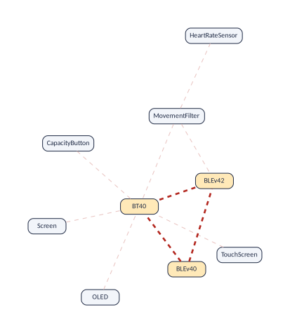
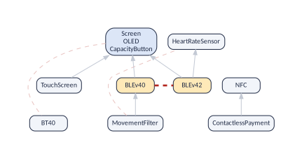
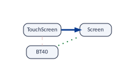

# Conflicts {#sec:conflicts}

## Primitive conflicts {#sec:primitive}

*Function:* `vp_primitive_conflicts()`

**The question.** Which conflicts did somebody decide, and which ones are their echo?

If A requires B and B excludes C, then A excludes C: conflicts are inherited downwards along requirements. A conflict that is not inherited is **primitive**, and every other conflict follows from one of them:


``` r
vp_primitive_conflicts(band)
#> # A tibble: 3 x 3
#>   from           to              reach
#>   <chr>          <chr>           <int>
#> 1 Screen         BT40                5
#> 2 MovementFilter HeartRateSensor     2
#> 3 BLEv40         BLEv42              2
```

Three primitive conflicts explain all 10 of the band (the figure). The column `reach` counts the conflicts that each one produces, itself included (atomic sets counted as one feature): the screen against classic Bluetooth produces five, because five features bring the screen along. On Linux 3.13, 578 primitive conflicts produce all 57,667. The list is the same as the file `__excludes_primitive.net` of variplex.

{#fig:minimalform}

**Why it matters.** A model with thousands of conflicts usually has only a handful that someone decided; the others are inherited. The primitive conflicts are the ones to review, to explain to users and to change: removing a primitive conflict removes every conflict it produces (its `reach`), while removing an inherited one is impossible without touching its source.

::: {.vp-box .vp-limitsbox}
**Limits: what this cannot tell you**

"Primitive" is relative to the graphs: it means "not inherited from another conflict through a requirement". Whether a primitive conflict was written as an exclusion or follows from a rule over three or more features can only be told from the model.

:::

## Why two features exclude each other {#sec:explain}

*Function:* `vp_explain_conflict()`

**The question.** Why can I not have these two together?

`vp_explain_conflict()` answers with a chain of links: the first feature requires some feature x, the second some feature y, and x and y have a primitive conflict. One row per link:


``` r
vp_explain_conflict(band, "MovementFilter", "BT40")
#> # A tibble: 3 x 5
#>   origin  step from           link     to    
#>    <int> <int> <chr>          <chr>    <chr> 
#> 1      1     1 MovementFilter requires BLEv40
#> 2      1     2 BLEv40         requires Screen
#> 3      1     3 Screen         excludes BT40
```

Read it in order: the movement filter requires BLE 4.0, which requires the screen, and the screen excludes classic Bluetooth (the figure). It is the answer of the command `strong4vm explain`, as a tibble. When several primitive conflicts can explain a conflict, each is an `origin` of its own, and all must be removed for the conflict to disappear.

{#fig:explain}

`vp_explain_requires()` does the same for a dependency. Its first route is a chain of arrows of the skeleton; with the at-least-one graph, other routes may appear:


``` r
vp_explain_requires(band, "MovementFilter", "Screen")
#> # A tibble: 4 x 5
#>   route  step from           link       to    
#>   <int> <int> <chr>          <chr>      <chr> 
#> 1     1     1 MovementFilter requires   BLEv40
#> 2     1     2 BLEv40         requires   Screen
#> 3     2     1 MovementFilter excludes   BT40  
#> 4     2     2 BT40           atleastone Screen
```

Route 2 reads: the movement filter excludes *BT40*, and every band has *BT40* or a screen, so a band with the movement filter has a screen. Two different reasons for the same fact. When the relationship does not hold, both functions say so and return no rows.

**Why it matters.** "Why can I not have both?" is the question every configurator user asks, and every maintainer who wants to lift a restriction. The chain says which requirement and which primitive conflict to look at, instead of searching the whole model.

::: {.vp-box .vp-limitsbox}
**Limits: what this cannot tell you**

An explanation is made of links of the graphs, not of the constraints of the model: each step is true, but the step may itself come from a rule over three or more features. Asked why *BLEv42* requires *HeartRateSensor*, `vp_explain_requires()` answers with one direct arrow, while the reason is a rule over three features. To find which constraints of the model to edit, you need the model.

:::

## Groups of alternatives {#sec:alternatives}

*Function:* `vp_alternative_groups()`

**The question.** Which sets of features can never be together, two by two, wherever they sit in the model?

A group of features that all exclude one another (a **clique** of the excludes graph) is a group of alternatives, declared or not: a product has at most one of them. The members can be any features, related or not, and the conflicts can be written ones or inherited ones (a feature excludes everything that excludes what it requires). The group is *maximal*: no other feature excludes all its members. This is *not* the alternative group of a feature model, a parent with children of which a product picks one; that shape is what [Alternative groups under a common parent](#sec:groups) looks for, and the end of that section compares the two.


``` r
vp_alternative_groups(band)
#> # A tibble: 6 x 3
#>   group  size feature       
#>   <int> <int> <chr>         
#> 1     1     3 BLEv40        
#> 2     1     3 BLEv42        
#> 3     1     3 BT40          
#> 4     2     3 BLEv42        
#> 5     2     3 MovementFilter
#> 6     2     3 BT40
```

Two groups of three: {*BLEv40*, *BLEv42*, *BT40*}, the three kinds of Bluetooth, and {*BLEv42*, *MovementFilter*, *BT40*} (the figure). The second was declared nowhere: it follows from the constraints.


{#fig:alternatives}

**Why it matters.** Groups of alternatives are the "pick one" choices of a product line, declared or not. Undeclared groups are restrictions that users meet without being told; and the size of the largest group is a floor on the number of products any test campaign must build to select every feature once, since no product has two of its features ([Testing](teams-testing.html#sec:testing)).

::: {.vp-box .vp-limitsbox}
**Limits: what this cannot tell you**

The groups are "at most one" groups. "At least one of these" (as in an alternative or an or-group of a feature model) is a rule over all the members, which no graph of pairs holds unless the group has two members. Finding every group is exact and can be slow on very dense excludes graphs.

:::

## The largest set of compatible features

*Function:* `vp_largest_compatible_set()`

**The question.** At most how many features can one product have?

The features selected in a product never exclude each other. So the largest set of features with no conflict among them is a ceiling on the size of any product:


``` r
vp_largest_compatible_set(band)
#> # A tibble: 8 x 1
#>   feature           
#>   <chr>             
#> 1 Screen            
#> 2 TouchScreen       
#> 3 OLED              
#> 4 CapacityButton    
#> 5 ContactlessPayment
#> 6 MovementFilter    
#> 7 BLEv40            
#> 8 NFC
```

Eight of the eleven. Here the ceiling is reached: the largest valid bands have eight features that can vary.

**Why it matters.** It bounds how rich a single product can be: no product of the line has more variable features than this. It tells product managers how far a "full" configuration can go, and testers how many features one product can exercise at most.

::: {.vp-box .vp-limitsbox}
**Limits: what this cannot tell you**

A ceiling, not always reached: a set without conflicts can still break a rule over three features, or lack an "at least one" partner. The search is exact up to 60 features; above, a quick search returns a large set, and the true largest one may be larger. (Finding it is a hard problem in general.)

:::

## Splitting the features into compatible groups

*Function:* `vp_colouring()`

**The question.** Into how few groups without conflicts can the features be split?

A **colouring** gives each feature a colour so that two features in conflict never share one:


``` r
vp_colouring(band) |> arrange(colour)
#> # A tibble: 11 x 2
#>    feature            colour
#>    <chr>               <int>
#>  1 ContactlessPayment      1
#>  2 HeartRateSensor         1
#>  3 BT40                    1
#>  4 NFC                     1
#>  5 Screen                  2
#>  6 TouchScreen             2
#>  7 OLED                    2
#>  8 CapacityButton          2
#>  9 BLEv42                  2
#> 10 MovementFilter          3
#> 11 BLEv40                  3
```

{#fig:colouring}

Three colours are enough, and three are needed, since the band has groups of three alternatives. A product fits in one colour, so testing every feature at least once needs at least as many products as the smallest number of colours.

**Why it matters.** A colouring is a plan for testing every feature at least once: each colour can, as far as conflicts go, be packed into products together. The number of colours is close to the number of products such a campaign needs.

::: {.vp-box .vp-limitsbox}
**Limits: what this cannot tell you**

The colouring is quick, and not always the smallest. The smallest number of colours lies between the size of the largest group of alternatives (a lower bound) and the number of colours found (an upper bound); when the two agree, as here, it is known exactly.

:::

## Features that behave identically

*Function:* `vp_twins()`

**The question.** Are some features interchangeable?

Two features are **twins** when they have the same requirements, dependants, conflicts and at-least-one partners. If they also exclude each other they are interchangeable *alternatives*; if not, interchangeable *extras*:


``` r
vp_twins(band)
#> # A tibble: 0 x 3
#> # i 3 variables: group <int>, kind <chr>, feature <chr>
vp_twins(bb) |> count(kind)
#> # A tibble: 2 x 2
#>   kind             n
#>   <chr>        <int>
#> 1 alternatives    18
#> 2 extras         275
```

The band has none. BusyBox has 64 groups. For the graphs, anything true of one twin is true of the others.


**Why it matters.** Twins are interchangeable for the configurator and for every analysis between two features: a test plan needs one of each group, and a configurator can present them together. Many twins hint at copy and paste, or at a family of variants that could be modelled as one feature with a parameter.

::: {.vp-box .vp-limitsbox}
**Limits: what this cannot tell you**

Twins for the graphs, not for the model: a rule over three features can treat them differently.

:::

## Alternative groups under a common parent {#sec:groups}

*Function:* `vp_candidate_groups()`

**The question.** Which features look like the alternative group of a feature model: children of one parent, of which a product has at most one?

In a feature model, an alternative group is a parent with children that exclude one another. The graphs show that shape without the tree: features that require the same feature directly (in the skeleton) and exclude one another. `vp_candidate_groups()` lists them, by parent:


``` r
vp_candidate_groups(band)
#> # A tibble: 2 x 4
#>   parent group  size feature
#>   <chr>  <int> <int> <chr>  
#> 1 Screen     1     2 BLEv40 
#> 2 Screen     1     2 BLEv42
vp_candidate_groups(linux) |> distinct(group) |> nrow()
#> [1] 180
```

In the band it finds the two versions of BLE under the screen (the figure). The model declares them as the alternative group of the abstract feature BLE, which the graphs leave out; the screen stands for it, because a band has BLE exactly when it has a screen. In Linux 3.13 it finds 180 such groups, which a Kconfig model never declares as groups. Rebuilding a feature model from the graphs would start from them [She et al. (2011)](#ref-She11).

{#fig:candidates}

**How this differs from groups of alternatives.** Both functions return features that all exclude one another, so a product never has two features of a group. They differ in which features may form a group:

|                         | **Groups of alternatives** (`vp_alternative_groups`, [Groups of alternatives](#sec:alternatives)) | **Alternative groups under a common parent** (`vp_candidate_groups`)                                         |
|:------------------------|:-------------------------------------------------------------------------------------------------------------------------------|:----------------------------------------------------------------------------------------------------|
| Who can be in a group   | Any features that all exclude one another                                                                                      | Only features that directly require the same feature (in the skeleton), and all exclude one another |
| Which conflicts count   | All, inherited ones included                                                                                                   | The same, but only among the children of one parent                                                 |
| Atomic sets             | Each member on its own                                                                                                         | One node per set                                                                                    |
| Smallest group          | 3 by default (each conflict is already a group of two)                                                                         | 2                                                                                                   |
| The question it answers | What can never be together: a floor for testing, colouring                                                                     | What a feature model would declare as a group: rebuilding or refactoring a tree                     |
| The band                | 2 groups                                                                                                            | 1 group                                                                                  |
| Linux 3.13              | 73,189 groups of three features or more, the largest of 26                                                     | 180 groups, 76 of them with three features or more                               |

On the band, the first group of alternatives, {*BLEv40*, *BLEv42*, *BT40*}, holds the candidate group: the two versions of BLE are children of the screen. *BT40* joins them in the group of alternatives, but it is no sibling: it requires nothing, and it is the opposite of the screen. The second group of alternatives, {*BLEv42*, *MovementFilter*, *BT40*}, has no candidate group in it: its members hang from three different places, and the movement filter excludes BLE 4.2 only because it requires BLE 4.0, an inherited conflict. The members of a candidate group always exclude one another, so each candidate group of three or more features lies inside a group of alternatives; the converse fails.

On Linux the difference is of scale: inherited conflicts make every feature that requires one option of a choice exclude every feature that requires another, so the cliques multiply, into 73,189 groups that overlap heavily, while only 180 sets of siblings are mutually exclusive. Use `vp_alternative_groups()` to know what cannot be combined, `vp_candidate_groups()` to know which choices a feature model would show to a user as one "pick one of these" question.


**Why it matters.** Groups that the constraints imply but nobody declared are invisible to users and to tools that read the tree. Finding them is the first step to make the model say what it means (declare them as groups) and to rebuild a feature model for a system, such as Linux, that never had one.

::: {.vp-box .vp-limitsbox}
**Limits: what this cannot tell you**

A group is "at most one of these". "Exactly one" needs an "at least one" rule over all the members, which no graph holds unless the group has two members (then it is a pair of opposites, below). The parent is the one of the skeleton: when the declared parent is abstract, and so not in the graphs, the group appears under the feature that stands for it (the screen, here), or not at all if there is none.

:::

## The fewest groups that state every conflict

*Function:* `vp_conflict_cover()`

**The question.** How many "at most one of these" declarations would a modeller need to state every conflict?

Every conflict follows from the primitive ones and the requirements. `vp_conflict_cover()` covers the primitive conflicts with groups of features that all exclude one another, picking each time the group that states the most conflicts still open:


``` r
vp_conflict_cover(band)
#> # A tibble: 6 x 4
#>   group  size feature         primitive_conflicts
#>   <int> <int> <chr>                         <int>
#> 1     1     2 BT40                              1
#> 2     1     2 Screen                            1
#> 3     2     2 HeartRateSensor                   1
#> 4     2     2 MovementFilter                    1
#> 5     3     2 BLEv40                            1
#> 6     3     2 BLEv42                            1
cover <- vp_conflict_cover(linux)
c(
  groups = n_distinct(cover$group),
  primitive_conflicts = nrow(vp_primitive_conflicts(linux))
)
#>              groups primitive_conflicts 
#>                 187                 578
```

The band needs three declarations, one per primitive conflict. Linux 3.13 needs 187 groups for its 578 primitive conflicts, and with them its 57,667 conflicts follow: a compact way to write, or to review, what is incompatible in it.


**Why it matters.** It measures how compactly the incompatibilities of a product line could be written down, and gives the groups to write. A model whose thousands of conflicts fit in a few dozen groups can be explained and reviewed group by group.

::: {.vp-box .vp-limitsbox}
**Limits: what this cannot tell you**

The groups state conflicts between two features, so each means "at most one of these", never "exactly one" (see the previous operation). The cover is greedy: small, not always the smallest.

:::

## Operations that need the at-least-one graph {#operations-that-need-the-at-least-one-graph .unnumbered}

The operations above use the requires and excludes graphs, which every run of `vp_generate()` writes. The next two also need the third graph, the at-least-one graph, which `vp_generate()` writes only when asked with `or_graph = TRUE` ([Reading the results](reading-and-drawing.html#sec:read)); without it they stop and say so. Other operations of the vignettes use it too, when it is there; the table after the box "The at-least-one graph is optional" ([Reading the results](reading-and-drawing.html#sec:read)) lists them all, with what each one gives without it.

## Opposites, and the minimal at-least-one graph

*Function:* `vp_opposites()`

**The question.** Which features are always opposite? Which at-least-one lines are not consequences of others?

Two features that exclude each other and of which every product has one are **opposites**: one is selected exactly when the other is not. Atomic sets are features that are always equal; opposites are always different. At-least-one lines are inherited *upwards*: if every product has $f$ or $g$, and $g$ requires $h$, then every product has $f$ or $h$. `vp_primitive_atleastone()` keeps those that do not follow from another one (the file `__atleastone_primitive.net`):


``` r
vp_opposites(band)
#> # A tibble: 3 x 2
#>   feature_1      feature_2
#>   <chr>          <chr>    
#> 1 Screen         BT40     
#> 2 OLED           BT40     
#> 3 CapacityButton BT40
vp_primitive_atleastone(band)
#> # A tibble: 1 x 2
#>   from   to   
#>   <chr>  <chr>
#> 1 Screen BT40
```

The screen (with its atomic set) and classic Bluetooth are opposites: one line of the minimal form says it.

**Why it matters.** Opposites are binary choices in disguise ("one or the other, always"): one question in a configurator instead of two, and one value in a test plan. The primitive at-least-one lines are the "you must have one of these" rules that someone decided, the counterpart of the primitive conflicts.

::: {.vp-box .vp-limitsbox}
**Limits: what this cannot tell you**

Both functions need the at-least-one graph (`or_graph = TRUE`). They are exact for pairs; "exactly one of these" over three or more features is no pair of opposites and has no line of its own.

:::

## Requirements explained by a conflict

*Function:* `vp_requires_from_conflicts()`

**The question.** Which requirements does no chain of requirements explain, but a conflict does?

If $f$ excludes $g$, and every product has $g$ or $h$, then $f$ requires $h$. Such an arrow can be in the skeleton (no chain of arrows explains it), and yet it is a consequence:


``` r
vp_requires_from_conflicts(band)
#> # A tibble: 4 x 4
#>   from           to     via   in_skeleton
#>   <chr>          <chr>  <chr> <lgl>      
#> 1 TouchScreen    Screen BT40  TRUE       
#> 2 MovementFilter Screen BT40  FALSE      
#> 3 BLEv40         Screen BT40  TRUE       
#> 4 BLEv42         Screen BT40  TRUE
vp_requires_from_conflicts(linux) |> count(in_skeleton)
#> # A tibble: 2 x 2
#>   in_skeleton     n
#>   <lgl>       <int>
#> 1 FALSE        3231
#> 2 TRUE          218
```

In the band, three of the six arrows of the skeleton are of this kind (the figure): the touch screen and both versions of BLE exclude classic Bluetooth, and a band without classic Bluetooth has a screen. Written nowhere as "requires the screen", they come from the opposites above. With the three graphs together, the links that nothing explains are fewer than the skeleton suggests: in Linux 3.13, 218 arrows of the skeleton.

{#fig:fromconflicts}


**Why it matters.** Such requirements look like independent decisions in the skeleton, but they are consequences of an alternative: changing the alternative changes them all. Knowing it avoids editing them one by one, and gives a truer count of how much of the model was really decided.

::: {.vp-box .vp-limitsbox}
**Limits: what this cannot tell you**

It needs the at-least-one graph (`or_graph = TRUE`). The explanation is one more combination of relationships between two features; the arrow may also come from a rule over three features.

:::

# Configuring {#sec:configuration}

Someone who configures a product takes decisions one by one: "I want this", "I do not want that". The graphs answer, without a solver, what each decision forces and whether the decisions taken so far can still be completed. This section is where the limit of [The one limit that every operation shares](variplex.html#sec:onelimit) matters most, so read the boxes.

## Everything about two features {#sec:pair}

*Function:* `vp_pair()`

**The question.** Which combinations of these two features can occur in a product?

Two features can be both selected, only the first, only the second, or neither. `vp_pair()` says which of the four combinations occur, and which relationship rules out the others:


``` r
vp_pair(band, "Screen", "BT40")
#> # A tibble: 4 x 5
#>   combination a     b     possible ruled_out_by                      
#>   <chr>       <lgl> <lgl> <lgl>    <chr>                             
#> 1 both        TRUE  TRUE  FALSE    "Screen excludes BT40"            
#> 2 only Screen TRUE  FALSE TRUE     ""                                
#> 3 only BT40   FALSE TRUE  TRUE     ""                                
#> 4 neither     FALSE FALSE FALSE    "every product has Screen or BT40"
vp_pair(band, "BLEv40", "BLEv42")
#> # A tibble: 4 x 5
#>   combination a     b     possible ruled_out_by            
#>   <chr>       <lgl> <lgl> <lgl>    <chr>                   
#> 1 both        TRUE  TRUE  FALSE    "BLEv40 excludes BLEv42"
#> 2 only BLEv40 TRUE  FALSE TRUE     ""                      
#> 3 only BLEv42 FALSE TRUE  TRUE     ""                      
#> 4 neither     FALSE FALSE TRUE     ""
```

Every band has exactly one of a screen and classic Bluetooth: they are *opposites*. The two versions of BLE are never together, but a band can have neither (the bands without BLE).

**Why it matters.** Pairs are the unit of most interaction bugs in configurable systems, and of pairwise testing. Knowing exactly which combinations of two features exist tells which interactions can happen in some product, and which cannot.

::: {.vp-box .vp-limitsbox}
**Limits: what this cannot tell you**

For two features the answer is **exact**: the three graphs hold everything the model says about any pair . Without the at-least-one graph, the row "neither" says `NA`. For three features or more, use the functions below, and read their limits.

:::

## Can these features go together? (wish lists)

*Function:* `vp_can_go_together()`

**The question.** Can a product have all these features? In the language of product lines, a **wish list** is a partial configuration that only selects features.

Give one wish list, or a list of them:


``` r
wishes <- list(
  c("TouchScreen", "HeartRateSensor", "NFC"),
  c("MovementFilter", "BLEv42"),
  c("TouchScreen", "BT40")
)
result <- vp_can_go_together(band, wishes)
result |> select(wish, possible)
#> # A tibble: 3 x 2
#>   wish                              possible
#>   <chr>                             <lgl>   
#> 1 TouchScreen, HeartRateSensor, NFC TRUE    
#> 2 MovementFilter, BLEv42            FALSE   
#> 3 TouchScreen, BT40                 FALSE
result |> select(reasons) |> tidyr::separate_longer_delim(reasons, "; ")
#> # A tibble: 4 x 1
#>   reasons                                                        
#>   <chr>                                                          
#> 1 ""                                                             
#> 2 "MovementFilter excludes BLEv42 (which brings HeartRateSensor)"
#> 3 "MovementFilter (which brings BLEv40) excludes BLEv42"         
#> 4 "TouchScreen (which brings Screen) excludes BT40"
```

The first wish list passes. The second cannot be built, for two reasons, both written out: the movement filter excludes the heart-rate sensor that Bluetooth 4.2 brings along, and it brings BLE 4.0, which excludes BLE 4.2. The third: a touch screen brings the screen, which excludes classic Bluetooth. These are the answers of the kernel of the user manual (Section 10), with the reasons as text.

**Why it matters.** It is the question of every customer and every sales engineer ("can we build a band with these?"), and of every product planner checking a new offer. Answered from the graphs, it takes no solver and comes with the reasons, so a "no" can be explained.

::: {.vp-box .vp-limitsbox}
**Limits: what this cannot tell you**

-   A `FALSE` is **always right**: two of the features, or two features they bring along, exclude each other in every product.

-   A `TRUE` means "no two of these features stand in each other's way". A rule over three or more features can still forbid the whole list. For the Mi Band 3 every `TRUE` happens to be right; add a rule over three features and some are wrong ([One rule, three features, and every function](limits-theory.html#sec:limitdemo)).

-   When it matters, confirm a `TRUE` with a solver: add the wish list to the model as a constraint and run variplex; a model with no product left ends with exit code 3 .

:::

## Selecting some features and leaving others out

*Function:* `vp_partial_configuration()`

**The question.** Is this mix of "yes" and "no" decisions possible?

A configurator also lets the user leave features out. `vp_partial_configuration()` takes both kinds of decision. It returns a list with two fields: `possible`, `TRUE` or `FALSE`, and `explanation`, a tibble with one row per feature that the decisions force both in and out. Its columns `in_because` and `out_because` say which decision forces the feature in and which forces it out (`your choice` when it is one of the decisions given; `not A` means "A left out"), and `reason` says the same as a sentence, which the listing below leaves out for width:


``` r
mix <- vp_partial_configuration(
  band,
  selected = "MovementFilter",
  deselected = "BLEv40"
)
mix$possible
#> [1] FALSE
mix$explanation |> select(-reason)
#> # A tibble: 2 x 3
#>   feature        in_because     out_because
#>   <chr>          <chr>          <chr>      
#> 1 MovementFilter your choice    not BLEv40 
#> 2 BLEv40         MovementFilter your choice
vp_partial_configuration(band, deselected = c("Screen", "BT40"))$explanation |>
  select(-reason)
#> # A tibble: 4 x 3
#>   feature        in_because out_because
#>   <chr>          <chr>      <chr>      
#> 1 BT40           not Screen your choice
#> 2 Screen         not BT40   your choice
#> 3 OLED           not BT40   not Screen 
#> 4 CapacityButton not BT40   not Screen
vp_partial_configuration(
  band,
  selected = "TouchScreen",
  deselected = "NFC"
)$possible
#> [1] TRUE
```

The first mix is impossible because the movement filter forces BLE 4.0 in, and the user wants it out (seen from the other side, leaving out BLE 4.0 forces the movement filter out): two rows, one per feature caught both ways. The second, because every band has a screen or classic Bluetooth: leaving out the screen forces *BT40* in, and the other way round; the two members of the atomic set of the screen are caught too. The third is possible as far as pairs go.

**Why it matters.** Real configuration sessions mix "I want this" and "I do not want that". Detecting an impossible mix as soon as it appears saves users from building a configuration that can never be completed.

::: {.vp-box .vp-limitsbox}
**Limits: what this cannot tell you**

-   As for wish lists: `FALSE` is always right, `TRUE` can be wrong because of a rule over three or more features.

-   Leaving features out needs the at-least-one graph. Without `or_graph = TRUE`, the second answer above would be a wrong `TRUE`, and the function warns about it.

:::

## What some decisions force {#sec:consequences}

*Function:* `vp_consequences()`

**The question.** If I take these decisions, what is decided for me?


``` r
vp_consequences(band, selected = "MovementFilter", deselected = "NFC")
#> # A tibble: 10 x 3
#>    feature            value    forced_by     
#>    <chr>              <chr>    <chr>         
#>  1 MovementFilter     selected MovementFilter
#>  2 Screen             selected MovementFilter
#>  3 OLED               selected MovementFilter
#>  4 CapacityButton     selected MovementFilter
#>  5 BLEv40             selected MovementFilter
#>  6 HeartRateSensor    left out MovementFilter
#>  7 BLEv42             left out MovementFilter
#>  8 BT40               left out MovementFilter
#>  9 NFC                left out not NFC       
#> 10 ContactlessPayment left out not NFC
```

Selecting the movement filter forces four features in and rules three out; leaving out NFC rules out contactless payment, which needs it. Each row says which decision forced it (`not NFC` means "NFC left out").

**Why it matters.** Propagation is what a configurator does after every click: it shows what is now forced in and ruled out, so that users never take a decision that is already impossible. It is also the answer to "what else will I get if I choose this?".

::: {.vp-box .vp-limitsbox}
**Limits: what this cannot tell you**

It is what each decision forces *by itself*. Through a rule over three features, two decisions together can force a feature that neither forces alone ("A needs B or C": select A and leave B out, and C is forced; the graphs do not see it).

:::

## The kernel

*Function:* `vp_kernel()`

**The question.** What is the smallest map that answers "can these go together?"?

The kernel of the user manual (Section 10) groups the features into **classes** that behave alike for that question. Its trouble-free class holds the features that can be added to any product:


``` r
vp_kernel(band)
#> # A tibble: 11 x 4
#>    class label              feature            trouble_free
#>    <int> <chr>              <chr>              <lgl>       
#>  1     1 Screen             Screen             FALSE       
#>  2     1 Screen             OLED               FALSE       
#>  3     1 Screen             CapacityButton     FALSE       
#>  4     2 TouchScreen        TouchScreen        FALSE       
#>  5     3 ContactlessPayment ContactlessPayment TRUE        
#>  6     3 ContactlessPayment NFC                TRUE        
#>  7     4 MovementFilter     MovementFilter     FALSE       
#>  8     5 HeartRateSensor    HeartRateSensor    FALSE       
#>  9     6 BLEv40             BLEv40             FALSE       
#> 10     7 BLEv42             BLEv42             FALSE       
#> 11     8 BT40               BT40               FALSE
vp_kernel_links(band)
#> # A tibble: 9 x 3
#>   from           link     to             
#>   <chr>          <chr>    <chr>          
#> 1 TouchScreen    requires Screen         
#> 2 MovementFilter requires Screen         
#> 3 MovementFilter requires BLEv40         
#> 4 BLEv40         requires Screen         
#> 5 BLEv42         requires Screen         
#> 6 BLEv42         requires HeartRateSensor
#> 7 Screen         excludes BT40           
#> 8 MovementFilter excludes HeartRateSensor
#> 9 BLEv40         excludes BLEv42
```

8 classes, 6 arrows and 3 red lines (the figure), as in the files `__kernel_classes.txt`, `__kernel_requires.net` and `__kernel_excludes.net`. On Linux 3.13 the kernel has 1,205 classes, and its trouble-free class holds 5,733 of the 7,100 options.

{#fig:kernel}


**Why it matters.** The kernel is the smallest structure that answers "can these go together?", so it is what a lightweight configurator, or a web page, can embed instead of a solver. Its trouble-free class lists the features that can be offered without any check.

::: {.vp-box .vp-limitsbox}
**Limits: what this cannot tell you**

The kernel keeps what the graphs say about "can these go together?" and nothing else: its "no" is final, its "yes" a good guess . It only deals with features that are wanted; what follows from leaving a feature out is not in it.

:::

## A safe order for the questions {#sec:rounds}

*Function:* `vp_rounds()`

**The question.** In what order should a configurator ask, so that nobody is asked about a feature before what it requires is decided?

**Why the order matters.** A configurator asks one question per feature: "do you want it?". Suppose it asks about the movement filter first, and the user says yes. That answer silently decides BLE 4.0 and the screen, which the user has not seen yet; worse, if the user had already refused the screen, the movement filter would be offered and then turn out to be impossible. A *safe* order asks about a feature only after every feature it requires has been asked about. Then, when a question comes, its requirements are settled: if one of them was refused, the configurator does not ask at all, and if all were accepted, the answer is free.

**The rounds.** `vp_rounds()` groups the features into rounds, using the levels of [Levels, depth and the longest chain](features-hierarchy.html#sec:levels): round 1 holds the features that require nothing; round 2 those that require only features of round 1; and so on. The questions of one round can be asked in any order, or all on one screen:


``` r
vp_rounds(band)
#> # A tibble: 11 x 2
#>    round feature           
#>    <int> <chr>             
#>  1     1 Screen            
#>  2     1 OLED              
#>  3     1 CapacityButton    
#>  4     1 HeartRateSensor   
#>  5     1 BT40              
#>  6     1 NFC               
#>  7     2 TouchScreen       
#>  8     2 ContactlessPayment
#>  9     2 BLEv40            
#> 10     2 BLEv42            
#> 11     3 MovementFilter
```

On the band:

-   *Round 1*: the screen (with its atomic set: one question), the heart-rate sensor, classic Bluetooth, NFC. None needs anything.

-   *Round 2*: the touch screen, contactless payment and the two versions of BLE. Each needs only features of round 1 (the screen, NFC, the heart-rate sensor), which are decided by now.

-   *Round 3*: the movement filter, which needs BLE 4.0, a feature of round 2.

**Why not fewer rounds?** Because of the longest chain of requirements: the movement filter requires BLE 4.0, which requires the screen. In a safe order the screen comes before BLE 4.0, and BLE 4.0 before the movement filter: three features that must be asked in three different rounds. So no safe order has fewer rounds than the depth of the model ([Levels, depth and the longest chain](features-hierarchy.html#sec:levels)), and the rounds above reach that number: 3 for the band, 17 for Linux 3.13. (In the theory of orders this is Mirsky's theorem [Mirsky (1971)](#ref-Mirsky71); in the literature of product lines, asking in rounds is *staged configuration* [Czarnecki et al. (2005)](#ref-Czarnecki05).)

**Which question first, within a round?** The rounds say what must come before what, not which question is best. One might think of asking first about the features whose *selection* decides the most; `vp_most_decisive()` lists them:


``` r
vp_most_decisive(band, 3)
#> # A tibble: 3 x 4
#>   feature        decision_power requires excludes
#>   <chr>                   <dbl>    <int>    <int>
#> 1 MovementFilter            0.7        4        3
#> 2 BLEv42                    0.7        4        3
#> 3 BT40                      0.7        0        7
```

But a question can be answered *no*, and a "no" to the movement filter, which three bands out of four give, decides nothing. The order that needs the fewest questions asks first about the feature whose answer is the most uncertain, the one in about half of the products (its entropy); that needs the share of the products that have each feature, which the graphs cannot give. The box "Decision power is not the order in which to ask" ([Measuring each feature](features-hierarchy.html#sec:features)) shows it on the band.

::: {.vp-box .vp-limitsbox}
**Limits: what this cannot tell you**

The rounds respect the requirements between two features. They do not prevent every dead end: a conflict between two features of the same round, or a rule over three features, can still make a later answer impossible, so a configurator must check each answer (with the functions above, and a solver at the end).

:::

## The modal implication graph (MIG) {#sec:mig}

*Function:* `vp_mig()`

**The question.** What does every single decision force, in one graph?

Each feature gives two decisions, selected and left out. `vp_mig()` lists every implication between two decisions that the three graphs give: an arrow of the requires graph gives two (if $f$ is selected so is $g$; if $g$ is left out so is $f$), a conflict two (if $f$ is selected, $g$ is left out, and the other way round), an at-least-one line two (if $f$ is left out, $g$ is selected, and the other way round). **MIG stands for modal implication graph**, the name that Krieter et al. gave to this graph [Krieter et al. (2018)](#ref-Krieter18); it is also the implication graph of the SAT literature. Their MIG has two kinds of arrow: *strong* ones, which always hold, and *weak* ones, from rules over three or more features, which hold only once other decisions are taken. The graphs of Strong4VM hold relationships between two features, so this MIG has the strong arrows only:


``` r
mig <- vp_mig(band)
mig |> count(because)
#> # A tibble: 3 x 2
#>   because        n
#>   <chr>      <int>
#> 1 atleastone     6
#> 2 excludes      20
#> 3 requires      42
mig |> filter(from == "BT40")
#> # A tibble: 10 x 5
#>    from  from_selected to             to_selected because   
#>    <chr> <lgl>         <chr>          <lgl>       <chr>     
#>  1 BT40  TRUE          Screen         FALSE       excludes  
#>  2 BT40  TRUE          TouchScreen    FALSE       excludes  
#>  3 BT40  TRUE          OLED           FALSE       excludes  
#>  4 BT40  TRUE          CapacityButton FALSE       excludes  
#>  5 BT40  TRUE          MovementFilter FALSE       excludes  
#>  6 BT40  TRUE          BLEv40         FALSE       excludes  
#>  7 BT40  TRUE          BLEv42         FALSE       excludes  
#>  8 BT40  FALSE         Screen         TRUE        atleastone
#>  9 BT40  FALSE         OLED           TRUE        atleastone
#> 10 BT40  FALSE         CapacityButton TRUE        atleastone
```

Each row is one arrow: deciding `from` as `from_selected` forces `to` to be `to_selected`, and `because` says which graph the arrow comes from. Selecting classic Bluetooth leaves out seven features; leaving it out forces the screen and its atomic set in. The tibble can be loaded into any tool that follows implications; `igraph::graph_from_data_frame()` turns it into an igraph graph.

**The compact MIG.** On the complete graphs every implication is an arrow: 68 on the band, too many to read. `vp_mig()` reads the graphs it is given, so on the minimal form it gives the **compact MIG**: one node per atomic set and only the arrows of the skeleton, of the primitive conflicts and of the primitive at-least-one lines, 20 on the band. Following its arrows still reaches every implication of the complete MIG. For example, the touch screen excludes classic Bluetooth, an inherited conflict with no arrow of its own in the compact MIG; but *TouchScreen* leads to *Screen* (a requirement), and *Screen* to *not BT40* (the primitive conflict).

**Drawing it with `vp_plot()`.** `vp_plot()` recognises a MIG (a tibble with the columns of `vp_mig()`) and draws it as it is: one node per decision, named "A" (selected, shaded) or "not A" (left out, white), and one arrow per implication, in the colour and line of the link it comes from: blue and solid for a requirement or its contrapositive, red and dashed for a conflict, green and dotted for an at-least-one line. Draw the compact one; left to right it reads best:


``` r
vp_plot(
  vp_mig(vp_minimal(band)),
  "figures/conflicts-configuring-mig.svg",
  rankdir = "LR"
)
# only the implications from conflicts, and only some decisions:
vp_plot(
  vp_mig(vp_minimal(band)),
  "figures/conflicts-configuring-mig_conflicts.svg",
  graphs = "excludes",
  highlight = "MovementFilter"
)
```


{#fig:mig width="\\linewidth"}

In the figure, the screen and classic Bluetooth form a circle (*not Screen* forces *BT40*, which forces *not Screen*): they are opposites, so each decision about one is a decision about the other. The arguments of `vp_plot()` work on decisions: `features =` keeps some decisions (`features = c("MovementFilter", "BLEv40", "not BT40")`), `highlight =` fills some in yellow, and `graphs =` keeps the arrows that come from some graphs. For a large model, draw the compact MIG of a part (`vp_mig(vp_minimal(vp_subset(model, features)))`).

**Why it matters.** It is the full map of what each decision forces, in both directions, ready for any tool that propagates decisions: a configurator, an explanation engine, an analysis of how long chains of consequences get ([Levels, depth and the longest chain](features-hierarchy.html#sec:levels)).

::: {.vp-box .vp-limitsbox}
**Limits: what this cannot tell you**

Implications between two decisions only: "A and B force C" is a rule over three features and has no arrow. Without the at-least-one graph, the implications of leaving features out are incomplete.

:::


# References

<span id="ref-Czarnecki05"></span>K. Czarnecki, S. Helsen, U. Eisenecker. Staged configuration through specialization and multilevel configuration of feature models. *Software Process: Improvement and Practice* 10(2):143--169, 2005.

<span id="ref-Krieter18"></span>S. Krieter, T. Thüm, S. Schulze, R. Schröter, G. Saake. Propagating configuration decisions with modal implication graphs. In *ICSE*, 2018. doi:10.1145/3180155.3180159.

<span id="ref-She11"></span>S. She, R. Lotufo, T. Berger, A. Wąsowski, K. Czarnecki. Reverse engineering feature models. In *ICSE*, pp. 461--470, 2011.

<span id="ref-Mirsky71"></span>L. Mirsky. A dual of Dilworth's decomposition theorem. *American Mathematical Monthly* 78(8):876--877, 1971.
