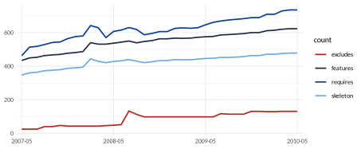
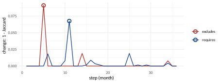
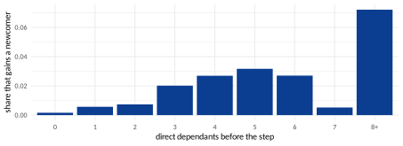

# Following a model through time {#sec:evolution}

Every version of a model is a run of `vp_generate()`, and `vp_read_history()` loads them all ([Reading the results](reading-and-drawing.html#sec:read)). Features are matched by name. Links are compared only among the features that can vary in both versions, the **kept** ones.

The operations of this section answer four kinds of question:

| **Kind of question**            | **Operations**                                                                                                                                                                                                                |
|:--------------------------------|:------------------------------------------------------------------------------------------------------------------------------------------------------------------------------------------------------------------------------|
| Between **two versions**        | What changed (`vp_compare`), in what was written (on the minimal forms), drawn (`vp_plot_compare`); how far each written change reaches (`vp_ripple`); what to retest (`vp_interaction_changes`); which features were renamed (`vp_rename_candidates`). |
| Over a **whole history**        | Sizes and changes step by step, growth laws, the shape of the model over time (`vp_history_apply`), the type of each step, stable hubs and disruptions, eras, communities over time.                                                |
| About **features through time** | Where new features attach, hotspots (`vp_feature_churn`), features that change together (`vp_co_change`), how long new links last and how features move between states, features that flip.                                           |
| **Looking ahead**               | Predicting which features disappear, and the size of the next versions.                                                                                                                                                       |

The two histories of the vignettes play different roles: the seven Mi Bands are few and very different, which suits the questions about two versions; the 37 months of BusyBox are many and alike, which suits statistics over a history.

## Two versions {#two-versions .unnumbered}

## What changed between two versions {#sec:compare}

*Function:* `vp_compare()`

**The question.** What did the four constraints added to the planned Mi Band 3 do?


``` r
planned <- vp_read("planned/miband3_planned")
vp_compare(planned, band) |>
  select(graph, kept, gained, lost, jaccard, spearman)
#> # A tibble: 3 x 6
#>   graph       kept gained  lost jaccard spearman
#>   <chr>      <int>  <int> <int>   <dbl>    <dbl>
#> 1 requires      11     11     0   0.476    0.867
#> 2 excludes      11      7     0   0.3     NA    
#> 3 atleastone    11      3     0   0       NA
```

Four constraints, 11 new dependencies and 7 new conflicts, nothing lost. `jaccard` is the links in both versions over the links in either (1 when nothing changed); `spearman` compares the order of the kept features by how many features require them (1 for the same order). These are also the numbers of the command `strong4vm diff`. `vp_changed_links()` lists the links, `vp_top_movers()` the features with the most changes, and `vp_state_moves()` the features that appeared, disappeared, or moved between variable, core and dead:


``` r
m3 <- history$model[[4]]
m4 <- history$model[[5]]
vp_changed_links(m3, m4, "requires") |> filter(change == "lost")
#> # A tibble: 10 x 3
#>    from           to             change
#>    <chr>          <chr>          <chr> 
#>  1 Screen         OLED           lost  
#>  2 Screen         CapacityButton lost  
#>  3 TouchScreen    OLED           lost  
#>  4 TouchScreen    CapacityButton lost  
#>  5 MovementFilter OLED           lost  
#>  6 MovementFilter CapacityButton lost  
#>  7 BLEv40         OLED           lost  
#>  8 BLEv40         CapacityButton lost  
#>  9 BLEv42         OLED           lost  
#> 10 BLEv42         CapacityButton lost
vp_top_movers(m3, m4, "requires", n = 3)
#> # A tibble: 3 x 4
#>   feature        gained  lost total
#>   <chr>           <int> <int> <int>
#> 1 TouchScreen         4     2     6
#> 2 BLEv42              3     2     5
#> 3 CapacityButton      0     5     5
vp_state_moves(m3, m4)
#> # A tibble: 6 x 3
#>   feature             before after   
#>   <chr>               <chr>  <chr>   
#> 1 AMOLED              absent variable
#> 2 CapacitivitySensing absent variable
#> 3 FullColor           absent variable
#> 4 Gyroscope           absent variable
#> 5 ProximitySensor     absent variable
#> 6 BLEv50              absent variable
```

From the Mi Band 3 to the Mi Band 4 every lost dependency points to the OLED panel or the capacity button: the Mi Band 4 brought a second kind of screen, so a screen no longer means OLED.


**Why it matters.** Product lines evolve with every release, and each change can remove products that customers rely on, or allow combinations that were never tested. Comparing the graphs of two versions shows, without reading every changed constraint, which relationships the release added or removed, and Jaccard and Spearman sum it up in two numbers that can be tracked release after release.

::: {.vp-box .vp-limitsbox}
**Limits: what this cannot tell you**

-   A change that only touches a rule over three or more features leaves every graph as it was: `vp_compare()` reports Jaccard 1 while the model may have lost products ([One rule, three features, and every function](limits-theory.html#sec:limitdemo)).

-   Features are matched by name: a renamed feature is one removed and one added, and its links drop out of the comparison.

-   With fewer than two kept features there is nothing to compare: Jaccard is 1 by convention and Spearman `NA`.

:::

## Comparing what was written {#sec:compareminimal}

*Function:* `vp_compare on vp_minimal()`

**The question.** Did the new version change what was written, or only its consequences?

`vp_compare()` is a measure, so it compares the graphs it is given. Given two minimal forms, it compares the written structure:


``` r
vp_compare(vp_minimal(planned), vp_minimal(band)) |>
  select(graph, gained, lost, jaccard)
#> # A tibble: 3 x 4
#>   graph      gained  lost jaccard
#>   <chr>       <int> <int>   <dbl>
#> 1 requires        4     0   0.333
#> 2 excludes        2     2   0.2  
#> 3 atleastone      1     0   0
```

In the complete graphs the planned band only gained (11 dependencies, 7 conflicts). In the minimal form it also *lost* two primitive conflicts: the new constraints made them consequences of others. The minimal form is the natural target for growth laws and link prediction, where each new link should be one decision: `vp_growth()`, `vp_history_changes()` and the other functions of this section work on a history of minimal forms, made with `mutate(history, model = lapply(model, vp_minimal))`.

**Why it matters.** A release can change a few written constraints and many consequences. Distinguishing the two tells whether a release was a small edit with large effects, which deserves more testing than its diff suggests, or a large rewrite.

::: {.vp-box .vp-limitsbox}
**Limits: what this cannot tell you**

The minimal form approximates what was written ([The minimal form](reading-and-drawing.html#sec:minimal)); a change of the written constraints that leaves the minimal form as it was is invisible, and so is, as always, a change that touches only rules over three features.

:::

## Seeing what changed

*Function:* `vp_plot_compare()`

**The question.** Where in the model are the changes?

`vp_plot_compare()` draws two versions in one picture ([Drawing the graphs](reading-and-drawing.html#sec:plot) explains the drawings): links kept in grey, gained thick, lost dashed orange; new features in yellow, removed features with a dashed border. It compares the minimal forms, so it shows what was written, and by default only the features touched by a change:


``` r
vp_plot_compare(
  history$model[[4]],
  history$model[[5]],
  "figures/evolution-miband3_to_4.svg"
)
```

{#fig:compare34}

Read the orange arrows as in the previous operation: in a minimal form, an arrow also disappears when it becomes a consequence of others. *TouchScreen* $\to$ *Screen* is gone because the touch screen now requires *BLEv42*, which requires the screen: the dependency is still there, no longer written. With `minimal = FALSE` the drawing compares the complete graphs, where a lost arrow is a dependency truly lost.

**Why it matters.** A picture of a release lets a reviewer see in seconds which parts of the model moved, instead of reading a list of changed links.

::: {.vp-box .vp-limitsbox}
**Limits: what this cannot tell you**

The drawing shows one graph at a time (`graph = "excludes"` for conflicts) and only links between two features. Like every comparison, it matches features by name.

:::

## How far a written change reaches

*Function:* `vp_ripple()`

**The question.** When someone writes one constraint, how many relationships change?

A written change is a change of the minimal form; its consequences are the changes of the complete graphs. Their ratio is the **ripple** of a step:


``` r
vp_ripple(history)
#> # A tibble: 6 x 8
#>    step from     to       written_gained written_lost gained  lost ripple
#>   <int> <fct>    <fct>             <int>        <int>  <int> <int>  <dbl>
#> 1     1 miband1  miband1s              0            0      0     0  NA   
#> 2     2 miband1s miband2               0            0      0     0  NA   
#> 3     3 miband2  miband3               7            2     20     0   2.22
#> 4     4 miband3  miband4               2            1     19    12  10.3 
#> 5     5 miband4  miband6               6            4     68     8   7.6 
#> 6     6 miband6  miband8               1            0     15     8  23
vp_ripple(busybox) |> arrange(desc(written_gained + written_lost)) |> head(3)
#> # A tibble: 3 x 8
#>    step from    to      written_gained written_lost gained  lost ripple
#>   <int> <fct>   <fct>            <int>        <int>  <int> <int>  <dbl>
#> 1    11 2008-03 2008-04              0            7      0    41  5.86 
#> 2    10 2008-02 2008-03              1            5      0     5  0.833
#> 3     6 2007-10 2007-11              2            3     10     0  2
```

From the Mi Band 3 to the 4, three written changes changed 31 relationships (ripple 10.3). From the Mi Band 6 to the 8, *one* written requirement (*SpO2* requires *Photoplethysmogram*) changed 23: everything the new arrow brings in through chains, and every conflict that its new requirements inherit (property P2). BusyBox, whose features are loosely tied, has a typical ripple of 1: most edits stay where they are written.

**Why it matters.** The ripple measures how coupled a model is *in practice*: a high ripple means that an innocent-looking edit changes the products in places far from the edit. A rising ripple along a history is a warning that the model is becoming harder to change safely. Steps with a high ripple are the ones to review with `vp_changed_links(old, new)`, which lists every consequence.

::: {.vp-box .vp-limitsbox}
**Limits: what this cannot tell you**

"Written" is the minimal form, with the limits of comparing what was written (above). Links of features added or removed are left out, as in `vp_compare()`.

:::

## What to retest after a change

*Function:* `vp_interaction_changes()`

**The question.** A new version is out. Which of the old tests are now invalid, and which new interactions are untested?

Among the features that can vary in both versions, a combination of two features (both selected, one without the other, neither) is possible exactly when no link forbids it: that is property P3. So the changed links give, exactly, every combination of two features that the step made possible or impossible. With the test sample of the old version (the five bands of [Testing](teams-testing.html#sec:testing)), `in_sample` counts how many tests have each combination:


``` r
# sample: the 5 tests of the Mi Band 3 (Section "Testing")
changes <- vp_interaction_changes(
  history$model[[4]],
  history$model[[5]],
  sample
)
changes |> count(change, tested = in_sample > 0)
#> # A tibble: 3 x 3
#>   change         tested     n
#>   <chr>          <lgl>  <int>
#> 1 now impossible FALSE      4
#> 2 now impossible TRUE      15
#> 3 now possible   FALSE     12
changes |> filter(change == "now impossible", in_sample > 0) |> head(4)
#> # A tibble: 4 x 7
#>   feature_1          value_1 feature_2       value_2 change         graph    in_sample
#>   <chr>              <lgl>   <chr>           <lgl>   <chr>          <chr>        <int>
#> 1 TouchScreen        TRUE    HeartRateSensor FALSE   now impossible requires         1
#> 2 TouchScreen        TRUE    BLEv42          FALSE   now impossible requires         2
#> 3 ContactlessPayment TRUE    TouchScreen     FALSE   now impossible requires         1
#> 4 ContactlessPayment TRUE    HeartRateSensor FALSE   now impossible requires         1
changes |> filter(change == "now possible") |> head(4)
#> # A tibble: 4 x 7
#>   feature_1   value_1 feature_2      value_2 change       graph    in_sample
#>   <chr>       <lgl>   <chr>          <lgl>   <chr>        <chr>        <int>
#> 1 Screen      TRUE    OLED           FALSE   now possible requires         0
#> 2 Screen      TRUE    CapacityButton FALSE   now possible requires         0
#> 3 TouchScreen TRUE    OLED           FALSE   now possible requires         0
#> 4 TouchScreen TRUE    CapacityButton FALSE   now possible requires         0
```

The two lists are the test plan of the new version:

-   *Now impossible, and in some test*: those tests describe bands that the Mi Band 4 does not allow. Fifteen combinations are of this kind; for example, contactless payment without the touch screen, which one of the five tests has, and NFC without *BLEv42*, which two have. They must be fixed or dropped.

-   *Now possible*: new interactions. No old test can have them (they were impossible), so each one is untested: a screen without OLED, a touch screen without the capacity button, and so on (12 combinations). New tests must cover them. `vp_pick_sample()` picks configurations that do ([Testing](teams-testing.html#sec:testing)).

The features new in the Mi Band 4 bring their own combinations, which are all untested: `vp_combinations_to_cover()` counts them, and `vp_uncovered()` on the new version lists them once the sample has columns for them.


**Why it matters.** Regression testing of a product line is expensive: every release would call for testing everything again. Knowing exactly which interactions became possible (and need new tests) and which became impossible (and invalidate old tests) focuses the campaign on what the release really changed.

::: {.vp-box .vp-limitsbox}
**Limits: what this cannot tell you**

Exact for combinations of two features that can vary in both versions; a test that breaks a rule over three features is not caught (use `vp_sample_violations()` too, and in the end the solver). A feature that moved between variable, core and dead is not a kept feature: its combinations changed, but are not listed here (see `vp_state_moves()`).

:::

## Features that were probably renamed {#sec:renames}

*Function:* `vp_rename_candidates()`

**The question.** A feature disappeared and another appeared: is it the same one, renamed?

Features are matched by name, so a rename breaks every comparison of this section. The function `vp_rename_candidates()` pairs each removed feature with the added feature whose links to the kept features are most alike, one to one (a maximum matching in a bipartite graph), and gives the similarity of the names beside it:


``` r
vp_rename_candidates(busybox$model[[31]], busybox$model[[32]])
#> # A tibble: 4 x 4
#>   old                   new               similarity name_similarity
#>   <chr>                 <chr>                  <dbl>           <dbl>
#> 1 CONFIG_APP_DUMPLEASES CONFIG_DUMPLEASES          1           0.810
#> 2 CONFIG_APP_DHCPRELAY  CONFIG_DHCPRELAY           1           0.8  
#> 3 CONFIG_APP_UDHCPC     CONFIG_UDHCPC              1           0.765
#> 4 CONFIG_APP_UDHCPD     CONFIG_UDHCPD              1           0.765
```

The two columns are computed as follows:

-   `similarity` compares links. Each feature is described by its links to the kept features (those that can vary in both versions), each one labelled with its kind and direction: "needs *x*", "needed by *x*", "excludes *x*" and, when the model has them, "or *x*" (at least one of the two). The similarity of a removed feature and an added one is the Jaccard index of their two sets of labels: the labels they share divided by all the distinct labels of either. It is 1 when the two features have exactly the same links, and 0 when they share none, or when neither has any. Pairs below `threshold` (0.5 by default) are not considered; among the others, the matching keeps each feature in at most one pair and picks the pairs whose total similarity is largest.

-   `name_similarity` compares the names, after the pairs are made, and does not take part in the matching. It is $1 - d/\ell$, where $d$ is the edit distance between the two names (the fewest characters to insert, delete or replace to turn one into the other) and $\ell$ the length of the longer name: 1 when the names are equal, near 0 when they have little in common. For example, `CONFIG_APP_UDHCPC` becomes `CONFIG_UDHCPC` by deleting four characters, and the longer name has 17, so $1 - 4/17 = 0.765$.

The rows come sorted by `similarity`, then by `name_similarity`.

In 2009-12 the options of the DHCP applets lost their prefix `APP_`: four renames, found by their links alone, and confirmed by their names.

**From candidates to renames.** `vp_rename()` gives the features of one version the names they have in the other,
before comparing. It takes the renames as a named vector, as a data frame with `old` and `new` (such as the answer of
`vp_rename_candidates()`), or as a file. `vp_rename_candidates()` writes that file when it is given `file`: one line per
pair, the old name, a tab and the new name (a tab, so that names with spaces work too), after a first line, starting
with `#`, that records the thresholds used (the command `strong4vm diff --rename` reads the same file). Only the pairs
whose `name_similarity` is at least `name_threshold` (0.7 by default) are written: those confirmed both by their links
and by their names. The answer of the function is the same, with or without `file`, so the pairs left out can still be
read in it and added by hand:


``` r
dir.create("evolution", showWarnings = FALSE)
vp_rename_candidates(
  busybox$model[[31]],
  busybox$model[[32]],
  file = "evolution/renames.txt"
) |>
  invisible()
cat(readLines("evolution/renames.txt"), sep = "\n")
#> # renames from vp_rename_candidates(): link similarity >= 0.5, name similarity >= 0.7
#> CONFIG_APP_DUMPLEASES	CONFIG_DUMPLEASES
#> CONFIG_APP_DHCPRELAY	CONFIG_DHCPRELAY
#> CONFIG_APP_UDHCPC	CONFIG_UDHCPC
#> CONFIG_APP_UDHCPD	CONFIG_UDHCPD
old <- busybox$model[[31]]
new <- busybox$model[[32]]
vp_compare(old, new) |> select(graph, kept, added, removed, gained, lost)
#> # A tibble: 2 x 6
#>   graph     kept added removed gained  lost
#>   <chr>    <int> <int>   <int>  <int> <int>
#> 1 requires   596     4       4      0     0
#> 2 excludes   596     4       4      0     0
vp_compare(vp_rename(old, "evolution/renames.txt"), new) |>
  select(graph, kept, added, removed, gained, lost)
#> # A tibble: 2 x 6
#>   graph     kept added removed gained  lost
#>   <chr>    <int> <int>   <int>  <int> <int>
#> 1 requires   600     0       0      0     0
#> 2 excludes   600     0       0      0     0
```

Without the renames, the comparison sees four features removed and four added; with them, the four are kept, and their links are compared as those of one feature. Raise `name_threshold` to write only the surest pairs (with 0.8, the two `UDHCP` pairs, at 0.765, would be left out); lower it to 0 to write every pair, whatever its names, when names are known to have changed completely. `threshold` still decides which pairs are candidates at all, by their links.


**Why it matters.** Renames are frequent in real product lines, and every comparison by name mistakes a rename for a removal and an addition: links are lost, histories break, statistics are biased. Pairing renames first makes every other comparison of this section trustworthy.

::: {.vp-box .vp-limitsbox}
**Limits: what this cannot tell you**

A candidate, to be confirmed by a person: two different features can have the same links (in this history, with a similarity of 0.5, a few pairs are clearly not renames), and a feature renamed and changed at once may be missed. Features with no link to the kept features cannot be matched at all.

:::

## A whole history {#a-whole-history .unnumbered}

## Sizes and changes, step by step

*Function:* `vp_history_changes()`

**The question.** How did the model grow, and which steps changed it most?

`vp_history_sizes()` gives the size of every version, `vp_history_changes()` what changed at every step. Both take a history, so `vp_read_history()` must be called first: `busybox` is the history read in [Graphs made by version 1 of Strong4VM](reading-and-drawing.html#sec:version1), one version per month. On BusyBox, with a chart made with ggplot2:


``` r
# busybox: read with vp_read_history() (Section "Graphs made by version 1...")
sizes <- vp_history_sizes(busybox)
sizes |>
  select(version, features, requires, excludes, skeleton) |>
  slice(c(1, 13, 25, 37))
#> # A tibble: 4 x 5
#>   version features requires excludes skeleton
#>   <fct>      <int>    <int>    <int>    <int>
#> 1 2007-05      434      462       25      347
#> 2 2008-05      537      607       48      428
#> 3 2009-05      575      646       98      446
#> 4 2010-05      623      735      131      478
p <- sizes |>
  tidyr::pivot_longer(
    c(features, requires, skeleton, excludes),
    names_to = "count"
  ) |>
  ggplot(aes(version, value, colour = count, group = count)) +
  geom_line(linewidth = 0.8) +
  scale_x_discrete(breaks = levels(sizes$version)[c(1, 13, 25, 37)]) +
  labs(x = NULL, y = NULL)
```


{#fig:historysizes}


``` r
changes <- vp_history_changes(busybox)
changes |>
  filter(graph == "requires") |>
  arrange(jaccard) |>
  select(from, to, gained, lost, jaccard) |>
  head(3)
#> # A tibble: 3 x 5
#>   from    to      gained  lost jaccard
#>   <fct>   <fct>    <int> <int>   <dbl>
#> 1 2008-03 2008-04      0    41   0.932
#> 2 2009-05 2009-06     12     0   0.981
#> 3 2007-10 2007-11     10     0   0.982
```

**Why it matters.** The sizes and changes of every step are the raw history of a product line: when it grew, when it was reorganised, when a release touched far more than usual. Everything else in this section starts from them.

::: {.vp-box .vp-limitsbox}
**Limits: what this cannot tell you**

The same as for two versions, at every step.

:::

## Growth laws

*Function:* `vp_growth()`

**The question.** When the number of features doubles, by how much do the links grow?

`vp_growth()` takes logarithms of both counts: for each kind of link it fits the straight line $\log(\mathit{links}) = a + b
\log(\mathit{features})$ by least squares, one point per version. A straight line on these log-log axes is a *power law*, $\mathit{links} = e^{a} \cdot \mathit{features}^{\,b}$, and the slope $b$ is its exponent: when the features double, the links are multiplied by $2^{b}$. A slope of 1 means links grow in step with the features (twice the features, twice the links); 2, that they grow with the square of the features (twice the features, four times the links); above 1, faster than the features [Leskovec et al. (2005)](#ref-Leskovec05). Note that the line is drawn against the number of features, not against time: links growing exponentially with the features would not give a straight line here but one bending upwards (a straight line on $\log(\mathit{links})$ against $\mathit{features}$ itself, not its logarithm). Growth over time is what `vp_history_sizes()` shows.


``` r
vp_growth(busybox)
#> # A tibble: 4 x 3
#>   links               slope r_squared
#>   <chr>               <dbl>     <dbl>
#> 1 requires            1.01      0.908
#> 2 excludes            4.88      0.842
#> 3 skeleton            0.823     0.978
#> 4 primitive_conflicts 1.40      0.736
```

In BusyBox the dependencies grow in step with the features (slope 1.01), but the conflicts much faster (4.88). `r_squared` says how well a straight line fits (1 is perfect).

The logarithm of 0 does not exist, so a version with no features, or with none of the links of a kind, is left out of the line of that kind; with fewer than three versions left, `slope` and `r_squared` are `NA`. On the Mi Bands 1 to 4, for example, the Mi Band 1 has no features that can vary, and only the Mi Bands 3 and 4 have a skeleton, so the skeleton has two points and an `NA` slope, while the requirements, with three points, do get one.


**Why it matters.** Whether links grow faster than features decides whether a product line becomes harder to manage as it grows: a slope above 1 means that every new feature adds more than its share of dependencies or conflicts, so the effort of configuring, testing and maintaining grows faster than the line itself.

::: {.vp-box .vp-limitsbox}
**Limits: what this cannot tell you**

A slope fitted on one history of a few years; the versions are not independent of one another, and `r_squared` says nothing about the future. Three points are enough to get a slope, but not to trust it. A power law is assumed: `r_squared` near 1 says the points lie near a line on log-log axes, not that no other curve fits as well. With little growth (BusyBox grows from 434 to 623 features) a slope is fragile.

:::

## The shape of a model over time

*Function:* `vp_history_apply()`

**The question.** Does the model get deeper, wider, more concentrated, harder to explain?

Any measure of the vignettes can be followed version by version: `vp_history_apply(history, f, ...)` applies a function to every version and binds the answers in one tibble. It works in three steps:

1.  *Call.* A history is a tibble with one row per version, oldest first, and the models in the column `model` ([Reading the results](reading-and-drawing.html#sec:read)). For each row, `f` is called with that model as its first argument, `f(history$model[[k]], ...)`: the arguments after `f` are passed on, unchanged, to every call. `f` can be a function of the vignettes (`vp_depth`, or its name as a string, `"vp_depth"`) or a function written on the spot, `function(m) ...`, to combine several measures or post-process one.

2.  *Turn the answer into rows.* What `f` returns decides the columns:

    -   one number without a name: one row, with the number in a column `value`;

    -   a named vector, such as `c(depth = 3, width = 5)`: one row, one column per name;

    -   a tibble or data frame: its rows and columns, as they are, so a version can give any number of rows, zero included.

    Anything else (a list, `NULL`, a vector of several numbers without names) stops with an error that names the version.

3.  *Bind.* A column `version` (a factor, in the order of the history) is put in front of the rows of each version, and the blocks are bound one under the other with `dplyr::bind_rows()`. Columns are matched by name: if some version lacks a column, it gets `NA` there.

So it is `lapply()` over the models followed by `bind_rows()`, with the version kept. A single number, for the seven Mi Bands (the history read in [Reading the results](reading-and-drawing.html#sec:read)):


``` r
vp_history_apply(history, vp_depth)
#> # A tibble: 7 x 2
#>   version  value
#>   <fct>    <int>
#> 1 miband1      0
#> 2 miband1s     1
#> 3 miband2      1
#> 4 miband3      3
#> 5 miband4      4
#> 6 miband6      5
#> 7 miband8      6
```

A function that returns a tibble, with an argument passed on through `...`: the most decisive feature of each version (`vp_most_decisive(m, n = 1)`):


``` r
vp_history_apply(history, vp_most_decisive, n = 1)
#> # A tibble: 6 x 5
#>   version  feature         decision_power requires excludes
#>   <fct>    <chr>                    <dbl>    <int>    <int>
#> 1 miband1s HeartRateSensor          0            0        0
#> 2 miband2  Screen                   0.286        2        0
#> 3 miband3  MovementFilter           0.7          4        3
#> 4 miband4  BT40                     0.812        0       13
#> 5 miband6  MovementFilter           0.95         4       15
#> 6 miband8  MovementFilter           1            4       18
```

The Mi Band 1 has no row: it has no feature that can vary, so `vp_most_decisive()` returns an empty tibble, and an empty block adds nothing. Keep this in mind when counting versions in the answer; a function that returns a number never loses a version.

A named vector gives a wide table, one row per version, which is the most convenient form for a set of measures. The shape measures of [Levels, depth and the longest chain](features-hierarchy.html#sec:levels) and [Width and chains](features-hierarchy.html#sec:width), for the seven Mi Bands:


``` r
shape <- vp_history_apply(history, function(m) {
  c(
    depth = vp_depth(m),
    decision_chain = nrow(vp_longest_decision_chain(m)),
    width = vp_width(m),
    free = nrow(vp_largest_free_set(m)),
    gini = round(vp_gini(vp_feature_table(m)$required_by), 2)
  )
})
shape
#> # A tibble: 7 x 6
#>   version  depth decision_chain width  free  gini
#>   <fct>    <dbl>          <dbl> <dbl> <dbl> <dbl>
#> 1 miband1      0              0     0     0  0   
#> 2 miband1s     1              1     1     1  0   
#> 3 miband2      1              2     6     4  0.62
#> 4 miband3      3              3     5     4  0.65
#> 5 miband4      4              5     9     5  0.68
#> 6 miband6      5              6     6     3  0.5 
#> 7 miband8      6              7     7     3  0.58
```

From the Mi Band 2 on, the band gets deeper at every generation, from one layer to six, while its width stays between five and nine: the product line grows by stacking specialisations (on the Mi Band 8, Bluetooth 5.2 needs SpO2, which needs the photoplethysmogram, which needs the AMOLED screen), not by adding independent options. The free features fall from five (Mi Band 4) to three: more and more of the options are tied to one another, and on four of the bands the longest chain of decisions outgrows the depth: conflicts lengthen it. The function returns a tibble, so the shape can be drawn with ggplot2 like any other: `tidyr::pivot_longer(shape, -version)` puts the measures one under the other, ready for `ggplot(aes(version, value, colour = name, group = name))`.

`f` runs once per version, so its cost is multiplied by the length of the history: a measure that takes a few seconds on one version of BusyBox takes minutes on its 37 versions. Putting several measures in one `f`, as above, keeps them in one table; it saves time only when the measures share work inside `f`.

**Why it matters.** Trends are what a single version cannot show: a model getting deeper becomes harder to explain and to configure; one whose free features shrink offers fewer real choices; one whose Gini grows leans on fewer foundations. Following them warns of problems before they become visible in any single release.

::: {.vp-box .vp-limitsbox}
**Limits: what this cannot tell you**

A measure followed over time keeps the limits it has on one version; and a change of the measure can come from features added or removed, not only from a change of the relationships. Compare the shape with the sizes (`vp_history_sizes()`) before reading a trend.

:::

## The type of each step

*Function:* `vp_edit_type()`

**The question.** Did a version restrict the model, relax it, or both?

Thüm et al. classify an edit by what it does to the products: a *specialisation* removes products, a *generalisation* adds them, an *arbitrary edit* does both, a *refactoring* changes nothing [Thüm et al. (2009)](#ref-Thuem09). Among the kept features, gaining links only is necessary for a specialisation, losing links only for a generalisation, and no change at all for a refactoring:


``` r
vp_edit_type(busybox) |> count(type)
#> # A tibble: 4 x 2
#>   type                n
#>   <chr>           <int>
#> 1 arbitrary edit      1
#> 2 generalisation?     4
#> 3 refactoring?       23
#> 4 specialisation?     8
```

In 36 monthly steps of BusyBox, 23 change no relationship at all, and only one both adds and removes links, which makes it certainly an arbitrary edit.

**How it works.** For each step, from one version to the next, `vp_edit_type()` does four things:

1.  *Complete graphs.* Models read in their minimal form are expanded first (`vp_expand()`), because the products are decided by all the relationships, not by those written: a link dropped from the minimal form can still be implied by others, and is then not lost.

2.  *Kept features.* Links are compared only among the features that can vary in both versions, as in `vp_compare()` ([What changed between two versions](#sec:compare)): a feature added, removed, or turned core or dead is left out.

3.  *Count.* `gained` is the number of links in the new version and not in the old one, `lost` the number in the old and not in the new, added up over the requires, excludes and, when both versions have it, at-least-one graphs.

4.  *Classify.* No link gained or lost: "refactoring?"; only gained: "specialisation?"; only lost: "generalisation?"; both: "arbitrary edit".

Why these rules hold: each link is a statement true of *every* product. "$A$ requires $B$" says that no product has $A$ without $B$; "$A$ excludes $B$", that none has both; "at least one of $A$, $B$", that none has neither. If a step only removes products, every statement true of all the old products is still true of the fewer new ones: no link can be lost, though new ones may appear. So a step that loses a link has added at least one product, a step that gains a link has removed at least one, and a step that does both has done both: it is an arbitrary edit, with certainty. The converse does not hold, hence the question marks: a step with only gained links has removed products, but may also have added some that no pair of features reveals; and a step with no change has changed nothing that two features can see.

The answer has one row per step, with `step`, `from`, `to`, `gained`, `lost` and `type`; to see which links changed in a given step, call `vp_changed_links()` on its two versions.


**Why it matters.** Whether a release only restricts, only relaxes, or does both, tells what customers and testers should expect: specialisations can break existing configurations, generalisations add untested ones, refactorings should change nothing and can be verified as such.

::: {.vp-box .vp-limitsbox}
**Limits: what this cannot tell you**

Necessary conditions, so the types with a question mark are only possible: a step with no change in the graphs can still have changed a rule over three features, and features added or removed change the products too. "Arbitrary edit" is certain.

:::

## Stable hubs and disruptions

*Function:* `vp_disruptions()`

**The question.** Are the most required features the same from version to version? Which steps changed far more than usual?


``` r
vp_hub_stability(busybox, top = 20) |>
  summarise(lowest_spearman = min(spearman), top20_kept = mean(top_kept))
#> # A tibble: 1 x 2
#>   lowest_spearman top20_kept
#>             <dbl>      <dbl>
#> 1           0.990       18.5
vp_disruptions(busybox) |>
  filter(disruption) |>
  select(from, to, graph, gained, lost, score)
#> # A tibble: 2 x 6
#>   from    to      graph    gained  lost score
#>   <fct>   <fct>   <chr>     <int> <int> <dbl>
#> 1 2007-09 2007-10 excludes      4     0  5.90
#> 2 2008-03 2008-04 requires      0    41  5.70
vp_top_movers(busybox$model[[11]], busybox$model[[12]], "requires", n = 3)
#> # A tibble: 3 x 4
#>   feature                 gained  lost total
#>   <chr>                    <int> <int> <int>
#> 1 CONFIG_TEST                  0    31    31
#> 2 CONFIG_ECHO                  0    10    10
#> 3 CONFIG_ASH_BUILTIN_ECHO      0     2     2
```

The ranking of the hubs barely moves: the Spearman correlation never falls below 0.99, and about 18 of the 20 most required features stay in the top 20 one month later. A step is a **disruption** when its change ($1 -$ Jaccard) is more than 3.5 robust standard deviations above the median of all steps [Peel and Clauset (2015)](#ref-Peel15); [Akoglu et al. (2015)](#ref-Akoglu15). Two steps of BusyBox are flagged. In the one from 2008-03 to 2008-04, 41 dependencies were lost, and `vp_top_movers()` says which features to look at first: CONFIG_TEST lost the most.

**How the hubs are compared.** `vp_hub_stability(history, top = 50)` looks at each step, from one version to the next, and counts, in the requires graph of each version, how many features require each feature: its in-degree, the column sums of the adjacency matrix. In the complete graph (the default form) this counts every feature that needs it, directly or through a chain (property P1). Two numbers come out of each step:

-   `spearman`, the Spearman rank correlation of the in-degrees of the *kept* features (those in both versions): the features are ranked by in-degree in each version, ties sharing their average rank, and the two rankings are correlated. It is 1 when the order of the features is the same in both versions, even if every count grew; near 0 when the order has nothing to do with the old one; negative when it is reversed. It is `NA` when fewer than two features are kept. Features added or removed play no part in it.

-   `top_kept`, how many of the `top` most required features of the old version are also among the `top` most required of the new one, out of `top`. Here every feature of each version counts, so a hub that disappears, or a new feature that enters the top, lowers it. Features tied at the edge of the top are cut in the order in which the model lists them.

The two say different things. A high `spearman` with a low `top_kept` means that the order as a whole held but the leaders changed (or left); a low `spearman` with a high `top_kept`, that the leaders held while the many features with few dependants reshuffled, which is usually harmless. A small `top` looks only at the leaders; the summary above takes the lowest correlation and the mean of `top_kept` over all the steps.

**How a disruption is found.** `vp_disruptions(history, threshold = 3.5)` starts from `vp_history_changes()`: for each step and each graph, the Jaccard index $J$ of the links among the kept features (links in both versions divided by links in either; 1 when nothing changed or when neither version has a link). The change of the step is $x = 1 - J$: 0 for no change, 1 when no link is shared. Then, for each graph separately (requires, excludes and, when the history has it, at least one):

1.  the usual change is the *median* $m$ of $x$ over all steps;

2.  the usual spread is the *median absolute deviation*, $\mathrm{MAD} = 1.4826 \cdot \operatorname{median}_i |x_i - m|$ (the factor makes it equal to the standard deviation for normally distributed data);

3.  the score of each step is $(x - m) / \mathrm{MAD}$, the number of robust standard deviations above the usual change;

4.  a step with a score above `threshold` is a disruption.

The median and the MAD are used instead of the mean and the standard deviation because they are *robust*: a single huge step would inflate the standard deviation and hide itself, while it barely moves the median. With 3.5, the usual threshold for this score, a step is flagged only if it is far out [Peel and Clauset (2015)](#ref-Peel15); [Akoglu et al. (2015)](#ref-Akoglu15). When more than half of the steps change nothing, the MAD is 0; the ordinary standard deviation is used instead, and if that is 0 too (all steps alike) every score is 0 and nothing is flagged. The test is one-sided: a step that changed much less than usual is not flagged. The answer is `vp_history_changes()` with two more columns, `score` and `disruption`, one row per step and graph; a step can be a disruption in one graph and not in another, and the figure below draws both.

Because $x$ is a share, a disruption is a step that changed a large *part* of a graph, not necessarily many links: in an early, small model, a few links can be a large share. Read `gained` and `lost` next to `score`. And because the complete graphs are compared, one written change can show up as many changed links (see `vp_ripple()`); to compare what was written, give the function a history of minimal forms ([Comparing what was written](#sec:compareminimal)).

**Where to look first.** `vp_top_movers(old, new, graph, n = 10)` takes the links of one graph that were gained or lost between two versions, among the kept features (`vp_changed_links()`), and counts, for each feature, the changed links that touch it at either end. A feature with a large `total` is where the change is concentrated; for the requires graph, a feature that *lost* many links as their target is one that many features stopped needing. The `n` features with the most changes come first.

{#fig:disruptions}


**Why it matters.** Stable hubs are the backbone of a product line: if they stay the same release after release, knowledge about them stays valid. Disruptions are the releases that changed far more than usual, which deserve a post-mortem, extra testing, and a check that the change was intended.

::: {.vp-box .vp-limitsbox}
**Limits: what this cannot tell you**

The threshold is a convention: change it and other steps are flagged. A step is judged only against the other steps of the same history, so a history with few steps gives a rough median and MAD, and a history where every step is large flags none of them. Hub stability counts only the requires graph, and in-degrees in the complete graph favour features at the bottom of long chains. A flagged step is a question for whoever knows the history of the system, not an explanation; and a disruption that only touches rules over three features is invisible.

:::

## Eras of a history {#sec:eras}

*Function:* `vp_eras()`

**The question.** Did the model go through distinct periods?

`vp_version_distance()` compares every two versions, not only consecutive ones (the distance is $1 -$ Jaccard, as in `vp_compare()`). `vp_eras()` then splits the history into $k$ runs of consecutive versions, the **eras**, as alike as possible inside each run (the criterion of $k$-means, solved exactly). A boundary between two eras is where the model changed course:


``` r
distances <- vp_version_distance(busybox)
for (k in 2:4) {
  print(
    vp_eras(busybox, k) |>
      group_by(era) |>
      summarise(
        first = first(version),
        last = last(version),
        spread = first(spread)
      )
  )
}
#> # A tibble: 2 x 4
#>     era first   last    spread
#>   <int> <fct>   <fct>    <dbl>
#> 1     1 2007-05 2008-03 0.0111
#> 2     2 2008-04 2010-05 0.0174
#> # A tibble: 3 x 4
#>     era first   last      spread
#>   <int> <fct>   <fct>      <dbl>
#> 1     1 2007-05 2008-03 0.0111  
#> 2     2 2008-04 2008-08 0.000672
#> 3     3 2008-09 2010-05 0.00955 
#> # A tibble: 4 x 4
#>     era first   last      spread
#>   <int> <fct>   <fct>      <dbl>
#> 1     1 2007-05 2008-03 0.0111  
#> 2     2 2008-04 2008-08 0.000672
#> 3     3 2008-09 2009-05 0.00146 
#> 4     4 2009-06 2010-05 0.00249
```


{#fig:eras}

**How the figure is made.** `vp_version_distance(busybox)` gives one row per pair of versions, 666 rows. Each pair is drawn twice, as $(a, b)$ and as $(b, a)$, so the picture is symmetric about the diagonal, and every version is paired with itself at distance 0 to fill the diagonal. ggplot2's `geom_tile()` paints one square per pair, with the versions in time order on both axes (oldest at the bottom left), and `scale_fill_gradient()` maps the distance to a colour, from almost white for 0 to dark blue for the largest distance found. The red lines come from `vp_eras(busybox, 4)`: wherever the era number changes between two consecutive versions, a line is drawn halfway between them, vertical and horizontal. The code is in the file `r_analysis_manual.tex`, chunk `eras_figure`.

**How to read it.** Pick a version on the horizontal axis and go up its column: each cell says how far that version is from the version of the row. Then:

-   *The scale.* The darkest blue is a distance of 0.11 (versions `2007-11` and `2010-03`), not 1: any two months of BusyBox share most of their dependencies among the features they have in common. The figure shows small differences, made visible by the colours.

-   *Squares on the diagonal* are the eras: blocks of consecutive versions that are pale inside, because their versions are alike. In the eras after the first, the mean distance between two versions (`spread`) is at most 0.002; the first era, from `2007-05` to `2008-03`, is less uniform (0.011), and its square shows paler and darker blocks: smaller changes that four eras are not enough to separate.

-   *Rectangles off the diagonal* compare two eras. The rectangles in the top left and bottom right corners (era 1 against era 4) are the darkest, with a mean of 0.10: the model drifted away from where it started. Era 1 against era 2 (0.06) is already dark: the step from `2008-03` to `2008-04`, the disruption found above, made a break that was never undone. Eras 3 and 4 are close (0.02): the later history changed little.

-   *A stripe inside a rectangle* is a version that does not look like the rest of its era. In era 2, `2008-08` is at a mean distance of 0.02 from the versions of era 1, while `2008-07` is at 0.07: a pale stripe in the dark rectangle: a version much closer to the old era than its neighbours. Whether it took back old dependencies or lost the features whose dependencies had changed, the distances alone cannot tell (`vp_state_moves()` and `vp_changed_links()` on the two versions can). Either way, the eras, which are runs of consecutive versions, cannot express it; only the distances show it.

-   *A dark cross* (a whole row and column darker than their neighbours) would be one version unlike all others, for example a release with a mistake fixed the next month.

The distance of each pair is measured on the features that the two versions have in common, and these differ from pair to pair. So the distances are not those of points on a map: two versions at distance 0 can still be at different distances from a third.

The first boundary, with two eras, falls between `2008-03` and `2008-04`: the disruption found by `vp_disruptions()` above, where 41 dependencies were lost. Asking for more eras keeps it and adds `2008-08`/`2008-09`, then `2009-05`/`2009-06`: the steps with the largest written changes in `vp_ripple()`. The eras agree with the disruptions, but they say more: a disruption is one step, an era is a period that the versions inside have in common, and a version that is closer to an older era than to its neighbours (a reverted change) shows up in the distances as a pale square away from the diagonal.

**How the distances are computed.** `vp_version_distance(history, graph = "requires")` compares every two versions $a$ and $b$ of the history, $n(n-1)/2$ pairs for $n$ versions (666 for the 37 months of BusyBox). Both models are taken in their complete form (a minimal form is expanded first), the features that can vary in both are kept, and the links of the chosen graph among those features are compared: $J(a, b)$ is the number of links in both divided by the number in either, and the distance is $d(a, b) = 1 - J(a, b)$, from 0 (the same links) to 1 (no link in common). The answer has one row per pair, the older version in `from`, with `kept`, `jaccard` and `distance`. Only one graph is compared at a time: `graph = "excludes"` gives the eras of the conflicts, which need not match those of the dependencies.

**How the eras are chosen.** `vp_eras(history, k = 3, graph = "requires")` looks for the best way of cutting the sequence of versions into $k$ runs of consecutive versions. Unlike ordinary clustering, an era cannot skip versions: a version that returns to an old state stays in its own period, and the return is seen in the distances, not in the eras. The cost of an era $E$ with $m$ versions is $$\mathrm{cost}(E) = \frac{1}{m} \sum_{\{a, b\} \subseteq E} d(a, b),$$ the sum of the distances between every two of its versions divided by its size, and the eras chosen are those whose costs add up to the least. This is the criterion of $k$-means written with distances: for points in space and squared distances, it equals the sum of the squared distances of the points to the centre of their cluster, so it needs no centre and works with any distance. Dividing by $m$ and not by the number of pairs matters: the mean distance of the pairs would make an era of one version (no pairs, cost 0) free, and every answer would isolate the most unusual versions instead of finding periods.

The best cut is found exactly, not by a heuristic: by dynamic programming, the cheapest way of cutting versions 1 to $j$ into $e$ eras is the cheapest way of cutting 1 to $i-1$ into $e-1$ eras, plus the cost of the era from $i$ to $j$, for the best $i$. Sums of distances over blocks of versions are read from a table of cumulative sums, so each era costs a constant time and the whole search takes about $k n^2$ steps: instant for BusyBox. When two cuts cost the same, the one whose last era starts first is kept.

The answer has one row per version, with its `era` (1 to $k$, in time order) and the `spread` of its era: the mean distance between two versions of the era (0 for an era of one version), repeated on every row of the era, so `group_by(era)` gives one value per era, as above. A small spread means the versions of the era are alike; an era with a large spread is a period that kept changing, and asking for more eras may split it.

**Choosing $k$.** $k$ goes from 1 (the whole history) to $n$ (every version its own era), and the total cost can only fall as $k$ grows, so there is no "best" $k$ in the function. Try a few values, as above, and keep the boundaries that persist: the eras for $k + 1$ are computed afresh and need not split those for $k$, so a boundary that survives every $k$ (here between `2008-03` and `2008-04`) is a solid one, and one that appears and disappears is weak. Compare the boundaries with the disruptions and with `vp_history_sizes()`: a boundary at a step where many features were added can come from the new features alone.

**Why it matters.** Eras are the phases of a product line's life: before and after a reorganisation, a new architecture, a change of maintainers. They tell which versions can be compared directly, which statistics should be computed per era, and where to look for the decision that changed the model's course.

::: {.vp-box .vp-limitsbox}
**Limits: what this cannot tell you**

The distance is measured among the features kept by the two versions: two versions that share few features look alike because there is little to compare (Jaccard 1 when nothing is shared). The number of eras is your choice; more eras always fit better. Eras are runs of consecutive versions, so a period that comes back later (a change reverted months after) is not one era, and the cost criterion is chosen, not derived from how products evolve. And, as always, the graphs see only relationships between two features.

:::

## Communities over time {#sec:comhistory}

*Function:* `vp_community_history()`

**The question.** Do the communities of a model change from version to version?


``` r
vp_community_history(busybox[1:6, ])
#> # A tibble: 5 x 5
#>    step from    to      between_versions same_version_two_runs
#>   <int> <fct>   <fct>              <dbl>                 <dbl>
#> 1     1 2007-05 2007-06            0.994                 0.987
#> 2     2 2007-06 2007-07            0.994                 1    
#> 3     3 2007-07 2007-08            1                     1    
#> 4     4 2007-08 2007-09            0.994                 0.994
#> 5     5 2007-09 2007-10            0.994                 1
```

For each step, two numbers compare groupings: `between_versions`, the communities of two consecutive versions, and `same_version_two_runs`, two runs of the algorithm on the same version. When the two numbers are alike, the change between versions cannot be told apart from the randomness of the algorithm.

**Why it matters.** If the modules of a product line drift, the organisation of teams, files and documentation should follow. But that conclusion is only valid if the change of communities is larger than the noise of the algorithm, which is what this operation checks.

::: {.vp-box .vp-limitsbox}
**Limits: what this cannot tell you**

The random element of community detection is as large as the change it should measure; a study of how communities evolve needs a method that gives the same groups every time (a consensus over many runs, for instance).

:::

## Features through time {#features-through-time .unnumbered}

## Where new features attach

*Function:* `vp_attachment()`

**The question.** Do new features attach to the features that are already most required [Barabási and Albert (1999)](#ref-Barabasi99)?

`vp_attachment()` gives, for each step and each kept feature, how many direct dependants it had and how many of the new features require it directly in the new version:


``` r
att <- vp_attachment(busybox)
att |>
  group_by(direct_dependants = pmin(direct_dependants, 5)) |>
  summarise(features = n(), share_with_newcomers = mean(new_dependants > 0))
#> # A tibble: 6 x 3
#>   direct_dependants features share_with_newcomers
#>               <dbl>    <int>                <dbl>
#> 1                 0    13642              0.00161
#> 2                 1     2986              0.00569
#> 3                 2     1229              0.00732
#> 4                 3      397              0.0202 
#> 5                 4      260              0.0269 
#> 6                 5     1037              0.0415
vp_auc(att$direct_dependants, att$new_dependants > 0)
#> [1] 0.802
```

The more direct dependants a feature has, the more often a newcomer attaches to it. `vp_auc()` measures how well a score ranks the cases: here, ranking the features by their direct dependants puts the ones that will receive a newcomer first with an area under the curve of 0.80 (0.5 is a coin toss, 1 perfect).

{#fig:attachment}


**Why it matters.** Preferential attachment explains how hubs form: new features attach to the features that are already central, so central features become more central, and more critical, with every release. Knowing it tells where future dependencies will land, and which features will need the most care in the future.

::: {.vp-box .vp-limitsbox}
**Limits: what this cannot tell you**

Attachments are read from the skeleton of the new version: an arrow that a new feature gets only through a chain is not a direct attachment. New features attached only through a rule over three features ("the new one needs A or B") attach to nothing.

:::

## Hotspots

*Function:* `vp_feature_churn()`

**The question.** Which features change most often?

In the history of source code, the files that change most are where the bugs are; the same idea applies to features. `vp_feature_churn()` counts, for every feature, the links it gained and lost along the history, and in how many steps:


``` r
vp_feature_churn(busybox) |> head(5)
#> # A tibble: 5 x 7
#>   feature            versions steps_changed gained  lost churn required_by
#>   <chr>                 <int>         <int>  <int> <int> <int>       <int>
#> 1 CONFIG_TEST              36             1      0    31    31           0
#> 2 CONFIG_ECHO              37             3      9    11    20           0
#> 3 CONFIG_UDHCP_DEBUG       19             1     12     0    12          12
#> 4 CONFIG_HUSH              37             3      3     2     5          15
#> 5 CONFIG_LASH              37             2      2     2     4           0
```

`CONFIG_TEST` lost 31 relationships in one step, the disruption of `2008-04`. `CONFIG_ECHO` changed in three different steps. `CONFIG_HUSH`, the hush shell, combines both warnings: it changed in three steps, and 15 features require it. A **hotspot** that many features depend on is a risky foundation: every change to it reaches all of them.


**How the table is made.** `vp_feature_churn(history, graphs)` walks the history step by step, from each version to the next. In each step it takes the links that were gained or lost among the kept features (`vp_changed_links()`, the features that can vary on both sides of the step), in the graphs given by `graphs` (by default requires, excludes and, when both versions have it, at least one). A changed link has two ends, and it counts once for each: when $A$ stops requiring $B$, both $A$ and $B$ get one lost link. Then, for each feature that can vary in some version, it adds up:

-   `versions`: in how many versions of the history the feature can vary (it is not core, dead or absent). Out of 37 versions for BusyBox: a feature with fewer was added late, removed early, or was core or dead for a while, and had fewer steps in which to change.

-   `steps_changed`: in how many steps at least one of its links changed. This is the number of separate times the feature was touched.

-   `gained` and `lost`: how many links it gained and lost, over all the steps and graphs together. A link lost and gained back later counts twice.

-   `churn`: `gained` $+$ `lost`, the total amount of change. The table is sorted by it, then by `steps_changed`.

-   `required_by`: how many features require it, directly or through a chain (its in-degree in the complete requires graph), in the last version where it can vary. It says how much of the model rests on the feature at the end of its life, not how many were hit by each change.

**How to read it.** `churn` and `steps_changed` tell two different stories, and the five rows above show both:

-   *High churn in one step* is one event, not a hotspot. `CONFIG_TEST` lost 31 links in a single step, and none since; that step is worth explaining (`vp_top_movers()` finds it too), but the feature did not keep changing. The same holds for `CONFIG_UDHCP_DEBUG`, which gained 12 links in one step and is, in the last version where it can vary, required by 12 features; it can vary only in 19 versions.

-   *Several steps* mark a real hotspot: something about the feature was edited again and again. `CONFIG_ECHO` changed in three steps, gaining 9 links and losing 11; `CONFIG_LASH`, in two. Sort by `steps_changed` instead of `churn` to put these first: `arrange(desc(steps_changed))`.

-   *Several steps and a large* `required_by` is the risky combination: `CONFIG_HUSH` changed only 5 links, but in three different steps, and 15 features rest on it, so each change to it may affect all of them.

Because the complete graphs are compared, one edit of the model can change many links at once: removing one requirement of $A$ on $B$ can also remove the links that followed from it through chains (property P1) and the conflicts that $A$ inherited from $B$ (property P2), unless something else still implies them. So a large `churn` can come from a small edit; `vp_ripple()` measures how much, and on a history of minimal forms ([Comparing what was written](#sec:compareminimal)) the churn counts closer to what was written. Pass `graphs = "requires"` or `graphs = "excludes"` to count one kind of link only.

::: {.vp-box .vp-limitsbox}
**Limits: what this cannot tell you**

Churn counts links of the graphs, not edits of the model: a feature whose written constraint was changed in a way that leaves its relationships with other features alone (a rule over three features) has churn 0. Links are compared among kept features, so a feature gains no churn from features that appear or disappear around it.

:::

## Features that change together

*Function:* `vp_co_change()`

**The question.** Which features are tied by their history, even when no link ties them?

Mining software repositories found that files that are always edited together are coupled, whether or not the code says so. The same holds for features: `vp_co_change()` lists the pairs whose links changed in the same steps, at least `min_together` times:


``` r
together <- vp_co_change(busybox)
together |> count(linked, through_their_link = through_their_link > 0)
#> # A tibble: 4 x 3
#>   linked through_their_link     n
#>   <lgl>  <lgl>              <int>
#> 1 FALSE  FALSE                 27
#> 2 FALSE  TRUE                   9
#> 3 TRUE   FALSE                  8
#> 4 TRUE   TRUE                   2
together |>
  filter(!linked, through_their_link == 0) |>
  select(feature_1, feature_2, together, jaccard) |>
  head(4)
#> # A tibble: 4 x 4
#>   feature_1                 feature_2               together jaccard
#>   <chr>                     <chr>                      <int>   <dbl>
#> 1 CONFIG_FEATURE_SH_IS_HUSH CONFIG_HUSH_HELP               2       1
#> 2 CONFIG_FEATURE_SH_IS_HUSH CONFIG_HUSH_IF                 2       1
#> 3 CONFIG_FEATURE_SH_IS_HUSH CONFIG_HUSH_INTERACTIVE        2       1
#> 4 CONFIG_FEATURE_SH_IS_HUSH CONFIG_HUSH_JOB                2       1
```

Most pairs that change together have no link in the last version and did not change *through* a link between them: their tie is in the history only. `CONFIG_FEATURE_SH_IS_HUSH`, the choice of hush as the default shell, changes together with every option of hush: no relationship between two features ties the choice of the default shell to the options of that shell, but whoever edits one edits the others. That is a coupling worth knowing before the next edit, and a candidate for a constraint the model may lack.

::: {.vp-box .vp-limitsbox}
**Limits: what this cannot tell you**

Two features change together for many reasons: one edit of a menu, a common parent, a rename of a family of options. The pairs are candidates for a closer look, not dependencies. With few steps (the Mi Band has six) almost everything changes together; the analysis needs a long history.

:::

## How long new links last, and the life of features

*Function:* `vp_link_lifetime()`

**The question.** When a link appears between two features that already existed, does it stay? How do features move between variable, core, dead and absent?


``` r
vp_link_lifetime(busybox, "requires", horizon = 3)
#> # A tibble: 3 x 4
#>     age followed still_present share
#>   <int>    <dbl>         <dbl> <dbl>
#> 1     1       29            29     1
#> 2     2       29            29     1
#> 3     3       29            29     1
vp_life_cycle(busybox)
#> # A tibble: 7 x 4
#>   before   after        n    share
#>   <chr>    <chr>    <int>    <dbl>
#> 1 absent   variable   263 0.985   
#> 2 absent   core         4 0.0150  
#> 3 core     core       255 0.988   
#> 4 core     variable     3 0.0116  
#> 5 variable variable 19551 0.996   
#> 6 variable absent      75 0.00382 
#> 7 variable core         2 0.000102
```

`vp_link_lifetime()` follows each new link for a few versions: `share` is the part still present. In BusyBox, the 29 dependencies that appeared between features that already existed were all still there three months later. `vp_life_cycle()` counts the moves of features between states over the whole history: a variable feature stays variable from one month to the next with a probability of 99.6 %. `vp_feature_states()` gives the state of every feature in every version, for your own analyses.

**How link lifetimes are measured.** `vp_link_lifetime(history, graph = "excludes", horizon = 5)` works on one graph at a time (conflicts by default; the example asks for dependencies). For each version $t$ after the first:

1.  it takes the links of version $t$ that were not in version $t-1$: the links *born* at $t$;

2.  it keeps only those whose two features could already vary in version $t-1$. A link between features that are new, or that were core or dead before, is a consequence of the features coming into play, not a new relationship between existing ones, so it is left out;

3.  for each age $k = 1, 2, \ldots,$ `horizon`, if version $t+k$ exists, it counts the born links (`followed`) and how many of them are in version $t+k$ (`still_present`).

The counts of all the versions $t$ are added up, age by age, and `share` is `still_present` / `followed`: the part of the new links that are present $k$ versions after they appeared (`NA` when no link could be followed that far). Three details matter when reading it:

-   `followed` shrinks with the age: a link born in the last versions cannot be followed far, so each age is measured on its own group of links. A share at age 3 is not computed on the same links as the share at age 1.

-   "Present at $t+k$" is checked at that version only: a link that disappears and comes back before $t+k$ counts as present. The share is not a survival curve in the strict sense, though in a calm history the two hardly differ.

-   A link also stops being present when one of its features disappears or becomes core or dead: the link did not change, its feature did. `vp_state_moves()` tells the two cases apart.

The graph is read as given: in the complete form (the default), a link that appears because of a chain counts as born. On a history of minimal forms ([Comparing what was written](#sec:compareminimal)) it measures the links that were written, closer to the edits of the maintainers.

**How the life cycle is counted.** `vp_feature_states(history)` lists every feature that appears in any version, with its state in each version: `variable`, `core`, `dead`, or `absent` when the version does not have it. It has one row per feature and version (the long format of the tidyverse), ready for `count()`, `pivot_wider()` or a chart. `vp_life_cycle(history)` pairs the state of each feature in each version with its state in the next one, over every step, and counts the pairs:

-   `before`, `after`: the two states; a row with the same state twice (`variable` to `variable`) counts the features that stayed. Pairs `absent` to `absent` (a feature before its birth or after its death) are left out, since they say nothing.

-   `n`: how many times a feature went from `before` to `after` in one step, over all steps and features.

-   `share`: `n` divided by all the moves out of `before`, so the shares of each `before` add up to 1. It estimates the probability that a feature in state `before` is in state `after` one version later.

The rows describe the life of a feature: `absent` to `variable` is a birth (or a return), `variable` to `absent` a removal, `variable` to `core` an option that became mandatory, `variable` to `dead` one that can no longer be selected. In probability terms, the table is a Markov chain fitted to the history: it assumes that the chances of each move are the same in every step, and it pools all steps to estimate them. A history with distinct eras ([Eras of a history](#sec:eras)) is better split first and counted per era; `vp_flip_flops()`, next, follows the moves of each feature in order instead of pooling them.


**Why it matters.** Links that appear and soon disappear are churn: work that was undone, often a sign of uncertainty or of fixes. Features moving between variable, core and dead show options that become mandatory or obsolete: information that users, documentation and tests must follow.

::: {.vp-box .vp-limitsbox}
**Limits: what this cannot tell you**

Few new links between old features appear in a calm history like this one, so the shares rest on few cases (the column `followed`). A renamed feature looks like a feature that died and one that was born; give `vp_rename_candidates()` a look first. The life cycle pools all steps: a move that happened in a burst, in one release, weighs as much as the same number of moves spread over years.

:::

## Features that flip

*Function:* `vp_flip_flops()`

**The question.** Which features go back and forth between states?


``` r
vp_flip_flops(busybox)
#> # A tibble: 6 x 3
#>   feature                    moves path                        
#>   <chr>                      <int> <chr>                       
#> 1 CONFIG_DEFAULT_DEPMOD_FILE     2 variable > core > variable  
#> 2 CONFIG_DEFAULT_MODULES_DIR     2 variable > core > variable  
#> 3 CONFIG_DPKG                    2 variable > absent > variable
#> 4 CONFIG_FEATURE_TEST_64         2 variable > absent > variable
#> 5 CONFIG_SENDMAIL                2 variable > absent > variable
#> 6 CONFIG_TEST                    2 variable > absent > variable
```

Features that change state back and forth: something in their conditions is edited again and again. Two BusyBox options were core for a while and then could vary again; four disappeared and came back.

**Why it matters.** A feature that goes back and forth between states is a feature nobody has settled: its conditions are edited again and again. It is a candidate for a design decision, and a risk for users whose configurations depend on it.

::: {.vp-box .vp-limitsbox}
**Limits: what this cannot tell you**

A renamed feature looks like one that disappeared; one that came back under its old name looks like a flip.

:::

## Looking ahead {#looking-ahead .unnumbered}

## Predicting the next version

*Function:* `vp_prediction_table()`

**The question.** Can the graphs predict which features will disappear, or how big the next version will be?

`vp_prediction_table()` builds the table a prediction model learns from: one row per feature and version, with its measures (the *predictors*) and what happened to it next (the *outcomes*). A logistic regression fitted on the first half of the history and tested on the second:


``` r
pt <- vp_prediction_table(busybox, horizon = 3)
# outcomes known by version 18
train <- pt |> filter(as.integer(version) <= 18 - 3)
test <- pt |> filter(as.integer(version) > 18)
fit <- glm(
  gone_later ~ log1p(required_by) + log1p(requires) + log1p(excludes) + age,
  family = binomial,
  data = train
)
vp_auc(predict(fit, test), test$gone_later)
#> [1] 0.498
vp_forecast_size(busybox, train = 25) |>
  group_by(links) |>
  summarise(
    growth_law = mean(error_growth_law),
    same_ratio = mean(error_same_ratio)
  )
#> # A tibble: 4 x 3
#>   links               growth_law same_ratio
#>   <chr>                    <dbl>      <dbl>
#> 1 excludes               0.0651     0.158  
#> 2 primitive_conflicts    0.0648     0.0486 
#> 3 requires               0.0460     0.0286 
#> 4 skeleton               0.00532    0.00798
```

Which features disappear cannot be predicted from these measures: an area under the curve of 0.50, a coin toss. The size of later versions is easier: the growth law fitted on the first 25 months forecasts the skeleton of the last 12 with an average error of 0.5 %; the cruder rule "the links per feature stay as in the last known version" does about as well.


**How the table is built.** `vp_prediction_table(history, horizon = 3)` takes every version $t$ except the last (which has no "next") and, in it, every feature that can vary. Each pair (feature, version) is one row, so a feature that lives through 30 versions gives 30 rows. The columns are of two kinds.

*Predictors*, measured in version $t$ only, as `vp_feature_table()` gives them ([Every measure of every feature](features-hierarchy.html#sec:featuretable)):

-   `age`: how many versions have passed since the feature could first vary in this history (0 in that version). A feature present in the first version starts at 0 there, even if it is older than the history.

-   `required_by`, `requires`, `excludes`: how many features require it, how many it requires, how many it conflicts with, in the complete graphs.

-   `level`: its level in the hierarchy of requirements ([Levels, depth and the longest chain](features-hierarchy.html#sec:levels)).

-   `direct_dependants`: how many features require it directly, in the skeleton.

-   `betweenness`: how often it lies on the paths between other features.

*Outcomes*, read from later versions:

-   `gone_next`: `TRUE` when the feature is absent from version $t + 1$. Becoming core or dead does not count: the feature is still there.

-   `gone_later`: `TRUE` when it is absent from version $t + \mathit{horizon}$, checked at that version only (a feature that leaves and returns in between counts as present). It is `NA` in the last `horizon` versions, whose future the history does not reach.

-   `new_dependants`: how many features that are new in version $t + 1$ require it directly there (as in `vp_attachment()`). It is the outcome for questions such as "where will new features attach?".

So the table pairs what could be known at version $t$ with what happened after it. It does not fit any model itself: it is the input of whatever model you choose, here a logistic regression (`glm()` with `family = binomial`), which estimates the probability of `gone_later` from the predictors. The counts are taken through `log1p()` ($\log(1 + x)$), because a few features have very large counts and would otherwise dominate the fit.

**Training and testing without peeking.** The model is fitted on the early rows and judged on the later ones, as it would be used: learning from the past, predicting the future. The cut is at version 18, but the training rows stop at version $18 - 3 = 15$: the outcome `gone_later` of a row of version 16 is read in version 19, which belongs to the test period, and using it would leak the future into the training. In general, with a cut at version $c$, train on rows up to $c - \mathit{horizon}$.

**How the prediction is scored.** `predict(fit, test)` gives each test row a score (the log-odds that the feature will be gone). `vp_auc(score, outcome)` computes the *area under the ROC curve*: the probability that a feature that did disappear got a higher score than one that did not, over all such pairs (ties count one half). It is computed from the ranks of the scores (the Mann--Whitney statistic), so only the order of the scores matters, not their scale. An AUC of 0.5 is a coin toss; 1, a perfect ranking; below 0.5, worse than chance. Rows whose outcome is `NA` are left out.

**How the sizes are forecast.** `vp_forecast_size(history, train)` fits the growth law of `vp_growth()` on the first `train` versions and, for each later version and kind of link, compares the observed number of links with two forecasts: `growth_law`, the fitted power law applied to the number of features of that version, and `same_ratio`, the links per feature of the last training version times the number of features. The errors are relative: $|\mathrm{forecast} - \mathrm{observed}| / \mathrm{observed}$. Both forecasts are given the true number of features of each later version: they predict the links *given* the features, not the size of a release whose features are not yet known.

**Why it matters.** Predicting which features will disappear, or how large the next release will be, helps plan maintenance, deprecations and the size of test campaigns. Measuring how well the graphs predict also tells how much of a product line's evolution is written in its structure, and how much comes from outside.

::: {.vp-box .vp-limitsbox}
**Limits: what this cannot tell you**

-   What disappears is decided by things the graphs do not see: hardware going out of use, code being merged, subsystems being reorganised.

-   One history, versions that are not independent of one another, and features matched by exact name: the numbers are indicative.

-   Never test a prediction on versions older than those it was fitted on.

:::


# References

<span id="ref-Akoglu15"></span>L. Akoglu, H. Tong, D. Koutra. Graph based anomaly detection and description: A survey. *Data Mining and Knowledge Discovery* 29(3):626--688, 2015.

<span id="ref-Barabasi99"></span>A.-L. Barabási, R. Albert. Emergence of scaling in random networks. *Science* 286:509--512, 1999.

<span id="ref-Leskovec05"></span>J. Leskovec, J. Kleinberg, C. Faloutsos. Graphs over time: Densification laws, shrinking diameters and possible explanations. In *KDD*, pp. 177--187, 2005.

<span id="ref-Peel15"></span>L. Peel, A. Clauset. Detecting change points in the large-scale structure of evolving networks. In *AAAI*, 2015. doi:10.1609/aaai.v29i1.9574.

<span id="ref-Thuem09"></span>T. Thüm, D. Batory, C. Kästner. Reasoning about edits to feature models. In *ICSE*, pp. 254--264, 2009.
