This vignette goes through everything a run of `vp_generate()` finds, one result at a time, on the Mi Band 3 of
[Get started](variplex.html): the features that are in every band or in none, the three graphs of strong
relationships, the atomic sets, the minimal form, the kernel and the two reports of the run. Then it checks and
explains the results, compares versions of a model, and ends with the options of `vp_generate()`, formulas made by
other tools, and what happens when a model is wrong. Each result is also a file, and the vignette shows the files
too, because other programs can read them.


``` r
library(variplex)
library(dplyr)
band <- vp_generate(
  vp_example("miband3_realized.uvl"),
  output_dir = "out",
  or_graph = TRUE,
  kernel = TRUE,
  keep_dimacs = TRUE
)
show_file <- function(ending) {
  writeLines(readLines(paste0("out/miband3_realized__", ending)))
}
```

`show_file()` prints a file of the run; it is only a shortcut for this vignette.

# Core, dead and variable features {#sec:core}

Before looking at pairs of features, `vp_generate()` sets aside the 5 abstract features, which are not
parts of a band, and looks at each other feature alone. It sorts it into one of three kinds, one of the classic
analyses of feature models [Benavides et al. (2010)](#ref-Benavides10); [Trinidad et al. (2008)](#ref-Trinidad08).
Only the third kind is a real choice, and only the third kind gets a question to the solver:

| **Kind of feature** | **Mi Band 3** | **Is a question to the solver worth asking?** |
|:--|:--|:--|
| **core**: in every valid configuration | 8 | No. Supposing that it is selected changes nothing, because it always is. Every other feature "requires" it, which tells nothing about the choices you can make. |
| **dead**: in no valid configuration | 0 | No. It can never be selected, so "suppose it is selected" has no answer. A dead feature is almost always a mistake in the model ([When something is wrong](#sec:wrong)). |
| **variable**: in some valid configurations and not in others | 11 | **Yes**, one question each: "suppose this feature is selected: which features must then be selected too, and which can then not be selected at all?" |

One quick check of all the features at once tells the three kinds apart before the expensive questions start. That
is why the first run of [Get started](variplex.html) said `Querying 11 variables`: 24 features, of which
5 are abstract, 8 are core and 0 are dead, leave 11 questions, and these
11 features are exactly the dots of the graphs. Two words of that message need a gloss: `variables` are
the variables of the logic formula (in a formula translated from UVL each variable is one feature), and
`(input filter)` says that the variables not worth a question were set aside before asking, which is the normal way
to work.

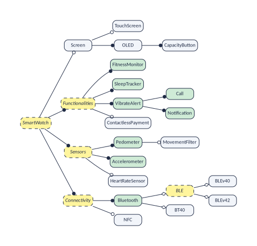

`vp_features()` gives every feature with its status; the core features are also in the file `__core.txt`:


``` r
vp_features(band) |> count(status)
#> # A tibble: 2 x 2
#>   status       n
#>   <chr>    <int>
#> 1 core         8
#> 2 variable    11
show_file("core.txt")
#> 0 "FitnessMonitor"
#> 0 "SleepTracker"
#> 0 "VibrateAlert"
#> 0 "Call"
#> 0 "Notification"
#> 0 "Pedometer"
#> 0 "Accelerometer"
#> 0 "Bluetooth"
```

They are no surprise: the concrete features that hang from the root through mandatory links only (the root and the
headings on the way are abstract, so they are not listed). In the file, each line has a number and a name. The number
is the position of the feature in the graphs, and it is 0 because core features are not drawn in the graphs: they are
in every band, so every feature "requires" them, and drawing that would only add noise
([Showing core features and abstract ones](#sec:fixed) shows how to draw them anyway).

The file of dead features is empty, which is good news:


``` r
show_file("dead.txt")
```

::: {.vp-box .vp-plainwords}
More than half of this model is not a choice at all, and variplex asks only about the rest. In a formula made by
another tool it also skips the helper variables of the translation, and there the saving is large: the formula of
Linux 3.13 has 23,838 variables, and variplex asks only 7,100 questions
([Formulas made by other tools](#sec:others)).
:::

# The requires graph: "if I take this, I also get that" {#sec:requires}

In R, the requires graph is a tibble with one row per arrow: `from` requires `to`.


``` r
vp_links(band, "requires")
#> # A tibble: 21 x 2
#>    from               to            
#>    <chr>              <chr>         
#>  1 Screen             OLED          
#>  2 Screen             CapacityButton
#>  3 TouchScreen        Screen        
#>  4 TouchScreen        OLED          
#>  5 TouchScreen        CapacityButton
#>  6 OLED               Screen        
#>  7 OLED               CapacityButton
#>  8 CapacityButton     Screen        
#>  9 CapacityButton     OLED          
#> 10 ContactlessPayment NFC           
#> # i 11 more rows
```

The file `__requires.net` holds the same graph, as text:


``` r
show_file("requires.net")
#> *Vertices 11
#> 1 "Screen"
#> 2 "TouchScreen"
#> 3 "OLED"
#> 4 "CapacityButton"
#> 5 "ContactlessPayment"
#> 6 "MovementFilter"
#> 7 "HeartRateSensor"
#> 8 "BLEv40"
#> 9 "BLEv42"
#> 10 "BT40"
#> 11 "NFC"
#> *Arcs
#> 1 3
#> 1 4
#> 2 1
#> 2 3
#> 2 4
#> 3 1
#> 3 4
#> 4 1
#> 4 3
#> 5 11
#> 6 1
#> 6 3
#> 6 4
#> 6 8
#> 8 1
#> 8 3
#> 8 4
#> 9 1
#> 9 3
#> 9 4
#> 9 7
```

It has two parts.

- After `*Vertices 11` come the 11 features that can vary, numbered from 1.
- After `*Arcs` come the relationships, one per line, as two numbers. The line `2 1` means: *feature 2 requires
  feature 1*, that is, *TouchScreen* requires *Screen*.

This format is called **Pajek**, and programs for network analysis read it directly
([Using the results in other programs](#sec:elsewhere)). The figure is the same graph as a drawing.

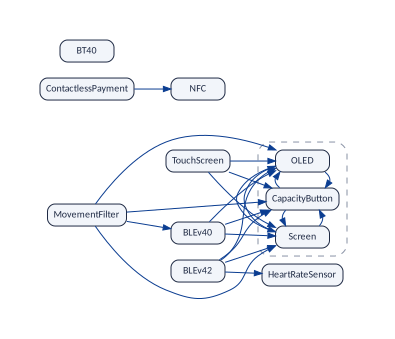

## Why so many arrows?

The model has only a handful of constraints, yet the graph has 21 arrows. The reason is that the graph is
**complete**: it holds every "requires" that is true, not only those that somebody wrote. Three examples:

- *TouchScreen* → *Screen* is written in the model: a child needs its parent.
- *MovementFilter* → *Screen* is written nowhere. It follows from a chain: the movement filter needs BLE version 4.0
  (constraint 1), which is a kind of BLE, and a band with BLE does not use classic Bluetooth, so it has a screen
  (constraint 4).
- *BLEv42* → *HeartRateSensor* is also written nowhere. A band with BLE version 4.2 has BLE, so it has a heart-rate
  sensor or a movement filter (constraint 2). But the movement filter needs version 4.0 (constraint 1), and a band has
  only one version. So it must be the heart-rate sensor.

::: {.vp-box .vp-plainwords}
You do not have to follow chains like these. That is the job of variplex. You read the answer: if the arrow is in the
graph, the relationship holds in every valid band; if it is not, there is at least one valid band where it fails.
:::

::: {.vp-box .vp-tryit}
**Try it**

What do you get "for free" when you choose *BLEv42*?


``` r
vp_requirements(band, "BLEv42")
#> # A tibble: 4 x 1
#>   feature        
#>   <chr>          
#> 1 Screen         
#> 2 OLED           
#> 3 CapacityButton 
#> 4 HeartRateSensor
```

Screen, OLED, CapacityButton and HeartRateSensor (and BLE, an abstract feature, which the graphs leave out).
:::

# The excludes graph: "these two never go together" {#sec:excludes}


``` r
vp_links(band, "excludes")
#> # A tibble: 10 x 2
#>    from           to             
#>    <chr>          <chr>          
#>  1 Screen         BT40           
#>  2 TouchScreen    BT40           
#>  3 OLED           BT40           
#>  4 CapacityButton BT40           
#>  5 MovementFilter HeartRateSensor
#>  6 MovementFilter BLEv42         
#>  7 MovementFilter BT40           
#>  8 BLEv40         BLEv42         
#>  9 BLEv40         BT40           
#> 10 BLEv42         BT40
```

The row *MovementFilter*, *HeartRateSensor* means that the two are never in the same band. A conflict has no
direction (if A excludes B, then B excludes A), so each pair is listed once. In the file `__excludes.net` the same
features are followed by `*Edges`, each pair written with the smaller number first; a link without a direction is
called an **edge** instead of an arc:


``` r
show_file("excludes.net")
#> *Vertices 11
#> 1 "Screen"
#> 2 "TouchScreen"
#> 3 "OLED"
#> 4 "CapacityButton"
#> 5 "ContactlessPayment"
#> 6 "MovementFilter"
#> 7 "HeartRateSensor"
#> 8 "BLEv40"
#> 9 "BLEv42"
#> 10 "BT40"
#> 11 "NFC"
#> *Edges
#> 1 10
#> 2 10
#> 3 10
#> 4 10
#> 6 7
#> 6 9
#> 6 10
#> 8 9
#> 8 10
#> 9 10
```

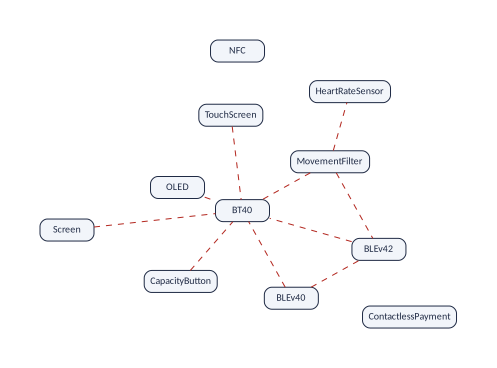

Again, most of these conflicts are consequences. The model says that *BT40* bands have no screen (constraint 5).
variplex adds that they cannot have a touch screen, an OLED panel, a capacity button, a movement filter or any version
of BLE either, because each of those needs a screen, directly or through a chain.

::: {.vp-box .vp-goodtoknow}
*HeartRateSensor*, *NFC* and *ContactlessPayment* are in few or no conflicts. Features like these are easy to add to a
band. We come back to this idea with the *kernel* ([The kernel: "can these go together?"](#sec:kernel)).
:::

# The at-least-one graph: "one of the two, at least" {#sec:third}

The first two graphs say what happens when you *take* a feature. A third graph says what happens when you *leave one
out*. It costs a second question per feature, so it is made only when you ask for it, with `or_graph = TRUE` (as the
run at the top of this vignette did). An edge between A and B means: *no valid band lacks both*.


``` r
vp_links(band, "atleastone")
#> # A tibble: 3 x 2
#>   from           to   
#>   <chr>          <chr>
#> 1 Screen         BT40 
#> 2 OLED           BT40 
#> 3 CapacityButton BT40
```

There are 3 such edges, all with *BT40*: a band has classic Bluetooth, or it has a screen (and with it
the other features of its atomic set, [Atomic sets](#sec:atomic)).

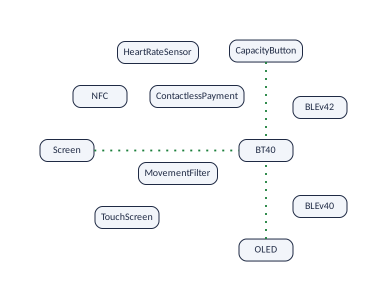

## Why BLEv40 and BLEv42 are not joined {#sec:noble}

In the model, *BLEv40* and *BLEv42* are the two alternatives of *BLE*, and an alternative group means "exactly one".
So why does no edge join them? Because the edge would say more than that: that *every* band has one of the two. And
*BLE* is itself one of two alternatives. *Bluetooth* is mandatory and is either *BLE* or *BT40*, and two constraints,
`!Screen => BT40` and `BT40 => !Screen`, give *BT40* to exactly the bands without a screen. Such a band has no *BLE*,
and so neither *BLEv40* nor *BLEv42*. Of the 24 valid bands, 18 have *BLE*, and
each of them has exactly one of the two versions; the other 6 have neither, and all of them are
bands without a screen, with *BT40*.

variplex can show it too. Add "neither version" to the model as a constraint, one line more at its end, and run it.
The model is still valid (a model that no band satisfies would be an error), and in the bands that are left, *BT40* is
core while the screen and both versions are dead (and so is *BLE*, which is not listed, being abstract):


``` r
tail(readLines(vp_example("miband3_no_ble.uvl")), 1)
#> [1] "\t!BLEv40 & !BLEv42"
no_ble <- vp_generate(vp_example("miband3_no_ble.uvl"))
vp_features(no_ble) |> filter(status != "variable" | feature == "BT40")
#> # A tibble: 16 x 2
#>    feature        status
#>    <chr>          <chr> 
#>  1 FitnessMonitor core  
#>  2 SleepTracker   core  
#>  3 VibrateAlert   core  
#>  4 Call           core  
#>  5 Notification   core  
#>  6 Pedometer      core  
#>  7 Accelerometer  core  
#>  8 Bluetooth      core  
#>  9 BT40           core  
#> 10 Screen         dead  
#> 11 TouchScreen    dead  
#> 12 OLED           dead  
#> 13 CapacityButton dead  
#> 14 MovementFilter dead  
#> 15 BLEv40         dead  
#> 16 BLEv42         dead
```

So what the model says about the two versions is conditional: *if* a band has *BLE*, it has *BLEv40* or *BLEv42*.
That is a rule about three features, *BLE* → *BLEv40* or *BLEv42*, and a graph joins two features at a time, so the
rule has no edge of its own. The three graphs show what it means for pairs of the features they keep. *BLE* is
abstract, so it is not one of them, but a band has *BLE* exactly when it has a screen ([Atomic sets](#sec:atomic)),
and the screen speaks for it. Both versions require *Screen*, and they exclude each other. One level up, where the
parent is mandatory, the alternative does become an edge: every band has *Bluetooth*, so every band has *BLE* or
*BT40*, that is, a screen or *BT40*: the edge between *Screen* and *BT40*. What pairs cannot say is the subject of
[Limits and theory](limits-theory.html).

## Everything about a pair

With the three graphs you know everything the model says about any two features. For two features A and B there are
four cases: both, only A, only B, neither. Each graph rules out one case, and `vp_pair()` puts them together:


``` r
vp_pair(band, "TouchScreen", "Screen")
#> # A tibble: 4 x 5
#>   combination      a     b     possible ruled_out_by                 
#>   <chr>            <lgl> <lgl> <lgl>    <chr>                        
#> 1 both             TRUE  TRUE  TRUE     ""                           
#> 2 only TouchScreen TRUE  FALSE FALSE    "TouchScreen requires Screen"
#> 3 only Screen      FALSE TRUE  TRUE     ""                           
#> 4 neither          FALSE FALSE TRUE     ""
vp_pair(band, "Screen", "BT40")
#> # A tibble: 4 x 5
#>   combination a     b     possible ruled_out_by                      
#>   <chr>       <lgl> <lgl> <lgl>    <chr>                             
#> 1 both        TRUE  TRUE  FALSE    "Screen excludes BT40"            
#> 2 only Screen TRUE  FALSE TRUE     ""                                
#> 3 only BT40   FALSE TRUE  TRUE     ""                                
#> 4 neither     FALSE FALSE FALSE    "every product has Screen or BT40"
vp_pair(band, "BLEv40", "BLEv42")
#> # A tibble: 4 x 5
#>   combination a     b     possible ruled_out_by            
#>   <chr>       <lgl> <lgl> <lgl>    <chr>                   
#> 1 both        TRUE  TRUE  FALSE    "BLEv40 excludes BLEv42"
#> 2 only BLEv40 TRUE  FALSE TRUE     ""                      
#> 3 only BLEv42 FALSE TRUE  TRUE     ""                      
#> 4 neither     FALSE FALSE TRUE     ""
```

- *TouchScreen* and *Screen*: "only A" never happens. That is *TouchScreen requires Screen*.
- *Screen* and *BT40*: never both (a conflict) and never neither (an "at least one" edge). Every band has exactly one
  of them.
- *BLEv40* and *BLEv42*: never both (a conflict), but neither does happen, in the bands without *BLE*
  ([Why BLEv40 and BLEv42 are not joined](#sec:noble)). So no at-least-one edge joins them.
- *NFC* and *HeartRateSensor* (try it): everything happens. They are independent, and no graph joins them.
- *Screen* and *OLED*: both or neither. They are in the same atomic set.

::: {.vp-box .vp-careful}
The at-least-one graph costs time: variplex asks two questions per feature instead of one (here 22
instead of 11). For big models the run takes about twice as long. That is why you have to ask for it.
:::

# Atomic sets: features that always travel together {#sec:atomic}

Look again at the dashed box of the requires graph. *Screen* requires *OLED*, and *OLED* requires *Screen*. When two
features require each other, a band has both or neither: for the purpose of choosing, they are one single decision. A
group like this is an **atomic set** [Benavides et al. (2010)](#ref-Benavides10); [Heß and Molt (2025)](#ref-Hess25):


``` r
vp_atomic_sets(band)
#> # A tibble: 3 x 3
#>     set feature        representative
#>   <int> <chr>          <chr>         
#> 1     1 Screen         Screen        
#> 2     1 OLED           Screen        
#> 3     1 CapacityButton Screen
show_file("atomic.txt")
#> Screen	OLED	CapacityButton
```

There is 1 atomic set, with 3 features. The file `__atomic.txt` lists the sets, one per
line. The members are expected: *OLED* is a mandatory child of *Screen*, and *CapacityButton* a mandatory child of
*OLED*. The set has one more member, which the graphs leave out because it is abstract, *BLE*, and that one is a
discovery:

**A band has a screen exactly when it uses Bluetooth Low Energy.**

Nobody wrote that. It follows from constraints 4 and 5 (no screen means classic Bluetooth, and classic Bluetooth means
no screen) together with the fact that every band has exactly one kind of Bluetooth. With `abstract = "keep"`
([Showing core features and abstract ones](#sec:fixed)), *BLE* is in the atomic set too.

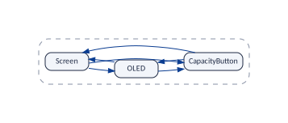

::: {.vp-box .vp-plainwords}
An atomic set is a group of features that behave as one. Find them and your model has fewer real decisions than it
seems.
:::

# The minimal form: the graphs without repetitions {#sec:minimal}

The complete graphs are exact, but they repeat themselves. *MovementFilter* points to *BLEv40* and *BLEv40* points to
*Screen*; the arrow from *MovementFilter* to *Screen* adds nothing new. The figure shows in grey every arrow that
follows from others.

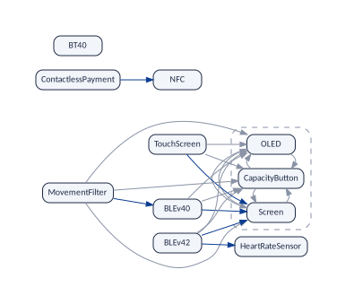

`vp_generate()` writes the essential part of each graph in a file of its own, and `vp_minimal()` computes it from any
model. Together with the atomic sets they are the **minimal form**:

| | |
|:--|:--|
| `__requires_skeleton.net`, `vp_skeleton()` | The **skeleton**: the arrows that do not follow from a chain of other arrows (the *transitive reduction* of the graph [Aho et al. (1972)](#ref-Aho72)). Each atomic set appears once, under the name of its representative. |
| `__excludes_primitive.net`, `vp_primitive_conflicts()` | The **primitive conflicts**: the conflicts that a feature has by itself, not because it requires something that has the conflict. |
| `__atleastone_primitive.net`, `vp_primitive_atleastone()` | The "at least one" edges that do not follow from others (with `or_graph = TRUE`; here 1 of the 3). |


``` r
band_min <- vp_minimal(band)
band_min
#> variplex model "miband3_realized"
#>   features: 9 variable (the nodes of the graphs), 8 core, 0 dead
#>   requires: 6 arrows   excludes: 3 lines
#>   at least one: 1 lines
#>   minimal form: skeleton, primitive conflicts and primitive at-least-one lines;
#>   each atomic set is one node (1 sets)
vp_links(band_min, "requires")
#> # A tibble: 6 x 2
#>   from               to             
#>   <chr>              <chr>          
#> 1 TouchScreen        Screen         
#> 2 ContactlessPayment NFC            
#> 3 MovementFilter     BLEv40         
#> 4 BLEv40             Screen         
#> 5 BLEv42             Screen         
#> 6 BLEv42             HeartRateSensor
vp_links(band_min, "excludes")
#> # A tibble: 3 x 2
#>   from           to             
#>   <chr>          <chr>          
#> 1 Screen         BT40           
#> 2 MovementFilter HeartRateSensor
#> 3 BLEv40         BLEv42
```

From 21 arrows to 6, and from 10 conflicts to 3. The
figure draws them together (`vp_plot(band_min)` makes the same drawing), and it is the clearest picture of the model:
3 conflicts and 6 dependencies explain everything.

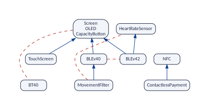

## How to read the minimal form

- **Requires**: follow the arrows upwards. *MovementFilter* reaches *BLEv40* and then the box, so it requires
  *BLEv40*, *Screen*, *OLED* and *CapacityButton*.
- **Excludes**: a red line also applies to everything below its ends. *BT40* conflicts with the box, so it conflicts
  with whatever points to the box: *TouchScreen*, *BLEv40*, *BLEv42* and *MovementFilter*.
- **At least one**: a green line also applies to everything above its ends. If every band has A or B, and A requires
  C, then every band has C or B.

The figure puts the minimal form of the three graphs in one drawing.


## Nothing is lost: `vp_expand()`

The minimal form is not an approximation. `vp_expand()` rebuilds the complete graphs from it, and `vp_read()` reads
the minimal form that `vp_generate()` wrote:


``` r
written <- vp_read("out/miband3_realized", form = "minimal")
rebuilt <- vp_expand(written)
identical(rebuilt$requires, band$requires)
#> [1] TRUE
identical(rebuilt$excludes, band$excludes)
#> [1] TRUE
identical(rebuilt$atleastone, band$atleastone)
#> [1] TRUE
```

::: {.vp-box .vp-plainwords}
Keep the minimal form to look at and to draw. Keep the complete graphs to compute with. They say the same.
:::

::: {.vp-box .vp-goodtoknow}
For this small model the saving is modest. For the Linux kernel (version 3.13) the complete graphs have 145,685 links
and the minimal form 11,981.
:::

# The kernel: "can these go together?" {#sec:kernel}

## The question

Suppose you make these bands. Customers, or your marketing department, come to you with **wish lists**:

- "a band with a touch screen, a heart-rate sensor and NFC";
- "a band with a movement filter and Bluetooth 4.2";
- "a band with a touch screen and classic Bluetooth".

In the language of software product lines, a wish list is a **partial configuration**
[Czarnecki et al. (2005)](#ref-Czarnecki05); [Benavides et al. (2010)](#ref-Benavides10): a configuration in which
some features have been decided and the others are still open (a wish list decides only features that a product must
have; a partial configuration can also say which ones it must not have). Which of them can be built? A wish list can
be built when at least one valid configuration has all its features. The Mi Band 3 has 11 features that
can vary, so there are 2,048 different wish lists, and only 520 of them can be built.
Checking them one by one against the 24 valid configurations is tedious; for Linux, whose
configurations cannot even be counted, it is impossible.

The graphs of the previous sections already hold the answer: a wish list can be built exactly when no two of its
features exclude each other, directly or through what they bring along (with one limit,
[Limits and theory](limits-theory.html)). `vp_can_go_together()` checks it:


``` r
vp_can_go_together(
  band,
  list(
    c("TouchScreen", "HeartRateSensor", "NFC"),
    c("MovementFilter", "BLEv42"),
    c("TouchScreen", "BT40")
  )
)
#> # A tibble: 3 x 3
#>   wish                              possible reasons                                                
#>   <chr>                             <lgl>    <chr>                                                  
#> 1 TouchScreen, HeartRateSensor, NFC TRUE     ""                                                     
#> 2 MovementFilter, BLEv42            FALSE    "MovementFilter excludes BLEv42 (which brings HeartRat~
#> 3 TouchScreen, BT40                 FALSE    "TouchScreen (which brings Screen) excludes BT40"
```

But the graphs hold much more than this question needs: for Linux 3.13, 7,100 configuration options and
145,685 links. The **kernel** is a much smaller map that keeps only what this one question needs. It adapts
the co-installability kernels of software packages [Vouillon and Di Cosmo (2013)](#ref-Vouillon13).

::: {.vp-box .vp-plainwords}
The kernel is a map made for one question: "can these features be in the same product?". It keeps the features that
can make the answer "no", with the links between them, and puts all the other features into a single box.
:::

## How the kernel is made

Three simplifications turn the graphs into the kernel. Follow them on the figure, which paints every feature with the
colour of the box it will end up in.

**1. Features that always go together count as one.** The 3 features of the atomic set (*Screen*,
*OLED* and *CapacityButton*) are always selected together, so for any wish list they stand or fall together. They
become one box, *A* (blue).

**2. Features that can never cause trouble are set aside.** A feature is **trouble-free** when it excludes no other
feature, neither by itself nor through the features it brings along. *NFC* is trouble-free: it excludes nothing.
*ContactlessPayment* brings *NFC* along, and excludes nothing either. Adding them to a wish list can never make it
impossible, so for this question they can be forgotten. All the trouble-free features go into one single box, the
class **"can always be added"**, *C* (green).

Having no red line of your own is not enough to be trouble-free. *TouchScreen* excludes nothing by itself, but it
brings *Screen* along, and *Screen* excludes *BT40*: a band with a touch screen can never use classic Bluetooth. So
*TouchScreen* can cause trouble, and it keeps a box of its own, *B* (orange). So do the other five features that can
cause trouble, each with its own colour.

**3. Between the boxes, only two kinds of line are kept**: the arrows that say which box brings which along, and the
red lines of the *root* conflicts, the primitive conflicts of [the minimal form](#sec:minimal), from which every other
conflict follows.

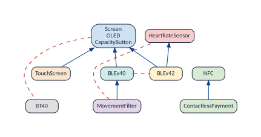

Each box is called a **class**. `vp_kernel()` lists the classes and `vp_kernel_links()` the links between them:


``` r
vp_kernel(band)
#> # A tibble: 11 x 4
#>    class label              feature            trouble_free
#>    <int> <chr>              <chr>              <lgl>       
#>  1     1 Screen             Screen             FALSE       
#>  2     1 Screen             OLED               FALSE       
#>  3     1 Screen             CapacityButton     FALSE       
#>  4     2 TouchScreen        TouchScreen        FALSE       
#>  5     3 ContactlessPayment ContactlessPayment TRUE        
#>  6     3 ContactlessPayment NFC                TRUE        
#>  7     4 MovementFilter     MovementFilter     FALSE       
#>  8     5 HeartRateSensor    HeartRateSensor    FALSE       
#>  9     6 BLEv40             BLEv40             FALSE       
#> 10     7 BLEv42             BLEv42             FALSE       
#> 11     8 BT40               BT40               FALSE
vp_kernel_links(band)
#> # A tibble: 9 x 3
#>   from           link     to             
#>   <chr>          <chr>    <chr>          
#> 1 TouchScreen    requires Screen         
#> 2 MovementFilter requires Screen         
#> 3 MovementFilter requires BLEv40         
#> 4 BLEv40         requires Screen         
#> 5 BLEv42         requires Screen         
#> 6 BLEv42         requires HeartRateSensor
#> 7 Screen         excludes BT40           
#> 8 MovementFilter excludes HeartRateSensor
#> 9 BLEv40         excludes BLEv42
```

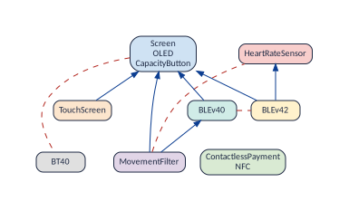

The 11 features, 21 arrows and 10 conflicts of the graphs became 8
boxes, 6 arrows and 3 red lines. Three red lines are enough because every conflict
of the band comes from one of three root conflicts: a screen against classic Bluetooth (*A*--*H*), the movement filter
against the heart-rate sensor (*D*--*E*), and the two versions of BLE against each other (*F*--*G*). The arrows carry
them to other features: *D* (*MovementFilter*) points to *F* (*BLEv40*), which conflicts with *G* (*BLEv42*), so the
movement filter conflicts with *BLEv42* too.

## Reading the kernel

| **What you see** | **Where it is** | **What it means** |
|:--|:--|:--|
| a box | a class of `vp_kernel()`; a line of `__kernel_classes.txt` | one or more features that count as one when you ask "can these go together?" |
| the green box | the class with `trouble_free` `TRUE` | features that can be added to any wish list |
| an arrow A → B | a `requires` row of `vp_kernel_links()`; `__kernel_requires.net` | every product with A has B too: A brings B along, and with it the conflicts of B |
| a red line A --- B | an `excludes` row of `vp_kernel_links()`; `__kernel_excludes.net` | a root conflict: no product has A and B together |

And this is the whole recipe for the question:

::: {.vp-box .vp-inside}
To know whether a wish list can be built:

1. replace each feature by its box, and forget the green box;
2. add every box that your boxes point to (the arrows already include whatever a box brings along indirectly, so one
   step is enough);
3. look at the red lines: if one of them joins two of your boxes, the wish list **cannot be built**, and that red line
   says why; if none does, **it can**.
:::

## Three wish lists

**"A touch screen, a heart-rate sensor and NFC."** *TouchScreen* is in box *B*, *HeartRateSensor* in *E*, *NFC* in
the green box *C*, which we forget. *B* points to *A*: a touch screen brings the screen along. The boxes are *B*, *E*
and *A*, and no red line joins two of them. **It can be built.**


**"A movement filter and Bluetooth 4.2."** *D* points to *A* and *F*; *G* points to *A* and *E*. Among *D*, *G*, *A*,
*F* and *E* there are two red lines. *D*--*E*: the movement filter excludes the heart-rate sensor, which Bluetooth 4.2
needs. *F*--*G*: the movement filter needs BLE version 4.0, and a band has only one version. **It cannot be built**,
for two reasons.

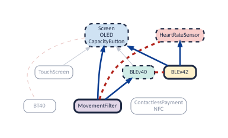

**"A touch screen and classic Bluetooth."** *B* points to *A*, and a red line joins *A* and *H*. **It cannot be
built**: a touch screen needs a screen, and a band with classic Bluetooth has none.

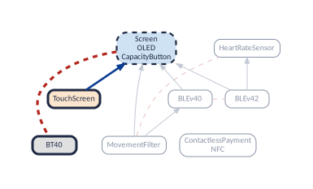

::: {.vp-box .vp-goodtoknow}
This recipe was checked against the 24 valid configurations of the band, for all 2,048
wish lists: the kernel gives the right answer every time (520 can be built, 1,528
cannot).
:::

## What the kernel is good for

1. **Answering "can these go together?" with a small map.** A configurator, a sales tool or a planning spreadsheet can
   keep the kernel instead of the whole graphs and check any wish list in the three steps above. For the Mi Band the
   saving is small. For Linux 3.13 the kernel has 1,205 classes, 3,393 arrows and
   578 red lines, instead of 7,100 options and 145,685 links.
2. **Knowing which features are free extras.** The green class lists the features that can be offered with any
   product, whatever else is chosen. In Linux 3.13 it holds 5,733 of the 7,100 configuration
   options that can vary (81 %): only 1,367 options, in 1,204
   classes, can ever make a selection impossible.
3. **Knowing where the trouble comes from.** The red lines are the root conflicts, and the arrows show how they
   spread. In the Mi Band, 3 root conflicts explain all 10 conflicts of the excludes
   graph.
4. **Measuring how entangled a product line is, and what a change did to it.** The planned version of the Mi Band 3
   ([Comparing versions](#sec:diff)) has only one cross-tree constraint. Its kernel has 4
   classes, and its green class holds 8 features:


``` r
planned <- vp_generate(
  vp_example("miband3_planned.uvl"),
  or_graph = TRUE,
  kernel = TRUE
)
vp_kernel(planned) |> filter(trouble_free)
#> # A tibble: 8 x 4
#>   class label  feature            trouble_free
#>   <int> <chr>  <chr>              <lgl>       
#> 1     1 Screen Screen             TRUE        
#> 2     1 Screen OLED               TRUE        
#> 3     1 Screen CapacityButton     TRUE        
#> 4     1 Screen TouchScreen        TRUE        
#> 5     1 Screen ContactlessPayment TRUE        
#> 6     1 Screen MovementFilter     TRUE        
#> 7     1 Screen HeartRateSensor    TRUE        
#> 8     1 Screen NFC                TRUE
```

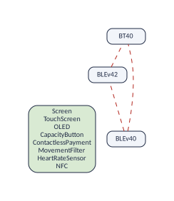

The four cross-tree constraints added in the realized band made 6 of these features able to cause
trouble. A kernel that grows means features that interact more; a green class that shrinks means fewer free extras.

## The three files

With `kernel = TRUE`, `vp_generate()` also writes the kernel. The first file lists the classes, one per line; the
other two are graphs like those of the previous sections, but their dots are the classes, not the features (vertex 1
is the first class, and so on; each class is named after its first member):


``` r
show_file("kernel_classes.txt")
#> Screen	OLED	CapacityButton
#> TouchScreen
#> ContactlessPayment	NFC
#> MovementFilter
#> HeartRateSensor
#> BLEv40
#> BLEv42
#> BT40
show_file("kernel_requires.net")
#> *Vertices 8
#> 1 "Screen"
#> 2 "TouchScreen"
#> 3 "ContactlessPayment"
#> 4 "MovementFilter"
#> 5 "HeartRateSensor"
#> 6 "BLEv40"
#> 7 "BLEv42"
#> 8 "BT40"
#> *Arcs
#> 2 1
#> 4 1
#> 4 6
#> 6 1
#> 7 1
#> 7 5
show_file("kernel_excludes.net")
#> *Vertices 8
#> 1 "Screen"
#> 2 "TouchScreen"
#> 3 "ContactlessPayment"
#> 4 "MovementFilter"
#> 5 "HeartRateSensor"
#> 6 "BLEv40"
#> 7 "BLEv42"
#> 8 "BT40"
#> *Edges
#> 1 8
#> 4 5
#> 6 7
```

## What the kernel is not {#sec:kernellimit}

**A class is not an atomic set.** The members of an atomic set, like the 3 features of box *A*, are
always *selected* together. The members of a class merely *behave alike* for this question: the two features of the
green box share a class, yet a band can have *NFC* without *ContactlessPayment*.

**Only rules about two features.** The kernel, like the graphs, is built from relationships between *two* features,
and a rule that ties three or more features at once is invisible to it. So a "no" of the kernel is always right, but a
"yes" can be wrong. [Limits and theory](limits-theory.html) shows when, how often, and how to be sure.

The kernel also only deals with features that you *want*; what follows from leaving a feature out is the business of
the at-least-one graph, which the kernel does not use (`vp_partial_configuration()` and `vp_consequences()` use it).

::: {.vp-box .vp-goodtoknow}
**For the curious: the recipe of the program.** It starts from the graph in which each atomic set is one node, and
from the root conflicts. It deletes every arrow that points to a node that excludes nothing; gives each node the set of
nodes it still requires, itself included if it excludes something; and merges the nodes that have the same set. The
trouble-free nodes all get the empty set, which is why they end up in one class.
:::

# The two reports: what was decided, and how the run went {#sec:reports}

Every run writes two files that describe the run itself. A model read by `vp_read()` or returned by `vp_generate()`
holds both: `band$variables` and `band$summary`.

## What was decided about each feature: `__variables.csv`

This file has one line per variable of the formula. It opens in any spreadsheet, and in R it is a tibble:


``` r
print(band$variables, n = Inf)
#> # A tibble: 24 x 8
#>    dimacs_var name               output_name        node_id class    status   decision rule 
#>         <int> <chr>              <chr>                <int> <chr>    <chr>    <chr>    <chr>
#>  1          1 SmartWatch         <NA>                    NA ABSTRACT core     dropped  U4   
#>  2          2 Screen             Screen                   1 OPTION   variable kept     U5   
#>  3          3 TouchScreen        TouchScreen              2 OPTION   variable kept     U5   
#>  4          4 OLED               OLED                     3 OPTION   variable kept     U5   
#>  5          5 CapacityButton     CapacityButton           4 OPTION   variable kept     U5   
#>  6          6 Functionalities    <NA>                    NA ABSTRACT core     dropped  U4   
#>  7          7 FitnessMonitor     FitnessMonitor          NA OPTION   core     kept     U5   
#>  8          8 SleepTracker       SleepTracker            NA OPTION   core     kept     U5   
#>  9          9 VibrateAlert       VibrateAlert            NA OPTION   core     kept     U5   
#> 10         10 Call               Call                    NA OPTION   core     kept     U5   
#> 11         11 Notification       Notification            NA OPTION   core     kept     U5   
#> 12         12 ContactlessPayment ContactlessPayment       5 OPTION   variable kept     U5   
#> 13         13 Sensors            <NA>                    NA ABSTRACT core     dropped  U4   
#> 14         14 Pedometer          Pedometer               NA OPTION   core     kept     U5   
#> 15         15 MovementFilter     MovementFilter           6 OPTION   variable kept     U5   
#> 16         16 Accelerometer      Accelerometer           NA OPTION   core     kept     U5   
#> 17         17 HeartRateSensor    HeartRateSensor          7 OPTION   variable kept     U5   
#> 18         18 Connectivity       <NA>                    NA ABSTRACT core     dropped  U4   
#> 19         19 Bluetooth          Bluetooth               NA OPTION   core     kept     U5   
#> 20         20 BLE                <NA>                    NA ABSTRACT variable dropped  U4   
#> 21         21 BLEv40             BLEv40                   8 OPTION   variable kept     U5   
#> 22         22 BLEv42             BLEv42                   9 OPTION   variable kept     U5   
#> 23         23 BT40               BT40                    10 OPTION   variable kept     U5   
#> 24         24 NFC                NFC                     11 OPTION   variable kept     U5
```

| **Column** | **Meaning** |
|:--|:--|
| `dimacs_var` | The number of the variable in the formula. |
| `name` | Its name in the model. |
| `output_name` | Its name in the graphs and lists. In this model it is always the same as `name`; the example below shows when it differs. Empty if the variable is not kept. |
| `node_id` | Its number in the graphs. Empty if it is not a dot of the graphs: here, the core features and the abstract ones, which are dropped. |
| `class` | **What it is.** Here `OPTION` (an ordinary feature; remember that the engine says *option*) or `ABSTRACT` (an abstract feature, the root included). A root that is not abstract is `ROOT`. |
| `status` | **How it behaves**: `core`, `dead` or `variable`. |
| `decision` | **What was done with it**: `kept`, `dropped` or `merged_into:` another. Here the abstract features are dropped and all the others are kept. |
| `rule` | **Why**: the name of the rule that decided. Here `U4` or `U5`: see the table below. |

**The rules of a UVL model.** Each kind of formula has its own set of rules ([Formulas made by other tools](#sec:others)).
For a formula translated from UVL by variplex itself there are five, and they are simple, because the translator
marks in the formula, with special comments, which variable is the root, which features are abstract, and which
variables are helpers that it added ([Looking at the formula](#sec:dimacs) shows these comments):

| **Rule** | **It applies to** | **`class`** | **`decision`** | **In the Mi Band 3** |
|:--|:--|:--|:--|:--|
| `U1` | a helper variable of the Tseitin transformation (`tseitin = TRUE`), marked `c aux N tseitin` | `TSEITIN` | dropped | none; 10 with `tseitin = TRUE` |
| `U2` | a helper variable that splits a long clause, marked `c aux N chain` (written by older versions of the translator) | `CHAIN` | dropped | none |
| `U3` | the root of the feature tree, marked `c root N`, if it is not abstract | `ROOT` | kept (it is core) | none: the root, *SmartWatch*, is abstract |
| `U4` | a feature marked `{abstract}`, marked `c abstract N`; the root too, if it is abstract | `ABSTRACT` | dropped (`abstract = "keep"` keeps them, `abstract = "merge"` merges them) | 5: *SmartWatch, Functionalities, Sensors, Connectivity, BLE* |
| `U5` | every other feature | `OPTION` | kept | the other 19 |

So, in the report above, the abstract features, the root *SmartWatch* among them, are dropped by `U4`, and every other
feature is kept by `U5`. With `tseitin = TRUE` the formula also has helper variables, and their rows say that `U1`
dropped them:


``` r
tseitin <- vp_generate(vp_example("miband3_realized.uvl"), tseitin = TRUE)
tseitin$variables |> filter(rule == "U1") |> head(3)
#> # A tibble: 3 x 8
#>   dimacs_var name  output_name node_id class   status   decision rule 
#>        <int> <chr> <chr>         <int> <chr>   <chr>    <chr>    <chr>
#> 1         25 <NA>  <NA>             NA TSEITIN variable dropped  U1   
#> 2         26 <NA>  <NA>             NA TSEITIN variable dropped  U1   
#> 3         27 <NA>  <NA>             NA TSEITIN core     dropped  U1
```

**An example of `output_name`.** In a UVL model, a feature keeps its name. Formulas made by other tools sometimes
write the names of the options with a prefix that is not part of the name. KconfigSampler, for instance, puts the type
of each option in front of it: the option `CONFIG_PLATFORM_WIN32` of the library axTLS is the variable
`boolean_CONFIG_PLATFORM_WIN32` of its formula, and variplex shows it under its real name. Three rows of the report of
that formula (from the dataset of Strong4VM):

```
dimacs_var,name,output_name,node_id,class,status,decision,rule
2,boolean_CONFIG_PLATFORM_WIN32,CONFIG_PLATFORM_WIN32,1,OPTION,variable,kept,S2
10,int_CONFIG_X509_MAX_CA_CERTS_EQ_3,,,VALUE,variable,dropped,S5
14,ART_1,,,TSEITIN,variable,dropped,S1
```

The first row is the option: `name` is the variable of the formula, `output_name` the name in the graphs. The other
two are helper variables of the translation (the value 3 of a number option, and a Tseitin variable), which are
dropped, so their `output_name` is empty.

For a UVL model this report is simple: every feature is kept but the abstract ones. It becomes essential for formulas
produced by other tools, which are full of variables that are not features ([Formulas made by other tools](#sec:others)).
There, this report is where you check that variplex kept the right ones. `vp_classify()` writes it without computing
any graph, which is fast even for Linux.

::: {.vp-box .vp-tryit}
**Try it**

Is a feature missing from a graph? Look at its row. If `status` is `core` or `dead`, it is in the corresponding list
instead. If `decision` is `dropped`, the column `rule` tells which rule dropped it.
:::

## A summary of the run: `__summary.json`

The second report is a JSON file, a format that people can read and programs can load. It records how the run was
made and what it found; in R it is a list:


``` r
names(band$summary)
#>  [1] "strong4vm_version" "command_line"      "void"              "options"          
#>  [5] "input"             "counts"            "kernel"            "mig"              
#>  [9] "uvl"               "checks"            "warnings"          "timings"
str(band$summary$counts)
#> List of 31
#>  $ variables_by_class     :List of 2
#>   ..$ ABSTRACT: int 5
#>   ..$ OPTION  : int 19
#>  $ by_rule                :List of 2
#>   ..$ U4:List of 3
#>   .. ..$ kept   : int 0
#>   .. ..$ dropped: int 5
#>   .. ..$ merged : int 0
#>   ..$ U5:List of 3
#>   .. ..$ kept   : int 19
#>   .. ..$ dropped: int 0
#>   .. ..$ merged : int 0
#>  $ formula_variables      : int 24
#>  $ fresh_variables        : int 0
#>  $ kept                   : int 19
#>  $ dropped                : int 5
#>  $ merged                 : int 0
#>  $ core                   : int 8
#>  $ dead                   : int 0
#>  $ variable_options       : int 11
#>  $ unconstrained          : int 0
#>  $ nodes                  : int 11
#>  $ arcs                   : int 21
#>  $ edges                  : int 10
#>  $ atleastone_edges       : int 3
#>  $ atomic_sets            : int 1
#>  $ kernel_nodes           : int 8
#>  $ kernel_arcs            : int 6
#>  $ kernel_conflicts       : int 3
#>  $ skeleton_arcs          : int 6
#>  $ primitive_conflicts    : int 3
#>  $ primitive_atleastone   : int 1
#>  $ largest_atomic_set     : int 3
#>  $ tristate_merged_pairs  : int 0
#>  $ nonbool_merged_options : int 0
#>  $ nonbool_without_not_set: list()
#>  $ unknown_kept           : int 0
#>  $ queried_variables      : int 11
#>  $ solver_calls           : int 5
#>  $ solver_instances       : int 1
#>  $ threads_used           : int 1
```

- `input`: the size of the formula and the translator profile, with how it was chosen (here, from the `.uvl`
  extension).
- `uvl`: facts about the UVL model: its features, how many are abstract, and how many constraints had to be skipped
  because they are not logical (none here).
- `counts`: the numbers of this vignette in one place: core, dead, nodes, arcs, edges, atomic sets, links of the
  minimal form, classes of the kernel, and calls to the solver (`solver_calls`, fewer than the questions when the MIG
  answers some of them alone: [Where the time went](#sec:timings)).
- `checks`: whether the results passed the consistency checks of [Is everything consistent?](#sec:check).
- `warnings`: everything the run warned about.

The summary also has every option with the value that was used, also those you did not give, the command line that
the options make (`command_line`), and the time spent in each step. With it, a result can always be traced back to how
it was produced.

## Where the time went: `timings` and `mig` {#sec:timings}

The times are in two places of the summary, in seconds. On the model of the vignettes they are all close to zero, so
here is a larger one, the automotive product line `automotive01` of the examples of Strong4VM, run with four threads
(`threads = 4`):

```
"timings": { "parse": 0.13, "classify": 0.02, "backbone": 0.34, "main_loop": 1.43, "atomic": 0.01,
             "post_processing": 0.25, "write": 0.08, "checks": 0.10 },
"mig": { "jobs": 2513, "jobs_without_solver": 1690, "solver_calls": 1123,
         "timings": { "build": 0.004, "setup": 0.05, "jobs": 1.37,
                      "graph_thread_seconds": 0.63, "filter_thread_seconds": 1.35, "solver_thread_seconds": 3.11 } }
```

`timings` has one entry per step of the run, one after the other: reading the model (`parse`), sorting its variables
(`classify`), finding the core and dead features (`backbone`), asking about each feature that can vary (`main_loop`),
the atomic sets (`atomic`), the minimal form and the kernel (`post_processing`), writing the files (`write`) and the
consistency checks (`checks`). On large models the main loop is usually the largest part; on a small model, or on a
slow disk, writing the files can take as long.

The main loop does not send every question to the solver. First it looks at a *modal implication graph* (MIG): a
cheap picture of the clauses of the formula, from which many answers can be read without a solver, and which tells
which features a selection cannot affect. Only what is left goes to the backbone solver. The graphs are the same with
and without it (`mig = FALSE` switches it off); only the time changes. `mig$timings` splits the main loop into its
parts:

| **Entry** | **What it measures** |
|:--|:--|
| `build` | Creating the MIG, once, before the threads start |
| `setup` | Creating one solver per thread |
| `jobs` | The questions, from the first to the last: wall-clock time, like the entries of `timings` |
| `graph_thread_seconds` | Using the MIG: following its edges from the selected feature |
| `filter_thread_seconds` | Using the MIG: choosing what to ask, and ruling out answers with the products the solver already found |
| `solver_thread_seconds` | Calling the backbone solver |

The last three entries are *thread time*: the time of every thread, added up. With four threads they can add up to
about four times `jobs`. Do not add them to the wall-clock entries; compare them with one another. With
`quiet = FALSE`, a run that used the MIG ends with these numbers already put together, with their shares, as the first
run of [Get started](variplex.html) shows: *total run* for the total, *calling the backbone solver* for the solver
(with *before the main loop*, which holds the core and dead features), and *create the MIG* with *propagation and weak
reach* and *candidates and witnesses* for the MIG.

# Checking and explaining {#sec:checkexplain}

Two questions about the results need no solver: are they consistent, and where does a relationship come from?

## Is everything consistent? `vp_check()` {#sec:check}


``` r
vp_check(band)
#> # A tibble: 6 x 3
#>   property                                                           holds violations
#>   <chr>                                                              <lgl>      <int>
#> 1 requires is complete: A -> B and B -> C give A -> C                TRUE           0
#> 2 conflicts are inherited: A -> B and B excludes C give A excludes C TRUE           0
#> 3 no feature requires two features that exclude each other           TRUE           0
#> 4 no pair both requires and excludes                                 TRUE           0
#> 5 at-least-one is inherited upwards: A or B, and B -> C give A or C  TRUE           0
#> 6 A excludes B and (B or C) give A -> C                              TRUE           0
```

`vp_check()` verifies properties that any correct result must have: if A requires B and B requires C, the arrow from A
to C must be there; a conflict of B must also be a conflict of everything that requires B; no feature may require two
features that exclude each other (it would be dead). A run of `vp_generate()` already does these checks before it
ends (and stops with an error if one fails, unless `fail_on_check = FALSE`). The function is useful for graphs that
come from somewhere else, or that someone may have edited.

## Why? `vp_explain_conflict()` and `vp_explain_requires()` {#sec:explain}

The graphs say *that* two features are in conflict. The explanations say *why*. Explaining implicit relationships by
what they come from has been studied for feature models [Kowal et al. (2016)](#ref-Kowal16);
[Ananieva et al. (2016)](#ref-Ananieva16); [Duszynski et al. (2019)](#ref-Duszynski19); these functions do it with the
graphs alone:


``` r
vp_explain_conflict(band, "MovementFilter", "BT40")
#> # A tibble: 3 x 5
#>   origin  step from           link     to    
#>    <int> <int> <chr>          <chr>    <chr> 
#> 1      1     1 MovementFilter requires BLEv40
#> 2      1     2 BLEv40         requires Screen
#> 3      1     3 Screen         excludes BT40
```

Read it like this: the conflict between *MovementFilter* and *BT40* is *inherited*. Its origin is the primitive
conflict between *Screen* and *BT40*, and *MovementFilter* gets it through the chain *MovementFilter* → *BLEv40* →
*Screen*. The figure highlights that path.

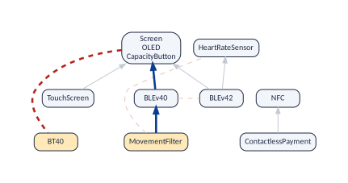

If the conflict is one of the primitive ones, there is nothing behind it:


``` r
vp_explain_conflict(band, "Screen", "BT40")
#> # A tibble: 1 x 5
#>   origin  step from   link     to   
#>    <int> <int> <chr>  <chr>    <chr>
#> 1      1     1 Screen excludes BT40
```

The same works for a dependency:


``` r
vp_explain_requires(band, "MovementFilter", "Screen")
#> # A tibble: 4 x 5
#>   route  step from           link       to    
#>   <int> <int> <chr>          <chr>      <chr> 
#> 1     1     1 MovementFilter requires   BLEv40
#> 2     1     2 BLEv40         requires   Screen
#> 3     2     1 MovementFilter excludes   BT40  
#> 4     2     2 BT40           atleastone Screen
```

The second route appears because this model has the at-least-one graph: *MovementFilter* excludes *BT40*, and every
band has *BT40* or a screen, so a band with the movement filter has a screen. Two different reasons for the same fact.
And if the relationship does not hold, you are told so:


``` r
vp_explain_requires(band, "TouchScreen", "HeartRateSensor")
#> "TouchScreen" does not require "HeartRateSensor": some valid product has TouchScreen without HeartRateSensor.
#> # A tibble: 0 x 5
#> # i 5 variables: route <int>, step <int>, from <chr>, link <chr>, to <chr>
```

# Comparing versions {#sec:diff}

Models change. A new version adds features and constraints, and the question is what that did to the relationships
[Thüm et al. (2009)](#ref-Thuem09); [Acher et al. (2012)](#ref-Acher12). This section compares two versions of the
same band, as planned and as built, and then a whole chain of versions: seven generations of the Mi Band. The vignette
[Following a model through time](evolution.html) goes much further.

## Two versions: the band as planned and as built

The examples also have `miband3_planned.uvl`: the Mi Band 3 as it was *planned*. It has the same 24
features, but only 1 of the 5 cross-tree constraints. The *realized* model, our
example, adds these 4:


``` r
constraints <- function(file) {
  l <- trimws(readLines(file))
  l[(which(l == "constraints") + 1):length(l)]
}
setdiff(
  constraints(vp_example("miband3_realized.uvl")),
  constraints(vp_example("miband3_planned.uvl"))
)
#> [1] "MovementFilter => !HeartRateSensor & BLEv40" "BLE => HeartRateSensor | MovementFilter"    
#> [3] "!Screen => BT40"                             "BT40 => !Screen"
```

The planned band (computed in [the kernel](#sec:kernel) above) has only 10 dependencies and
3 conflicts:


``` r
planned
#> variplex model "miband3_planned"
#>   features: 11 variable (the nodes of the graphs), 8 core, 0 dead
#>   requires: 10 arrows   excludes: 3 lines
#>   at least one: 0 lines
#>   atomic sets: 1 (of two or more features)
```

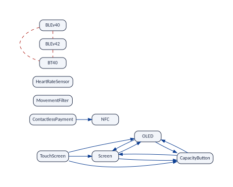

Now compare the two. `vp_compare()` takes the old version and the new one, and gives one row per graph:


``` r
vp_compare(planned, band)
#> # A tibble: 3 x 10
#>   graph       kept added removed old_links new_links gained  lost jaccard spearman
#>   <chr>      <int> <int>   <int>     <int>     <int>  <int> <int>   <dbl>    <dbl>
#> 1 requires      11     0       0        10        21     11     0   0.476    0.867
#> 2 excludes      11     0       0         3        10      7     0   0.3     NA    
#> 3 atleastone    11     0       0         0         3      3     0   0       NA
```

- `kept`, `added`, `removed`: the comparison is about the features that can vary, and both versions have the same
  11.
- `requires`: 11 dependencies were gained and none was lost. The four new cross-tree constraints created
  11 "requires" relationships.
- `excludes`: 7 conflicts were gained.
- `atleastone`: 3 "at least one" edges were gained. This row appears because both versions have the
  at-least-one graph.
- `jaccard` and `spearman` measure how much stayed the same: see below.

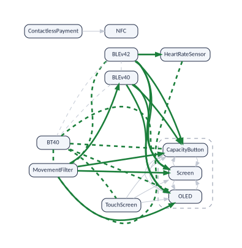

**The two measures.** `jaccard` is the links in both versions divided by the links in either: 1 when the graph did not
change, 0 when nothing of it is left. With the numbers of the dependencies: the planned band has 10 and
the realized one 21. None was lost, so all 10 of the planned band are in both, and
11 were gained: 10/21 = 0.47619. For the conflicts it is
3/10 = 0.30, and for the "at least one" edges
0/3 = 0.00. `spearman` sorts the kept features by how many features
require them, in each version, and compares the two orders: 1 for the same order. A Spearman of 0.87
says that the features that the others depend on most are almost the same in both versions: the new constraints added
links, but did not move the centre of the model.

`vp_changed_links()` lists the links that changed, and `vp_state_moves()` the features that moved between core, dead
and variable (none here):


``` r
vp_changed_links(planned, band, "requires")
#> # A tibble: 11 x 3
#>    from           to              change
#>    <chr>          <chr>           <chr> 
#>  1 MovementFilter Screen          gained
#>  2 MovementFilter OLED            gained
#>  3 MovementFilter CapacityButton  gained
#>  4 MovementFilter BLEv40          gained
#>  5 BLEv40         Screen          gained
#>  6 BLEv40         OLED            gained
#>  7 BLEv40         CapacityButton  gained
#>  8 BLEv42         Screen          gained
#>  9 BLEv42         OLED            gained
#> 10 BLEv42         CapacityButton  gained
#> 11 BLEv42         HeartRateSensor gained
vp_state_moves(planned, band)
#> # A tibble: 0 x 3
#> # i 3 variables: feature <chr>, before <chr>, after <chr>
```

::: {.vp-box .vp-plainwords}
Four cross-tree constraints, 11 new dependencies and 7 new conflicts. A comparison
of the graphs measures the real effect of a change, which is rarely the size of the change.
:::

## A feature that changed its name {#sec:rename}

Versions are compared by the names of the features. Suppose that in the planned band the first version of Bluetooth
Low Energy was called *BLEv40Old* (the example `miband3_planned_old.uvl`). Compared as they are, the two versions look
as if one feature had been removed and another added, and since links are compared only among the features of both
versions, the links of that feature drop out of the comparison (7 dependencies gained instead of 11):


``` r
planned_old <- vp_generate(
  vp_example("miband3_planned_old.uvl"),
  or_graph = TRUE
)
vp_compare(planned_old, band) |>
  select(graph, kept, added, removed, gained, lost)
#> # A tibble: 3 x 6
#>   graph       kept added removed gained  lost
#>   <chr>      <int> <int>   <int>  <int> <int>
#> 1 requires      10     1       1      7     0
#> 2 excludes      10     1       1      7     0
#> 3 atleastone    10     1       1      3     0
```

`vp_rename()` gives the features of the old version their new names first: from a named vector, or from a file with
one rename per line, the old name, **a space**, and the new name (a tab instead of the space if a name has spaces of
its own; lines that start with `#` and empty lines are ignored). With it, the comparison is the one above:


``` r
vp_compare(vp_rename(planned_old, c(BLEv40Old = "BLEv40")), band) |>
  select(graph, kept, added, removed, gained, lost)
#> # A tibble: 3 x 6
#>   graph       kept added removed gained  lost
#>   <chr>      <int> <int>   <int>  <int> <int>
#> 1 requires      11     0       0     11     0
#> 2 excludes      11     0       0      7     0
#> 3 atleastone    11     0       0      3     0
cat(readLines(vp_example("miband3_renames.txt")), sep = "\n")
#> # one rename per line: the old name, a space (a tab if a name has spaces), the new name
#> BLEv40Old BLEv40
vp_compare(vp_rename(planned_old, vp_example("miband3_renames.txt")), band) |>
  select(graph, kept, gained, lost)
#> # A tibble: 3 x 4
#>   graph       kept gained  lost
#>   <chr>      <int>  <int> <int>
#> 1 requires      11     11     0
#> 2 excludes      11      7     0
#> 3 atleastone    11      3     0
```

A rename whose old name is not a feature of the model changes nothing, so `vp_rename()` warns about it.
`vp_rename_candidates()` finds the likely renames by comparing the links of the features that disappeared and appeared.

## Many versions: seven generations of the band {#sec:evolution}

A product line lives for years, and each new product is a new version of its model
[Lotufo et al. (2010)](#ref-Lotufo10); [Kuiter et al. (2026)](#ref-Kuiter25). The examples have the realized model of
7 generations of the band: the Mi Band 1, 1s, 2, 3, 4, 6 and 8 (there is no realized model of the Mi Band 5 or
7). `vp_history()` runs every version and gathers the models, oldest first:


``` r
gens <- c(
  "miband1",
  "miband1s",
  "miband2",
  "miband3",
  "miband4",
  "miband6",
  "miband8"
)
history <- vp_history(
  vp_example(paste0(gens, "_realized.uvl")),
  versions = gens,
  or_graph = TRUE
)
history
#> # A tibble: 7 x 2
#>   version  model     
#>   <fct>    <list>    
#> 1 miband1  <vp_model>
#> 2 miband1s <vp_model>
#> 3 miband2  <vp_model>
#> 4 miband3  <vp_model>
#> 5 miband4  <vp_model>
#> 6 miband6  <vp_model>
#> 7 miband8  <vp_model>
vp_history_sizes(history) |>
  select(version, features, core, requires, excludes, atleastone)
#> # A tibble: 7 x 6
#>   version  features  core requires excludes atleastone
#>   <fct>       <int> <int>    <int>    <int>      <int>
#> 1 miband1         0     8        0        0          0
#> 2 miband1s        1     8        0        0          0
#> 3 miband2         8     8        6        3          0
#> 4 miband3        11     8       21       10          3
#> 5 miband4        17     8       32       35          1
#> 6 miband6        21     8      108       72          1
#> 7 miband8        23     8      127       93          1
```

- The first band offers no choice at all: its 8 features are all core (and its
  4 abstract features are left out). There is exactly one product, and nothing to draw.
- Every generation adds features that can vary: 0 in the Mi Band 1, 23 in the Mi Band 8.
  The number of core features stays at 8.
- The relationships grow much faster than the constraints. The Mi Band 8 has 22 cross-tree
  constraints, and variplex finds 127 dependencies and 93 conflicts among its
  23 features that can vary: the lesson of [the requires graph](#sec:requires), once more.

`vp_history_changes()` compares each version with the one before:


``` r
vp_history_changes(history) |>
  filter(graph == "requires") |>
  select(from, to, kept, added, removed, gained, lost, jaccard, spearman)
#> # A tibble: 6 x 9
#>   from     to        kept added removed gained  lost jaccard spearman
#>   <fct>    <fct>    <int> <int>   <int>  <int> <int>   <dbl>    <dbl>
#> 1 miband1  miband1s     0     1       0      0     0   1       NA    
#> 2 miband1s miband2      1     7       0      0     0   1       NA    
#> 3 miband2  miband3      8     3       0     11     0   0.353    0.894
#> 4 miband3  miband4     11     6       0     11    10   0.344    0.297
#> 5 miband4  miband6     17     4       0     45     4   0.364    0.302
#> 6 miband6  miband8     21     2       0      9     8   0.855    0.864
```

### What is compared

The comparison is about the features that can vary in *both* versions: the **kept** features. In the first step, from
the Mi Band 1 to the Mi Band 1s, none is kept, because the Mi Band 1 has no feature that can vary. Core features are
not vertices of the graphs, so they are not counted as kept, even when both versions have them; `vp_state_moves()`
follows them instead. The step from the Mi Band 1s to the Mi Band 2:


``` r
vp_state_moves(history$model[[2]], history$model[[3]])
#> # A tibble: 8 x 3
#>   feature        before after   
#>   <chr>          <chr>  <chr>   
#> 1 BT40           core   variable
#> 2 Screen         absent variable
#> 3 OLED           absent variable
#> 4 CapacityButton absent variable
#> 5 MovementFilter absent variable
#> 6 BLEv40         absent variable
#> 7 BLEv42         absent variable
#> 8 Bluetooth      absent core
```

The rows whose state before is `absent` are the new features. The row of *BT40* is a *move*: classic Bluetooth was core
in the Mi Band 1s (every band had it) and can vary in the Mi Band 2, where a band has either classic Bluetooth or BLE.
The new feature *Bluetooth* is core: every band has one of the two.

The relationships are compared only among the kept features. A link that touches a new feature is not counted as
gained: it could not exist before. So the step from the Mi Band 1s to the Mi Band 2 has nothing to compare: with only
1 kept feature, there is no link to compare, and its Jaccard of 1 is a convention, not "no change".
Always look at the number of kept features first.

### A redesign: the Mi Band 3 to the Mi Band 4


``` r
m3 <- history$model[[4]]
m4 <- history$model[[5]]
vp_compare(m3, m4) |>
  select(graph, kept, added, gained, lost, jaccard, spearman)
#> # A tibble: 3 x 7
#>   graph       kept added gained  lost jaccard spearman
#>   <chr>      <int> <int>  <int> <int>   <dbl>    <dbl>
#> 1 requires      11     6     11    10   0.344    0.297
#> 2 excludes      11     6      8     0   0.556   NA    
#> 3 atleastone    11     6      0     2   0.333   NA
```

The two versions share 11 features that can vary. Among them, the Mi Band 3 has
21 dependencies and the Mi Band 4 has 22: 11 are
in both, 10 were lost and 11 were gained. Notice that
21 and 22 are almost the same number: counting links would say that nothing
happened. Jaccard says that more than half of the links are different. The figure draws the three groups on the shared
features.

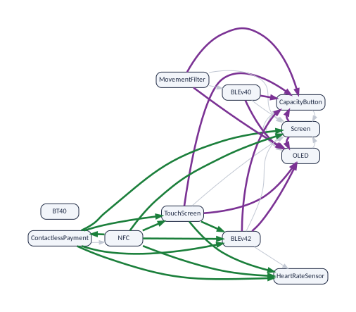

The lost arrows tell one story: every one of them points to *OLED* or to *CapacityButton*. In the Mi Band 3, a band
with a screen has an OLED screen with a capacity button. The Mi Band 4 brings a second kind of screen, AMOLED: a screen
no longer means OLED.


``` r
vp_changed_links(m3, m4, "requires") |> filter(change == "lost")
#> # A tibble: 10 x 3
#>    from           to             change
#>    <chr>          <chr>          <chr> 
#>  1 Screen         OLED           lost  
#>  2 Screen         CapacityButton lost  
#>  3 TouchScreen    OLED           lost  
#>  4 TouchScreen    CapacityButton lost  
#>  5 MovementFilter OLED           lost  
#>  6 MovementFilter CapacityButton lost  
#>  7 BLEv40         OLED           lost  
#>  8 BLEv40         CapacityButton lost  
#>  9 BLEv42         OLED           lost  
#> 10 BLEv42         CapacityButton lost
```

The explanations, asked on each version, confirm it, and they explain one of the gained arrows too:


``` r
vp_explain_requires(m3, "Screen", "OLED")
#> # A tibble: 3 x 5
#>   route  step from   link       to   
#>   <int> <int> <chr>  <chr>      <chr>
#> 1     1     1 Screen requires   OLED 
#> 2     2     1 Screen excludes   BT40 
#> 3     2     2 BT40   atleastone OLED
vp_explain_requires(m4, "TouchScreen", "HeartRateSensor")
#> # A tibble: 2 x 5
#>   route  step from        link     to             
#>   <int> <int> <chr>       <chr>    <chr>          
#> 1     1     1 TouchScreen requires BLEv42         
#> 2     1     2 BLEv42      requires HeartRateSensor
```

In the Mi Band 3 a touch screen did not need a heart-rate sensor ([Why?](#sec:explain) asked the same question). In
the Mi Band 4 it does: one of the new constraints, `TouchScreen => BLEv42`, met an old relationship, *BLEv42* requires
*HeartRateSensor*. Nobody wrote "a touch screen needs a heart-rate sensor"; the comparison found it.

::: {.vp-box .vp-inside}
**Reading a history, step by step**

1. **Kept, added, removed.** With fewer than two kept features, the Jaccard numbers mean nothing yet.
2. **Jaccard of each graph.** Near 1: the relationships among the features you already had stayed as they were.
   Low: they changed.
3. **Gained and lost.** Only gains: the version added rules, and the design got tighter. Losses: something that used
   to be forced is now a choice.
4. **The names.** `vp_changed_links()` lists every link that changed, `vp_state_moves()` the new features and the
   moves. Ask for explanations on both versions for the reasons.
5. **Spearman.** Low: the features that everything else depends on are not the same as before.
:::

# Using the results in other programs {#sec:elsewhere}

The graphs are in Pajek format, read by the usual programs for network analysis: Gephi and Pajek (to explore and
draw), and the library igraph (to compute; it exists for R, Python and C). The reports are CSV and JSON, read by
everything. In R, `vp_igraph()` gives any graph of a model as an igraph object:


``` r
g <- vp_igraph(band, "requires")
sort(igraph::degree(g, mode = "in"), decreasing = TRUE)
#>             Screen               OLED     CapacityButton    HeartRateSensor             BLEv40 
#>                  6                  6                  6                  1                  1 
#>                NFC        TouchScreen ContactlessPayment     MovementFilter             BLEv42 
#>                  1                  0                  0                  0                  0 
#>               BT40 
#>                  0
```

Counting the arrows that point to a feature tells how many features a change to it can affect, its *impact set*
[Abate et al. (2009)](#ref-Abate09); measures of this kind, over the whole dataset, are studied in
[Sánchez et al. (2026)](#ref-P-Variability). The same, in Python, from the files:

```python
import igraph as ig
g = ig.Graph.Read_Pajek("out/miband3_realized__requires.net")
print(sorted(zip(g.indegree(), g.vs["id"]), reverse=True)[:3])
```

::: {.vp-box .vp-careful}
Pajek has no way to write a double quote inside a name: `vp_generate()` writes it with a backslash before it, and
igraph does not understand that backslash (`vp_read()` does). No feature of the Mi Band has a double quote in its
name; if one of yours does, rename it before you use igraph on the files.
:::

# The options of `vp_generate()` {#sec:options}

`?vp_generate` lists every argument with its default value. The ones you are likely to use:

| **Argument** | **What it does** |
|:--|:--|
| `output_dir` | Writes the files in that folder instead of a temporary one. |
| `threads` | Uses that many threads. For large models this is the difference between minutes and hours. The results are the same with any number. |
| `quiet = FALSE` | Prints what the run does. |
| `or_graph = TRUE` | Adds the at-least-one graph ([The at-least-one graph](#sec:third)). |
| `kernel = TRUE` | Adds the kernel ([The kernel](#sec:kernel)). |
| `representativeness = TRUE` | Counts, with the model counter GANAK, how many of the products that the graphs let pass are real ones ([Measuring your own model](limits-theory.html#sec:measure)). |
| `keep_dimacs = TRUE` | Keeps the logic formula made from the UVL model. |
| `tseitin = TRUE` | Uses another way of translating the constraints (the *Tseitin* transformation), better for very complicated constraints. |
| `fixed_nodes = "keep"` | Draws the core and dead features in the graphs too. |
| `abstract = "keep"` | Keeps the abstract features, the root included, which are left out by default. |
| `abstract = "merge"` | Merges each abstract feature into a feature that is not abstract and is selected in exactly the same products, if there is one. |
| `legacy = TRUE` | Behaves like version 1 of Strong4VM. |
| `read = FALSE` | Returns the prefix of the files, without reading them. |

`vp_classify()` only writes the two reports, without computing graphs.

## Looking at the formula: `keep_dimacs` {#sec:dimacs}

With `keep_dimacs = TRUE` (as in the run at the top of this vignette), `vp_generate()` keeps the logic formula, in a
format called DIMACS:


``` r
writeLines(readLines("out/miband3_realized.dimacs"))
#> c generated-by uvl2dimacs 2.0 mode=straightforward
#> c Original features: 24
#> c Auxiliary variables: 0
#> c Total variables: 24
#> p cnf 24 47
#> c 1 SmartWatch
#> c 2 Screen
#> c 3 TouchScreen
#> c 4 OLED
#> c 5 CapacityButton
#> c 6 Functionalities
#> c 7 FitnessMonitor
#> c 8 SleepTracker
#> c 9 VibrateAlert
#> c 10 Call
#> c 11 Notification
#> c 12 ContactlessPayment
#> c 13 Sensors
#> c 14 Pedometer
#> c 15 MovementFilter
#> c 16 Accelerometer
#> c 17 HeartRateSensor
#> c 18 Connectivity
#> c 19 Bluetooth
#> c 20 BLE
#> c 21 BLEv40
#> c 22 BLEv42
#> c 23 BT40
#> c 24 NFC
#> c root 1
#> c abstract 1
#> c abstract 6
#> c abstract 13
#> c abstract 18
#> c abstract 20
#> 1 0
#> -2 1 0
#> -1 6 0
#> -6 1 0
#> -1 13 0
#> -13 1 0
#> -1 18 0
#> -18 1 0
#> -3 2 0
#> -2 4 0
#> -4 2 0
#> -4 5 0
#> -5 4 0
#> -6 7 0
#> -7 6 0
#> -6 8 0
#> -8 6 0
#> -6 9 0
#> -9 6 0
#> -12 6 0
#> -9 10 0
#> -10 9 0
#> -9 11 0
#> -11 9 0
#> -13 14 0
#> -14 13 0
#> -13 16 0
#> -16 13 0
#> -17 13 0
#> -15 14 0
#> -18 19 0
#> -19 18 0
#> -24 18 0
#> -19 20 23 0
#> -20 -23 0
#> -20 19 0
#> -23 19 0
#> -20 21 22 0
#> -21 -22 0
#> -21 20 0
#> -22 20 0
#> -15 -17 0
#> -15 21 0
#> -20 17 15 0
#> -12 24 0
#> 2 23 0
#> -23 -2 0
```

The lines that start with `c` are comments. Most of them give each feature a number; the last ones mark the root and
the abstract features. The line `p cnf 24 47` announces 24 variables and 47 clauses. Each of the other lines is one
clause: a list of numbers ending in 0, of which at least one must hold. A positive number means "the feature is
selected" and a negative one "it is not". The clause `-3 2 0` reads "not TouchScreen, or Screen": a band with a touch
screen has a screen.

With `tseitin = TRUE` the formula is built differently [Kuiter et al. (2022)](#ref-Kuiter22): it gets
10 helper variables (34 in all) and 73 clauses. The graphs are
exactly the same; variplex knows that the helpers are not features and leaves them out:


``` r
identical(tseitin$requires, band$requires)
#> [1] TRUE
```

## Showing core features and abstract ones {#sec:fixed}

With `fixed_nodes = "keep"` the graphs also show the core features, 19 features in all. The core
ones are isolated dots, and their number in the list is no longer 0:


``` r
fixed <- vp_generate(
  vp_example("miband3_realized.uvl"),
  fixed_nodes = "keep",
  read = FALSE
)
head(readLines(paste0(fixed, "__core.txt")), 4)
#> [1] "5 \"FitnessMonitor\"" "6 \"SleepTracker\""   "7 \"VibrateAlert\""   "8 \"Call\""
```

Abstract features are not parts of a band, so variplex leaves them out. With `abstract = "keep"` they are kept, the
root too: the graphs have 12 features instead of 11 (*BLE* is abstract and can
vary) and the core list has 12 instead of 8. The report shows the decisions:


``` r
keep <- vp_generate(vp_example("miband3_realized.uvl"), abstract = "keep")
keep$variables |>
  filter(class == "ABSTRACT") |>
  select(name, output_name, status, decision, rule)
#> # A tibble: 5 x 5
#>   name            output_name     status   decision rule 
#>   <chr>           <chr>           <chr>    <chr>    <chr>
#> 1 SmartWatch      SmartWatch      core     kept     U4   
#> 2 Functionalities Functionalities core     kept     U4   
#> 3 Sensors         Sensors         core     kept     U4   
#> 4 Connectivity    Connectivity    core     kept     U4   
#> 5 BLE             BLE             variable kept     U4
```

With `abstract = "merge"` an abstract feature is merged into a feature that is not abstract and is selected in exactly
the same bands, if there is one, the way the features of an atomic set are grouped. In this band BLE goes with the
screen (the bands with a screen are those with BLE), so it joins the atomic set of *Screen*; the root and the headings
that are in every band, 4 features, join a core feature:


``` r
merge <- vp_generate(vp_example("miband3_realized.uvl"), abstract = "merge")
merge$variables |> filter(class == "ABSTRACT") |> select(name, status, decision)
#> # A tibble: 5 x 3
#>   name            status   decision                  
#>   <chr>           <chr>    <chr>                     
#> 1 SmartWatch      core     merged_into:FitnessMonitor
#> 2 Functionalities core     merged_into:FitnessMonitor
#> 3 Sensors         core     merged_into:FitnessMonitor
#> 4 Connectivity    core     merged_into:FitnessMonitor
#> 5 BLE             variable merged_into:Screen
```

The graphs have 11 features, and nothing is lost: every relationship of BLE is a relationship of
*Screen*. In the planned band no feature goes with BLE, which stands there for the choice "BLEv40 or BLEv42"
([Why BLEv40 and BLEv42 are not joined](#sec:noble)), and `abstract = "merge"` keeps it. To compare versions, keep the
default: with `"merge"`, a feature can appear or disappear from one version to the next only because it became, or
stopped being, equivalent to another.

## Compatibility with version 1: `legacy`

Version 1 of Strong4VM wrote four files and treated every variable as a feature. `legacy = TRUE` reproduces it, for
those who need to compare with old results. The graphs then have all 24 features, core ones included,
and there is no minimal form:


``` r
legacy <- vp_generate(
  vp_example("miband3_realized.uvl"),
  legacy = TRUE,
  read = FALSE
)
#> Warning: 24 variables matched no rule of profile 'generic' and were kept (--unknown-names keep),
#> e.g. SmartWatch, Screen, TouchScreen, OLED, CapacityButton, Functionalities, FitnessMonitor,
#> SleepTracker, VibrateAlert, Call
list.files(dirname(legacy))
#> [1] "miband3_realized__core.txt"      "miband3_realized__dead.txt"     
#> [3] "miband3_realized__excludes.net"  "miband3_realized__requires.net" 
#> [5] "miband3_realized__summary.json"  "miband3_realized__variables.csv"
```

The warning is version 1 speaking: it had no rules to tell features from other variables, so it kept them all.

# Formulas made by other tools {#sec:others}

variplex also reads the logic formula of a variability model written in any other language, in DIMACS format, in
files ending in `.dimacs` or `.cnf`. The translation into a formula is done beforehand by a tool that knows the
language: KMax, KConfigReader or KconfigSampler for the Kconfig files of Linux, BusyBox or axTLS, TraVarT for feature
models of other notations, and so on. Then, for instance:


``` r
linux <- vp_generate("linux.dimacs", threads = 8, or_graph = TRUE)
```

Such formulas contain many variables that are *not* features: helpers that the translator invented, encodings of
numbers and texts, and so on. In the formula of Linux 3.13 made by KMax, 14,421 of the
23,838 variables are not configuration options. variplex recognises them by rules that depend on the
translator, keeps only the real options, and writes its decision for every variable in `__variables.csv`, with the
rule that decided ([The two reports](#sec:reports) shows the rules of a UVL model, and a row of a formula made by
KconfigSampler). The translator is detected from the comments of the formula; the argument `translator` names it if
needed, and the arguments `tristate`, `nonbool`, `visibility`, `abstract_groups`, `synthetic_root`, `unnamed`,
`unknown_names`, `decls`, `keep_pattern`, `drop_pattern` and `drop_names` adjust the rules (`?vp_generate`). Try them
with `vp_classify()`, which classifies the variables in seconds, before a long run:


``` r
vp_classify(vp_example("eleven_options.dimacs"), translator = "kmax")
#> # A tibble: 11 x 8
#>    dimacs_var name             output_name      node_id class  status decision rule 
#>         <int> <chr>            <chr>            <lgl>   <chr>  <lgl>  <chr>    <chr>
#>  1          1 ACPI             ACPI             NA      OPTION NA     kept     K6   
#>  2          2 IA64             IA64             NA      OPTION NA     kept     K6   
#>  3          3 ACPI_INTERPRETER ACPI_INTERPRETER NA      OPTION NA     kept     K6   
#>  4          4 ACPI_NUMA        ACPI_NUMA        NA      OPTION NA     kept     K6   
#>  5          5 IA64_GENERIC     IA64_GENERIC     NA      OPTION NA     kept     K6   
#>  6          6 NUMA             NUMA             NA      OPTION NA     kept     K6   
#>  7          7 IA64_DIG         IA64_DIG         NA      OPTION NA     kept     K6   
#>  8          8 IA64_HP_ZX1      IA64_HP_ZX1      NA      OPTION NA     kept     K6   
#>  9          9 X86              X86              NA      OPTION NA     kept     K6   
#> 10         10 X86_PC           X86_PC           NA      OPTION NA     kept     K6   
#> 11         11 IA64_SGI_SN2     IA64_SGI_SN2     NA      OPTION NA     kept     K6
```

# When something is wrong {#sec:wrong}

## A dead feature

Let us break the model on purpose. The example `miband3_dead.uvl` is a copy of the Mi Band 3 with one more constraint:
`NFC => !ContactlessPayment` ("a band with NFC has no contactless payment"). But constraint 3 says that contactless
payment *needs* NFC.


``` r
dead <- vp_generate(vp_example("miband3_dead.uvl"))
dead
#> variplex model "miband3_dead"
#>   features: 10 variable (the nodes of the graphs), 8 core, 1 dead
#>   requires: 20 arrows   excludes: 10 lines
#>   at least one: not computed (use vp_generate(or_graph = TRUE))
#>   atomic sets: 1 (of two or more features)
vp_features(dead) |> filter(status == "dead")
#> # A tibble: 1 x 2
#>   feature            status
#>   <chr>              <chr> 
#> 1 ContactlessPayment dead
```

No error: the model is still valid. But *ContactlessPayment* is now dead. It can never be selected, because selecting
it would need NFC and forbid NFC at once. A dead feature is a feature that exists on paper only; the list of dead
features is the first thing to look at after changing a model.

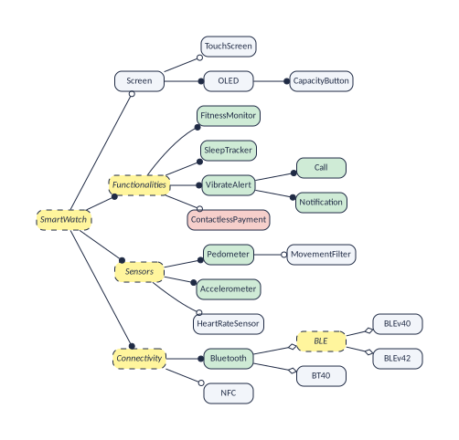

## A model without any product {#sec:void}

Now a worse mistake: a constraint that demands `BT40 & Screen`, while constraint 5 forbids it.


``` r
void <- tryCatch(
  vp_generate(vp_example("miband3_void.uvl")),
  error = function(e) e
)
class(void)
#> [1] "variplex_void_model" "variplex_error"      "error"               "condition"
conditionMessage(void)
#> [1] "the formula 'miband3_void.dimacs' is unsatisfiable (void model): no configuration exists, so no graphs were written. Look for contradictory constraints in the model; the summary miband3_void__summary.json records \"void\": true.\n  The model has no valid configuration: every feature is dead."
```

The model is **void**: no configuration satisfies all the constraints, so the product line has no product. There are
no configurations, so there is nothing to say about pairs of features, and no graphs are written; only the summary is,
with `"void": true`.

## Errors and their classes {#sec:exitcodes}

Every error of `vp_generate()` has the class `variplex_error` and a more precise one, so that a program can react to
each kind; the field `exit_code` is the exit code that the command line of Strong4VM gives for the same problem:

| **Class** | **`exit_code`** | **Meaning** |
|:--|:--|:--|
| `variplex_usage` | 1 | An argument has a value that is not accepted. |
| `variplex_input` | 2 | The input is wrong: it is not a valid model or formula. |
| `variplex_void_model` | 3 | The model is void: it has no valid configuration. |
| `variplex_solver` | 4 | The solver failed. |
| `variplex_unknown_name` | 5 | A name was not recognised (only with `unknown_names = "error"`). |
| `variplex_strict_uvl` | 6 | A constraint could not be translated (only with `strict_uvl = TRUE`). |
| `variplex_check_failed` | 7 | A consistency check failed. |

A value that an argument does not accept is answered with what was expected:


``` r
vp_generate(vp_example("miband3_realized.uvl"), tristate = "sometimes")
#> Error in `match.arg()`:
#> ! 'arg' should be one of "merge", "builtin", "both"
```


# References

<span id="ref-Abate09"></span>P. Abate, J. Boender, R. Di Cosmo, S. Zacchiroli. Strong dependencies between software components. In *ESEM*, 2009. Extended version: arXiv:0905.4226.

<span id="ref-Acher12"></span>M. Acher, P. Heymans, P. Collet, C. Quinton, P. Lahire, P. Merle. Feature model differences. In *CAiSE*, LNCS 7328, 2012.

<span id="ref-Aho72"></span>A. V. Aho, M. R. Garey, J. D. Ullman. The transitive reduction of a directed graph. *SIAM Journal on Computing* 1(2):131--137, 1972.

<span id="ref-Ananieva16"></span>S. Ananieva, M. Kowal, T. Thüm, I. Schaefer. Implicit constraints in partial feature models. In *FOSD*, pp. 18--27, 2016.

<span id="ref-Benavides10"></span>D. Benavides, S. Segura, A. Ruiz-Cortés. Automated analysis of feature models 20 years later: A literature review. *Information Systems* 35(6):615--636, 2010.

<span id="ref-Czarnecki05"></span>K. Czarnecki, S. Helsen, U. Eisenecker. Staged configuration through specialization and multilevel configuration of feature models. *Software Process: Improvement and Practice* 10(2):143--169, 2005.

<span id="ref-Duszynski19"></span>S. Duszynski, S. J. Dhar, T. Beichter. Using relation graphs for improved understanding of feature models in software product lines. In *SPLC*, vol. A, 2019.

<span id="ref-Hess25"></span>T. Heß, A. Molt. Improving deterministic BDD compilation with counting-free computation of atomic sets. In *SPLC*, 2025. doi:10.1145/3748269.3748491.

<span id="ref-Kowal16"></span>M. Kowal, S. Ananieva, T. Thüm. Explaining anomalies in feature models. In *GPCE*, 2016.

<span id="ref-Kuiter25"></span>E. Kuiter, C. Sundermann, T. Thüm, T. Heß, S. Krieter, G. Saake. How configurable is the Linux kernel? Analyzing two decades of feature-model history. *ACM TOSEM* 35(1), 2026. doi:10.1145/3729423.

<span id="ref-Kuiter22"></span>E. Kuiter, S. Krieter, C. Sundermann, T. Thüm, G. Saake. Tseitin or not Tseitin? The impact of CNF transformations on feature-model analyses. In *ASE*, 2022.

<span id="ref-Lotufo10"></span>R. Lotufo, S. She, T. Berger, K. Czarnecki, A. Wąsowski. Evolution of the Linux kernel variability model. In *SPLC*, LNCS 6287, pp. 136--150, 2010.

<span id="ref-P-Variability"></span>J. M. Sanchez, M. A. Olivero, R. Heradio, L. Cambelo, D. Fernandez-Amoros. Reasoning About Variability Models Through Network Analysis. Manuscript (`papers/variability`); arXiv:2603.16577, 2026.

<span id="ref-Thuem09"></span>T. Thüm, D. Batory, C. Kästner. Reasoning about edits to feature models. In *ICSE*, pp. 254--264, 2009.

<span id="ref-Trinidad08"></span>P. Trinidad, D. Benavides, A. Durán, A. Ruiz-Cortés, M. Toro. Automated error analysis for the agilization of feature modeling. *Journal of Systems and Software* 81(6):883--896, 2008.

<span id="ref-Vouillon13"></span>J. Vouillon, R. Di Cosmo. On software component co-installability. *ACM TOSEM* 22(4), 2013. doi:10.1145/2522920.2522927.
