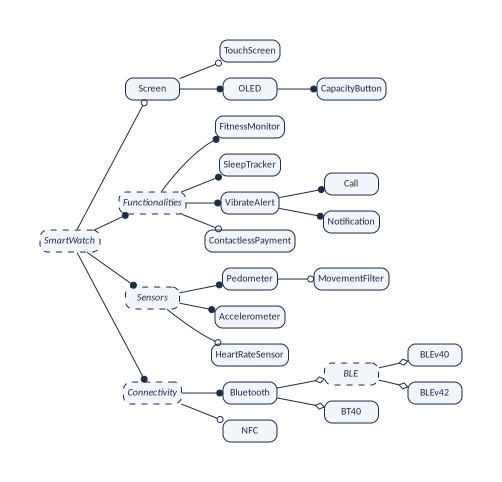
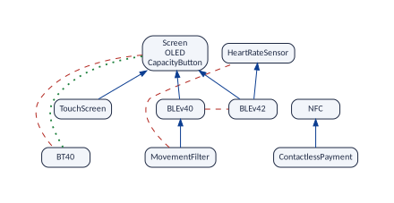

variplex takes a variability model and computes, with a SAT solver, every relationship between two of its features
that holds in all its valid configurations: which features **require** others, which **exclude** each other, and of
which two every product has **at least one**. More than a hundred functions then answer questions about those
graphs: what each feature weighs, how the model is layered, where its conflicts come from, which features can go
together, how much of the model a test sample covers, which patterns recur, and how the model changes from version to
version. Every function takes a model and returns a tibble.

This vignette explains what variplex finds and why it is worth the time of the solver, introduces the example that
all the vignettes use, and makes a first run. The other vignettes go through the results and the questions one by one:

| **Vignette** | **What it covers** |
|:--|:--|
| [The graphs and the files](graphs.html) | Every result of a run, on the example: core and dead features, the three graphs, atomic sets, the minimal form, the kernel, the reports, checking, explaining and comparing versions, and the options of `vp_generate()`. |
| [Reading and drawing](reading-and-drawing.html) | Reading the results into R, the parts of a model, subsets, histories, and drawing the graphs. |
| [Features, hierarchy and the whole model](features-hierarchy.html) | Measuring each feature; layers, chains, the skeleton and the feature tree; the whole model in numbers. |
| [Conflicts and configuration](conflicts-configuring.html) | Where conflicts come from and how they group; what a choice forces, what can go together, the kernel. |
| [Teams and testing](teams-testing.html) | Splitting the configuration among teams; covering samples of configurations. |
| [Patterns and statistics](patterns.html) | Triangles, communities, robustness, power laws, baselines, independent parts. |
| [Following a model through time](evolution.html) | Comparing versions and whole histories. |
| [Limits and theory](limits-theory.html) | What the graphs cannot see, how much of a model they leave out, features that are more than yes or no, and the proofs. |

# What variplex does

## Product lines, features and configurations

Many products come in variants. A car has an engine that is petrol, diesel or electric; it may or may not have a
sunroof. A fitness band is sold with or without a screen. The Linux kernel has more than ten thousand switches. A
family of products like these, built from a common set of parts, is a **software product line**, and the document
that describes the family is a **variability model**. The best-known kind of variability model is the **feature
model** [Czarnecki and Wąsowski (2007)](#ref-Czarnecki07); [Benavides et al. (2010)](#ref-Benavides10). It lists

- the **features**: the characteristics that a product may or may not have, and
- the **constraints**: which features need each other, and which cannot go together.

A **configuration** is a selection of features. It is **valid** when it respects all the constraints, and each valid
configuration describes one **product** of the line.

::: {.vp-box .vp-goodtoknow}
**Feature or option?** Both words name the same thing. The product-line community says *feature*. The world of
configurable systems, such as the Linux kernel, says *configuration option*, or just *option*. These vignettes say
*feature* for their example, which is a feature model, and *option* when they talk about systems like Linux. The
engine of variplex says *option* in its messages and reports: you will meet the class `OPTION` in the report of a run.
:::

## The problem: constraints have consequences

Constraints are written one at a time, by different people, at different moments. But constraints *chain*. If A needs
B, and B needs C, then A needs C, and nobody wrote that down. If A needs B, and B cannot go with D, then A cannot go
with D either. In a model with thousands of features these hidden consequences are everywhere, and no one can find
them by reading.

::: {.vp-box .vp-plainwords}
The constraints you wrote are the visible part. Their consequences are the part under water, and it is much bigger.
variplex shows you all of it.
:::

## What variplex finds

variplex reads a model and finds **every** relationship between two features that holds in **all** its valid
configurations [Heradio et al. (2026)](#ref-P-SoftwareX). That is what **strong** means: a relationship is strong when
it holds in every valid configuration, not only in some of them. Because each one involves two features, these are
**binary** relationships. The name comes from software packages, where strong dependencies and strong conflicts were
first studied [Abate et al. (2009)](#ref-Abate09); [Di Cosmo and Boender (2010)](#ref-DiCosmo10). On the way, variplex
also finds two facts about single features:

| **Relationship or fact** | **Meaning** | **Where it is** |
|:--|:--|:--|
| A **requires** B | Every valid configuration that has A also has B. | the requires graph |
| A **excludes** B | No valid configuration has both A and B. | the excludes graph |
| **At least one** of A, B | No valid configuration lacks both. | the at-least-one graph |
| A is **core** | Every valid configuration has A. | the list of core features |
| A is **dead** | No valid configuration has A: something is wrong with the model. | the list of dead features |

The relationships are written as **graphs**: drawings made of dots (the features) joined by arrows or lines (the
relationships). A graph is easy to draw, easy to query, and every tool for network analysis can read it. The graphs are
complete: they hold everything that follows from chaining the constraints, not only what somebody wrote.

::: {.vp-box .vp-plainwords}
Everything variplex finds is true. But a model can also have rules that tie three or more features at once, such as
"a band with Bluetooth Low Energy has version 4.0 or 4.2". Such a rule is no relationship between two features, so it
is in none of the graphs, and every function of the package inherits this blind spot. Each function documents what it
means for its answers, and the vignette [Limits and theory](limits-theory.html) explains it in full.
:::

## Why it pays off

Finding every relationship is not free. For each feature that can vary, variplex asks a solver what selecting it forces
and what it forbids, and each of these questions is a series of calls to a SAT solver, which copes well even with very
large models [Mendonça et al. (2009)](#ref-Mendonca09); [Liang et al. (2015)](#ref-Liang15). For the example of these
vignettes that is 11 questions and a fraction of a second. For the variability model of Linux 3.13 it
is 7,100 questions, which took 3.6 minutes with 8 threads
(10 minutes with the at-least-one graph, which doubles the questions, and the kernel).

That cost is paid once. Afterwards the answers are in the graphs, and questions about the model are answered by looking
at them, without a solver. Asked one by one, the same questions would need a solver each time: Linux 3.13 has
7,100 configuration options that can vary, so 25,201,450 pairs of options and
50,402,900 questions of the kind "does A require B?". And some questions cannot be asked one pair at a
time, because they are about all the pairs at once: which features everything else depends on, which ones can be
added to any product, what changed between two versions; the network analysis of these graphs
[Sánchez et al. (2026)](#ref-P-Variability) is made of such questions.

## Two ways in

`vp_generate()` accepts two kinds of input:

- a feature model written in **UVL**, the Universal Variability Language, which variplex translates into a logic
  formula by itself;
- the **logic formula** of a variability model written in *any* other language, in DIMACS, the standard format of
  logic solvers. The variability model of the Linux kernel, for instance, is written in the Kconfig language, and
  tools such as KMax, KConfigReader or KconfigSampler translate it into a formula
  [Kuiter et al. (2026)](#ref-Kuiter25); TraVarT does the same for feature models of other notations. Any variability
  language whose models can be translated into propositional logic can be analysed this way: the dataset published with
  Strong4VM [Heradio et al. (2026)](#ref-P-SciData) has 5,709 such formulas, of Linux, BusyBox, eCos, automotive
  product lines and many more systems.

From the formula on, the work is the same: the variables of the formula are sorted into features and the helper
variables that translations need; then, for each feature, a solver is asked "if this feature is selected, what else
is forced, and what becomes impossible?"; the answers, checked and summarised, are the graphs. These vignettes use a
model written in UVL because it is short and easy to read; everything works the same for a formula, and the vignette
[The graphs and the files](graphs.html#formulas-made-by-other-tools) says what is special about formulas made by other
tools.

# The example: the Mi Band 3

The example of the vignettes is a model of a fitness band, the Mi Band 3. It comes with the package, as do the other
examples (`vp_example()` lists them). It is written in UVL, a plain text format:


``` r
band_file <- vp_example("miband3_realized.uvl")
cat(readLines(band_file), sep = "\n")
#> namespace SmartWatch
#> 
#> features
#> 	SmartWatch {abstract true}
#> 		optional
#> 			Screen
#> 				optional
#> 					TouchScreen
#> 				mandatory
#> 					OLED
#> 						mandatory
#> 							CapacityButton
#> 		mandatory
#> 			Functionalities {abstract true}
#> 				mandatory
#> 					FitnessMonitor
#> 					SleepTracker
#> 					VibrateAlert
#> 						mandatory
#> 							Call
#> 							Notification
#> 				optional
#> 					ContactlessPayment
#> 			Sensors {abstract true}
#> 				mandatory
#> 					Pedometer
#> 						optional
#> 							MovementFilter
#> 					Accelerometer
#> 				optional
#> 					HeartRateSensor
#> 			Connectivity {abstract true}
#> 				mandatory
#> 					Bluetooth
#> 						alternative
#> 							BLE {abstract true}
#> 								alternative
#> 									BLEv40
#> 									BLEv42
#> 							BT40
#> 				optional
#> 					NFC
#> 
#> constraints
#> 	MovementFilter => !HeartRateSensor & BLEv40
#> 	BLE => HeartRateSensor | MovementFilter
#> 	ContactlessPayment => NFC
#> 	!Screen => BT40
#> 	BT40 => !Screen
```

## Reading the model

The first part, `features`, is a tree. Indentation says who is the parent of whom. The words `mandatory`, `optional`
and `alternative` say how the children hang from their parent:

| | |
|:--|:--|
| `mandatory` | If the parent is selected, the child is selected too. |
| `optional` | If the parent is selected, the child may be selected or not. |
| `alternative` | If the parent is selected, exactly one of these children is. |
| `or` | If the parent is selected, at least one of these children is. (Not used in this model.) |

In every case, a child can only be selected if its parent is.

**Abstract features.** Some features are marked `{abstract true}`. An **abstract feature** is not a part of the
product: it only gives the model its shape [Thüm et al. (2011)](#ref-Thuem11). It can be a heading that gathers
related features (*Sensors*, *Connectivity*), the name of a choice (*BLE* stands for "*BLEv40* or *BLEv42*"), or the
root, which names the whole family (*SmartWatch*). The other features are **concrete**: each one is something that a
band has or lacks, such as a sensor, a kind of screen or a version of Bluetooth. Two configurations that differ only in
abstract features describe the same band, so variplex leaves the abstract features out of its results, the root
included: its graphs and lists are about the concrete features. The relationships between those are still computed on
the whole model, abstract features included, so leaving the abstract features out changes none of them
(`vp_generate(abstract = "keep")` keeps them in the results).

The figure draws the tree. The model has 24 features, 5 of them abstract.



The second part, `constraints`, holds 5 **cross-tree constraints**: constraints between features of
different branches, which the tree cannot express. In words:

1. A band with the *movement filter* has no heart-rate sensor, and it uses Bluetooth Low Energy version 4.0.
2. A band with *Bluetooth Low Energy* (BLE) has a heart-rate sensor or a movement filter.
3. *Contactless payment* needs NFC.
4. A band without *screen* uses classic Bluetooth 4.0 (BT40).
5. A band with classic Bluetooth 4.0 has no screen.

## How many bands are there?

Leave aside the abstract features and the features that every band has, and 11 features remain. If they
were free, there would be 2048 combinations (2 multiplied by itself 11 times). The
constraints leave only **24** of them, listed in the file `miband3_products.csv` of the examples. The
smallest valid band adds just *BT40* to the mandatory parts; the largest one adds
*BLEv42, CapacityButton, ContactlessPayment, HeartRateSensor, NFC, OLED, Screen, TouchScreen*.

::: {.vp-box .vp-plainwords}
24 valid configurations out of 2048 combinations: the constraints forbid almost 99 of
every 100. Which pairs of features are behind that? That is what the graphs will tell.
:::

::: {.vp-box .vp-goodtoknow}
The number 24 was obtained by trying all the combinations, which is possible for a model this small.
variplex does not count configurations and does not need to: it works just as well when there are more configurations
than atoms in the universe. The complete list is used only to double-check: every relationship shown in the vignettes
was verified against the 24 bands, and the tests of the package check every function against the
valid configurations of many small models.
:::

# Installation and first run

## Installing

variplex is installed like any other package:


``` r
install.packages("variplex")
```

It needs nothing outside R. The engine (the C++ code of Strong4VM, with the SAT solver Glucose and the UVL parser) is
compiled when the package is installed from source, which takes a few minutes; the binary packages of CRAN for Windows
and macOS need no compiler at all. Three optional packages draw the graphs (`vp_plot()`): DiagrammeR shows a drawing in
RStudio or in a document, and DiagrammeRsvg and rsvg save it as SVG, PDF or PNG. The charts of the vignettes use
ggplot2, and one measure, the representativeness of the graphs, needs the model counter
[GANAK](https://github.com/meelgroup/ganak), a separate program.


``` r
install.packages(c("DiagrammeR", "DiagrammeRsvg", "rsvg", "ggplot2"))
```


``` r
library(variplex)
```

## The first run

One function does everything: `vp_generate()`. Give it the model; with `quiet = FALSE` it says what it does:


``` r
band <- vp_generate(band_file, output_dir = "out", quiet = FALSE)
#> Reading UVL file: miband3_realized.uvl
#> Parsing UVL file...
#> Building feature model...
#> Feature model built:
#>   Features: 24
#>   Relations: 21
#>   Constraints: 5
#> Transforming to CNF...
#> CNF model created:
#>   Variables: 24
#>   Clauses: 47
#> Writing DIMACS file: out/miband3_realized.dimacs
#> Loaded formula: out/miband3_realized.dimacs (24 variables, 47 clauses)
#> Translator profile: uvl (extension: input is a .uvl file)
#> Querying 11 variables (input filter)
#> Saved out/miband3_realized__requires.net
#> Saved out/miband3_realized__excludes.net
#> Saved out/miband3_realized__core.txt
#> Saved out/miband3_realized__dead.txt
#> Saved out/miband3_realized__requires_skeleton.net
#> Saved out/miband3_realized__excludes_primitive.net
#> Saved out/miband3_realized__atomic.txt
#> Saved out/miband3_realized__variables.csv
#> Saved out/miband3_realized__summary.json
#> Time with the modal implication graph (MIG):
#>   total run                               0.164 s
#>   before the main loop                    0.007 s  (read, classify, global backbone)
#>   main loop                               0.001 s  (0.4 %)
#>     create the MIG                        0.000 s  (1.0 %)
#>     create the solvers                    0.000 s  (10.6 %)
#>     jobs (wall time)                      0.000 s  (75.3 %), 1 thread(s)
#>     thread time of the jobs, summed over the threads:
#>       propagation and weak reach          0.000 s  (44.6 %)
#>       candidates and witnesses            0.000 s  (7.3 %)
#>       calling the backbone solver         0.000 s  (48.0 %)
#>   after the main loop                     0.157 s  (atomic sets, products, checks, files)
#>   MIG: 17 clauses, 30 strong and 12 weak edges
#>   jobs: 11, 7 without the solver; 4 backbone calls
#>   literals: 31 forced by propagation, 45 in reach, 25 refuted by witnesses, 20 sent to the solver (of 165 without the MIG)
```

What the messages say, in order:

- The model has 24 features and 5 cross-tree constraints (`Relations: 21` are the links of
  the feature tree). It was turned into a formula with 24 variables (one per feature) and
  47 small rules called *clauses*.
- `Translator profile: uvl` says that variplex knows where the formula comes from. This matters for formulas made by
  other tools; for a UVL model it is automatic.
- `Querying 11 variables`: variplex is about to ask the solver its questions, one per feature that can vary,
  11 in all (the vignette [The graphs and the files](graphs.html) explains why 11 and not
  24).
- Each `Saved` line is a file. The result: 11 features that can vary, 21 "requires" relationships
  and 10 "excludes" relationships.

The result is a **model**, the object that every other function of the package takes. Printed, it summarises what was
found:


``` r
band
#> variplex model "miband3_realized"
#>   features: 11 variable (the nodes of the graphs), 8 core, 0 dead
#>   requires: 21 arrows   excludes: 10 lines
#>   at least one: not computed (use vp_generate(or_graph = TRUE))
#>   atomic sets: 1 (of two or more features)
```

## The files

`vp_generate()` writes its results as files and reads them back. By default it writes them in a temporary folder,
which R deletes at the end of the session; `output_dir` keeps them, here in the folder `out`:


``` r
list.files("out")
#> [1] "miband3_realized__atomic.txt"             "miband3_realized__core.txt"              
#> [3] "miband3_realized__dead.txt"               "miband3_realized__excludes_primitive.net"
#> [5] "miband3_realized__excludes.net"           "miband3_realized__requires_skeleton.net" 
#> [7] "miband3_realized__requires.net"           "miband3_realized__summary.json"          
#> [9] "miband3_realized__variables.csv"
```

Every file name starts with the name of the model, `miband3_realized`, followed by two underscores. This common
beginning, `out/miband3_realized`, is the **prefix** of the run: `vp_read("out/miband3_realized")` reads the files
again in another session, without solving anything.

| **File** | **What it tells** |
|:--|:--|
| `__core.txt`, `__dead.txt` | Features that are in every band, and in none |
| `__requires.net` | "If I take this, I also get that" |
| `__excludes.net` | "These two never go together" |
| `__atleastone.net` (with `or_graph = TRUE`) | "One of the two, at least" |
| `__atomic.txt` | Features that always travel together |
| `__requires_skeleton.net`, `__excludes_primitive.net`, `__atleastone_primitive.net` | The graphs without repetitions: the minimal form |
| `__kernel_classes.txt`, `__kernel_requires.net`, `__kernel_excludes.net` (with `kernel = TRUE`) | A small map for the question "can these go together?" |
| `__count_formula.cnf`, `__count_graphs.cnf` (with `representativeness = TRUE`) | The model and the graphs as formulas, for the model counter GANAK |
| `__variables.csv` | What was decided about each variable, and why |
| `__summary.json` | How the run was made and what it found |

The graphs are written in the Pajek format, which igraph, Gephi, NetworkX and most tools for networks read, so the
results can also be used outside R.

## A first look

The functions of the package are named `vp_*`, so typing `vp_` in RStudio lists them; `vp_functions()` lists them by
topic, with the question each one answers:


``` r
vp_functions()
#> # A tibble: 126 x 4
#>    topic     name            parameters                                                      answers
#>    <fct>     <chr>           <chr>                                                           <chr>  
#>  1 1 reading vp_generate     "input, output_dir = NULL, threads = 1, or_graph = FALSE, kern~ comput~
#>  2 1 reading vp_classify     "input, output_dir = NULL, ..."                                 classi~
#>  3 1 reading vp_example      "file = NULL"                                                   the ex~
#>  4 1 reading vp_functions    "topic = NULL"                                                  every ~
#>  5 1 reading vp_read         "prefix, name = NULL, artificial = \"keep\", translator = \"km~ read t~
#>  6 1 reading vp_read_history "prefixes, versions = NULL, ..."                                read s~
#>  7 1 reading vp_history      "inputs, versions = NULL, ..."                                  comput~
#>  8 1 reading vp_features     "model"                                                         the fe~
#>  9 1 reading vp_links        "model, graph = \"requires\""                                   the li~
#> 10 1 reading vp_igraph       "model, graph = \"requires\""                                   the ig~
#> # i 116 more rows
```


``` r
table(vp_functions()$topic)
#> 
#>       1 reading      2 features     3 hierarchy   4 whole model     5 conflicts 6 configuration 
#>              15               7              21               4              12              16 
#>       7 testing      8 patterns     9 evolution      10 drawing 
#>               6              13              28               4
```

Each function takes a model and returns a tibble, so dplyr and ggplot2 work on the answers as they are. Here are three
questions, one answer each. Which features does the touch screen bring along? Can a band have a screen and classic
Bluetooth? And what do all the features weigh?


``` r
vp_requirements(band, "TouchScreen")
#> # A tibble: 3 x 1
#>   feature       
#>   <chr>         
#> 1 Screen        
#> 2 OLED          
#> 3 CapacityButton
vp_can_go_together(band, c("Screen", "BT40"))
#> # A tibble: 1 x 3
#>   wish         possible reasons             
#>   <chr>        <lgl>    <chr>               
#> 1 Screen, BT40 FALSE    Screen excludes BT40
vp_feature_table(band)
#> # A tibble: 11 x 16
#>    feature            required_by requires excludes atleastone decision_power decision_power~1 level
#>    <chr>                    <int>    <int>    <int>      <int>          <dbl>            <dbl> <int>
#>  1 Screen                       6        2        1         NA            0.3               NA     0
#>  2 TouchScreen                  0        3        1         NA            0.4               NA     1
#>  3 OLED                         6        2        1         NA            0.3               NA     0
#>  4 CapacityButton               6        2        1         NA            0.3               NA     0
#>  5 ContactlessPayment           0        1        0         NA            0.1               NA     1
#>  6 MovementFilter               0        4        3         NA            0.7               NA     2
#>  7 HeartRateSensor              1        0        1         NA            0.1               NA     0
#>  8 BLEv40                       1        3        2         NA            0.5               NA     1
#>  9 BLEv42                       0        4        3         NA            0.7               NA     1
#> 10 BT40                         0        0        7         NA            0.7               NA     0
#> 11 NFC                          1        0        0         NA            0                 NA     0
#> # i abbreviated name: 1: decision_power_off
#> # i 8 more variables: direct_required_by <int>, direct_requires <int>, betweenness <dbl>,
#> #   closeness_out <dbl>, closeness_in <dbl>, harmonic <dbl>, atomic_set <chr>, isolated <lgl>
```

Most functions read only the requires and excludes graphs. Everything about leaving features out also needs the
at-least-one graph, which costs a second question to the solver per feature and is computed on request:


``` r
band <- vp_generate(band_file, or_graph = TRUE, kernel = TRUE)
vp_pair(band, "BLEv40", "BT40")
#> # A tibble: 4 x 5
#>   combination a     b     possible ruled_out_by          
#>   <chr>       <lgl> <lgl> <lgl>    <chr>                 
#> 1 both        TRUE  TRUE  FALSE    "BLEv40 excludes BT40"
#> 2 only BLEv40 TRUE  FALSE TRUE     ""                    
#> 3 only BT40   FALSE TRUE  TRUE     ""                    
#> 4 neither     FALSE FALSE TRUE     ""
```

If DiagrammeR is installed, `vp_plot()` draws a model. Its minimal form (`vp_minimal()`) keeps only what nothing else
explains, and is much easier to read than the complete graphs:


``` r
vp_plot(vp_minimal(band))
```



# Two forms of the same graphs

variplex holds the graphs in two forms. The **complete** graphs hold every relationship, including all those that
follow from chaining others. The **minimal** form keeps only what nothing else explains: the skeleton of the requires
graph, the primitive conflicts and the primitive at-least-one lines, with each atomic set as one node. Both say the
same; the minimal form is close to what somebody wrote, the complete form is everything a user lives with.

The functions work on both, by one rule:

| **Kind of function** | **Which graphs it uses** |
|:--|:--|
| **Measures**: counts, degrees, densities, concentrations, centralities, similarity, communities, comparisons between versions | The graphs it is given. On the minimal form they measure the *written* structure: `vp_feature_table()` counts direct requirements, and `vp_compare()` of two minimal forms compares what was written. |
| **Inferences**: what can go together, what a choice forces, coverage, sample bounds, explanations, the kernel, the hierarchy | Always the complete graphs. Given a minimal form, they expand it first, so their answers do not depend on the form. |

# Three properties of the graphs

The complete graphs have three properties that many functions rely on. The documentation calls them P1, P2 and P3.

| | **Property** | **What it says, on the band** |
|:--|:--|:--|
| **P1** | The requires graph is complete | If A requires B and B requires C, the arrow from A to C is in the graph: nothing is left to chain. *MovementFilter* requires *BLEv40*, which requires the screen, and the arrow from *MovementFilter* to the screen is there. The skeleton (`vp_skeleton()`) removes those arrows, and `vp_expand()` puts them back. |
| **P2** | Conflicts are inherited downwards; at-least-one lines upwards | If A requires B and B excludes C, then A excludes C: the movement filter requires *BLEv40*, which excludes *BLEv42*, so the movement filter excludes *BLEv42* too. And if every product has A or B, and B requires C, then every product has A or C. The primitive conflicts (`vp_primitive_conflicts()`) are those that are not inherited. |
| **P3** | A part of the graphs is exact | Whether two features are related depends only on those two features, not on the others. So deleting features from the graphs leaves the links among the others exactly right, with no solver. `vp_subset()` relies on it. |

`vp_check()` verifies P1 and P2 on any model; P3 follows from the definition of a strong relationship, which involves
only the two features.


``` r
vp_check(band)
#> # A tibble: 6 x 3
#>   property                                                           holds violations
#>   <chr>                                                              <lgl>      <int>
#> 1 requires is complete: A -> B and B -> C give A -> C                TRUE           0
#> 2 conflicts are inherited: A -> B and B excludes C give A excludes C TRUE           0
#> 3 no feature requires two features that exclude each other           TRUE           0
#> 4 no pair both requires and excludes                                 TRUE           0
#> 5 at-least-one is inherited upwards: A or B, and B -> C give A or C  TRUE           0
#> 6 A excludes B and (B or C) give A -> C                              TRUE           0
```

# The one limit that every answer shares

::: {.vp-box .vp-plainwords}
variplex finds every relationship between *two* features that holds in every valid product, and nothing else.
Everything it finds is true. But a rule that ties three or more features at once, such as "a band with Bluetooth Low
Energy has version 4.0 or 4.2", is no relationship between two features, so it is in none of the graphs. Every
function of the package reads the graphs, so every one of them inherits this blind spot.
:::

The consequence depends on the function, and its documentation says what it is. Three kinds recur:

- **Counts and measures** (how many features require a feature, how deep the hierarchy is) count relationships between
  two features. A rule over three features adds nothing to them.
- **A "no" and a "yes"** (can these features go together?) are not equally sure. A "no" is always right, because it
  rests on relationships that hold in every product. A "yes" only means that no *two* of the features stand in each
  other's way.
- **Comparisons** (what changed between two versions) cannot see a change that touches only a rule over three or more
  features.

The vignette [Limits and theory](limits-theory.html) gathers all the limits, shows them on an example where they
matter, measures how much of a model the graphs leave out, and proves what the graphs say and what they cannot.


# References

<span id="ref-Abate09"></span>P. Abate, J. Boender, R. Di Cosmo, S. Zacchiroli. Strong dependencies between software components. In *ESEM*, 2009. Extended version: arXiv:0905.4226.

<span id="ref-Benavides10"></span>D. Benavides, S. Segura, A. Ruiz-Cortés. Automated analysis of feature models 20 years later: A literature review. *Information Systems* 35(6):615--636, 2010.

<span id="ref-Czarnecki07"></span>K. Czarnecki, A. Wąsowski. Feature diagrams and logics: There and back again. In *SPLC*, pp. 23--34, 2007.

<span id="ref-DiCosmo10"></span>R. Di Cosmo, J. Boender. Using strong conflicts to detect quality issues in component-based complex systems. In *ISEC*, pp. 163--172, 2010.

<span id="ref-P-SoftwareX"></span>R. Heradio, L. Cambelo, M. A. Olivero, J. M. Sanchez, A. P. Garcia-Plaza. Strong4VM: From Variability Models to Strong Transitive Dependency and Conflict Graphs. Manuscript (`papers/software_x`). Now published and indexed in Scopus: *SoftwareX* 34, 102663, 2026.

<span id="ref-P-SciData"></span>R. Heradio, L. Cambelo, M. A. Olivero, J. M. Sanchez, D. Fernandez-Amoros. A dataset of strong dependency and conflict graphs generated from Boolean formulas encoding the variability of highly configurable software systems. Data Descriptor manuscript (`papers/scientific_data_graphs`); dataset: Zenodo, <https://doi.org/10.5281/zenodo.18260602>.

<span id="ref-Kuiter25"></span>E. Kuiter, C. Sundermann, T. Thüm, T. Heß, S. Krieter, G. Saake. How configurable is the Linux kernel? Analyzing two decades of feature-model history. *ACM TOSEM* 35(1), 2026. doi:10.1145/3729423.

<span id="ref-Liang15"></span>J. H. Liang, V. Ganesh, K. Czarnecki, V. Raman. SAT-based analysis of large real-world feature models is easy. In *SPLC*, 2015.

<span id="ref-Mendonca09"></span>M. Mendonça, A. Wąsowski, K. Czarnecki. SAT-based analysis of feature models is easy. In *SPLC*, 2009.

<span id="ref-P-Variability"></span>J. M. Sanchez, M. A. Olivero, R. Heradio, L. Cambelo, D. Fernandez-Amoros. Reasoning About Variability Models Through Network Analysis. Manuscript (`papers/variability`); arXiv:2603.16577, 2026.

<span id="ref-Thuem11"></span>T. Thüm, C. Kästner, S. Erdweg, N. Siegmund. Abstract features in feature modeling. In *SPLC*, pp. 191--200, 2011. doi:10.1109/SPLC.2011.53.
